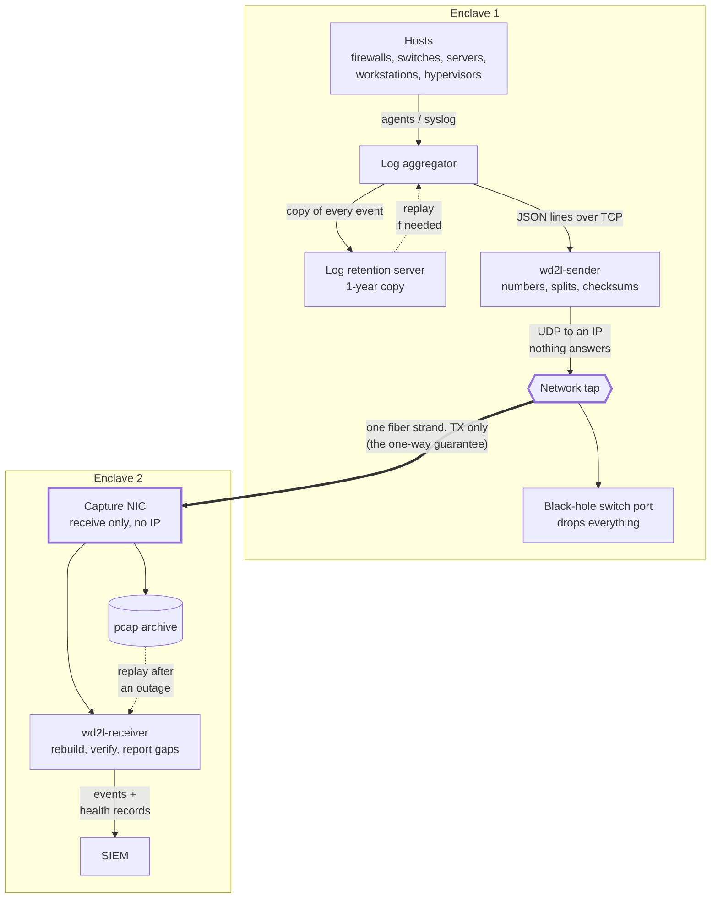

# Architecture: wiredata-to-log

**Problem.** Some environments must move security telemetry between enclaves that may not
communicate in both directions: an operational or mission network monitored from a separate
security enclave, or any boundary where policy, accreditation or physics rules out a return path.
Conventional log transport assumes the opposite. It relies on handshakes, acknowledgements and
retransmission, none of which can cross a one-way link.

**Direction.** Data moves only from Enclave 1 to Enclave 2, and Enclave 2 must be at the same or
a higher sensitivity level than Enclave 1, never a lower one. The difference can be
classification levels, an untrusted network feeding a trusted one (for example, logs collected
in a DMZ and sent into the internal network), or any similar distinction. Two separate enclaves
at the same level qualify too.

**Approach.** This repository presents an architecture and proof of concept (POC) that removes that
assumption. The wire itself is the transport. Enclave 1 emits each log event as sequenced,
self-verifying UDP datagrams toward an address that never answers. A network tap copies that cable
to Enclave 2 over a single transmit-only fiber strand, and Enclave 2 reconstructs every event from
the raw captured packets. Completeness is shown by sequence numbers and heartbeats, not
acknowledgements: every event is accounted for as either delivered intact or explicitly reported
lost. Recovery is by replay, from a packet archive in Enclave 2 or a one-year event store in
Enclave 1.

**Result.** In a network-namespace model of the full path, real system logs were rebuilt byte for
byte (identical SHA-256). With 1% injected packet loss, every lost event was reported by exact
sequence number, with no false reports. No frame ever traveled from Enclave 2 back toward
Enclave 1.



* The log server sends every event as numbered UDP packets to an IP that nothing answers. The
  switch port drops them.
* A network tap copies that cable to Enclave 2 over one fiber strand. That's the one-way guarantee.
* The receiver rebuilds each event and checks it (CRC + SHA-256). It sends events to the SIEM with
  their original host, source, sourcetype, index and time, and **reports every lost event by
  sequence number**.
* A rolling pcap archive lets you replay after a receiver outage without duplicates.
* Events that never reached Enclave 2 can't be asked for again across a one-way link. A log
  retention server in Enclave 1 keeps a copy of every event for 1 year, and the aggregator
  replays the lost time window from it.

The design is product-neutral: any log aggregator, network tap and SIEM that fill the roles
work. The POC was built against Cribl Stream (aggregator) and Splunk (SIEM) as
examples.

Start with [docs/architecture.md](docs/architecture.md). Design choices, and the options weighed
for each, are recorded as Architecture Decision Records (ADRs) in
[docs/decisions/](docs/decisions/).

## Repo map

| Path | What |
|---|---|
| `wd2l/` | Python package, standard library only (Python ≥ 3.9) |
| `wd2l/sender.py`, `wd2l/receiver.py` | Enclave 1: JSON lines in, framed UDP out, heartbeats. Enclave 2: capture or replay, rebuild, gap tracking, outputs |
| `wd2l/wire.py`, `wd2l/packets.py` | The frame format ([interface description](docs/interface-description.md)); Ethernet/IPv4/UDP parsing, pcap, raw-socket capture |
| `wd2l/audit.py`, `wd2l/audit_report.py`, `wd2l/reconcile.py` | Hash-chained audit records and their self-check; `wd2l-audit-report`; the set hashes that prove every event arrived unchanged ([audit design](docs/audit-and-health.md)) |
| `wd2l/fault.py`, `wd2l/hostinfo.py` | Which of six segments has the fault, and by which rule; time quality, NIC and archive probes |
| `wd2l/opaque.py`, `wd2l/outputs.py`, `wd2l/logsetup.py` | Flagging blobs that can't be inspected ([ADR-0002](docs/decisions/0002-opaque-content.md)); SIEM (HEC) and file output; JSON logs and `SIGUSR1` |
| `deploy/` | Per host: NIC scripts, nftables, systemd and Quadlet units, auditd rules, the audit seal timer, example SIEM configs (Splunk), a switch example |
| `docs/` | Architecture, interface description, audit design, deployment guides, runbooks, accreditation notes, ADRs (`docs/decisions/`) |
| `packaging/`, `.github/workflows/` | How releases are built and checked ([docs/releasing.md](docs/releasing.md)) |
| `lab/`, `samples/`, `tests/` | The whole path in network namespaces; real sample logs; unit, fuzz and end-to-end tests |

## Try it

```bash
python3 -m venv ~/wd2l-venv && . ~/wd2l-venv/bin/activate   # works where pip install is refused
pip install pytest
pip install --require-hashes -r packaging/release/requirements.txt   # hash-pinned: its own install
python3 -m pytest                                 # no root needed; nothing skips

sudo lab/run-lab.sh                               # full path in network namespaces
sudo lab/run-lab.sh --loss 1                      # 1% wire loss: every loss reported exactly
sudo lab/run-lab.sh --receiver-outage             # receiver stopped mid-run, archive replay fills it
sudo lab/run-lab.sh --receiver-crash              # receiver killed mid-run: nothing lost
sudo lab/run-lab.sh --maintenance                 # planned downtime: stop and start both sides, nothing lost
sudo lab/run-lab.sh --fault tap-down              # inject one fault: the receiver names its segment and rule
sudo lab/run-lab.sh --files samples/logs/messages samples/logs/secure samples/logs/audit.log
                                                  # real logs: rebuilt files must hash the same
sudo lab/run-lab.sh --image localhost/wd2l:dev    # the same path, from the container image
```

The lab needs root and kernel ≥ 5.16 (the nftables egress hook). On the RHEL family:
`sudo dnf install git python3 iproute iproute-tc nftables tcpdump`; on Ubuntu or Debian:
`sudo apt install git python3 python3-venv iproute2 nftables tcpdump`. The step-by-step guide,
with what each run proves: [docs/running-the-lab.md](docs/running-the-lab.md).

## Deploying

1. [Network](docs/deployment/network.md): black-hole switch port, network tap, one-strand fiber
2. [Log server](docs/deployment/log-server.md): egress NIC, firewall, `wd2l-sender`, log aggregator
3. [Log retention server](docs/deployment/retention-server.md): 1-year copy in Enclave 1, replay
   source, wd2l audit files
4. [Receiver](docs/deployment/receiver.md): capture NIC, archive, `wd2l-receiver`, SIEM
5. [Containers](docs/deployment/containers.md): the sender and receiver as containers under
   systemd (Quadlet), on the FIPS Red Hat Hardened Images base
6. [Operations](docs/operations.md), [planned downtime](docs/planned-downtime.md) and the
   [state-of-health dashboard](docs/state-of-health.md)

What crosses between the enclaves, packet by packet, for the interface control document (ICD):
[docs/interface-description.md](docs/interface-description.md). Releases, and how to verify one
offline: [docs/releasing.md](docs/releasing.md).

## Also here: a worked example of a secured software supply chain

The transfer above is what wd2l is for. Its releases go into enclaves, where a tampered or
vulnerable package would be hard to notice and harder to recall, so the release process is built
as a complete, working example of supply-chain controls. CI runs the build-time checks on every
release, and whoever receives the files can check the signatures, checksums, provenance and SBOM
again offline. [docs/releasing.md](docs/releasing.md) has the details and the commands.

| Practice | What wd2l does | Why it matters |
|---|---|---|
| **Two vulnerability scanners, one gate** | Grype and Trivy scan the image. The build fails on any fixable High or Critical finding not covered by an exception. Each exception names who approved it and an expiry date (at most 90 days, by policy), and an expired one fails the build ([`vuln_gate.py`](packaging/container/vuln_gate.py), [`vuln-exceptions.json`](packaging/container/vuln-exceptions.json)) | The scanners use different databases and matching, so each catches things the other misses. Expiring exceptions keep "accepted for now" from becoming "accepted forever" |
| **Rescan after release** | The three latest full releases (not pre-releases) are scanned again weekly with fresh data, and a new fixable finding opens an issue ([`image-rescan.yml`](.github/workflows/image-rescan.yml)) | Vulnerabilities are published after you ship. A clean scan on release day says nothing about next month |
| **SBOMs** | An SPDX and a CycloneDX bill of materials for each platform's image (amd64, arm64), and a check that each is its base image plus wd2l and nothing else ([`sbom_diff.py`](packaging/container/sbom_diff.py)) | When the next widely exploited library flaw lands, "are we affected?" is a lookup, not a rebuild. The diff shows nothing slipped in |
| **A verified, minimal base** | FIPS Red Hat Hardened Images, pinned by digest. Red Hat's signature, provenance and SBOM are checked before use. No shell, no package manager, not root ([ADR-0004](docs/decisions/0004-container-base-image.md)) | You inherit your base image's supply chain, so check it instead of trusting a tag. Less in the image means less to patch and less for an attacker to use |
| **Reproducible builds** | The image is built a second time from the same inputs on a fresh runner and compared with the first. The comparison is report-only for now, and the person publishing a release checks it | When the same inputs always give the same bits, a rebuild can confirm that what was published is what the source produces; a difference points to a hidden input or a tampered build |
| **Signatures** | `SHA256SUMS` and the image are signed with a key that verifies offline, and the image is also signed keyless through Sigstore ([ADR-0006](docs/decisions/0006-release-artifacts-and-signing.md)) | They prove the files came from this project's release process. The key works inside an enclave with no network |
| **Build provenance (SLSA Build Level 3)** | GitHub attestations for every file and the image, made by a separate workflow the build steps can't reach ([ADR-0007](docs/decisions/0007-slsa-build-l3.md)) | They show which commit, which workflow and which kind of runner built each file, and a compromised build step can't forge them |
| **Immutable releases** | Once a release is published, GitHub locks its tag and files | Nobody can swap a file after people have checked it |
| **A release manifest** | Each release lists, in JSON checked against a committed schema plus a readable view: its commit, every file with its SHA-256, the image digests and bases, the pinned build tools, and every issue it resolves with the pull request that resolved it. It's a release file, so the signature, the provenance and the release attestation cover it ([ADR-0008](docs/decisions/0008-release-manifest.md)) | One signed document says what was delivered and why, for whoever receives it, and still works years later without the forge that built it |
| **A guarded release path** | Rulesets on `main` (a pull request with passing CI, no force-push) and on version tags (admins only), the owner's approval before anything is signed, actions pinned to commits, and Dependabot for the pins | A branch, a pull request or a dependency update can't get anything signed on its own: signing needs a version tag on `main` and the owner's approval. (A compromised owner account still could; a second approver would close that.) |

Changing one byte of a downloaded RPM is enough to see it work: `sha256sum -c` reports it
`FAILED` and `gh attestation verify` refuses it. `rpm -K` alone isn't enough: it reports
`DIGESTS NOT OK` for a byte in the header or payload, but `digests OK` for one in the signature
header's reserved space, which only the signed `SHA256SUMS` covers.

## Status

Proof of concept, complete as of 1.0.0 and ready to be used with real hardware. It's verified in
the namespace lab (the end of [architecture.md](docs/architecture.md)), and signed releases have
been deployed on AlmaLinux 10, with rsyslog as the aggregator and Splunk as the SIEM:
* a Raspberry Pi 5 (arm64, SELinux enforcing), in container mode, with a virtual cable standing
  in for the tap and fiber;
* two FIPS-mode virtual machines on a port-mirrored virtual switch, running the native packages.

Not yet verified: the physical tap, switch and fiber, and a log retention server. The deployment
guides list the checks for each.

Audit records (aimed at common audit-control requirements, for example the NIST SP 800-53 AU
family or SOC 2 CC7.2), end-to-end reconciliation and fault location are built and verified. The
design, as built, is in [docs/audit-and-health.md](docs/audit-and-health.md); how several live
log files are tracked and rebuilt from one stream is in [docs/multiple-files.md](docs/multiple-files.md).

## License

MIT, see [LICENSE](LICENSE). The container image also contains Red Hat Hardened Images packages
under their own licenses (the UBI EULA); their sources are mirrored with every release
([ADR-0006](docs/decisions/0006-release-artifacts-and-signing.md)).
