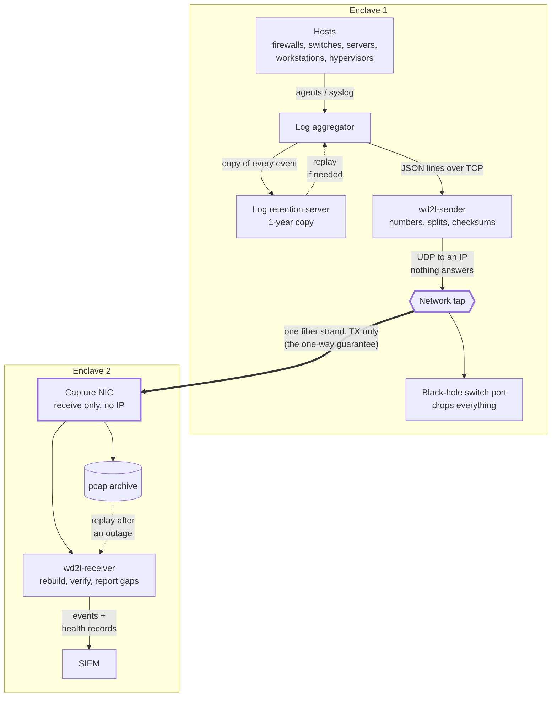

# Architecture: wiredata-to-log

**Problem.** Some environments must move security telemetry between enclaves that may not
communicate in both directions: an operational or mission network monitored from a separate
security enclave, or any boundary where policy, accreditation or physics rules out a return path.
Conventional log transport assumes the opposite. It relies on handshakes, acknowledgements and
retransmission, none of which can cross a one-way link.

**Direction.** Data moves only from Enclave 1 to Enclave 2, and Enclave 2 must be at the same or
a higher sensitivity level than Enclave 1, never a lower one. The difference can be
classification levels, an untrusted network feeding a trusted one (for example, logs collected
in a DMZ and sent into the internal network), or any similar distinction. Two separate enclaves
at the same level qualify too.

**Approach.** This repository presents an architecture and proof of concept that removes that
assumption. The wire itself is the transport. Enclave 1 emits each log event as sequenced,
self-verifying UDP datagrams toward an address that never answers. A network tap copies that cable
to Enclave 2 over a single transmit-only fiber strand, and Enclave 2 reconstructs every event from
the raw captured packets. Completeness is shown by sequence numbers and heartbeats, not
acknowledgements: every event is accounted for as either delivered intact or explicitly reported
lost. Recovery is by replay, from a packet archive in Enclave 2 or a one-year event store in
Enclave 1.

**Result.** In a network-namespace model of the full path, real system logs were rebuilt byte for
byte (identical SHA-256). With 1% injected packet loss, every lost event was reported by exact
sequence number, with no false reports. No frame ever traveled from Enclave 2 back toward
Enclave 1.



* The log server sends every event as numbered UDP packets to an IP that nothing answers. The
  switch port drops them.
* A network tap copies that cable to Enclave 2 over one fiber strand. That's the one-way guarantee.
* The receiver rebuilds each event and checks it (CRC + SHA-256). It sends events to the SIEM with
  their original host, source, sourcetype, index and time, and **reports every lost event by
  sequence number**.
* A rolling pcap archive lets you replay after a receiver outage without duplicates.
* Events that never reached Enclave 2 can't be asked for again across a one-way link. A log
  retention server in Enclave 1 keeps a copy of every event for 1 year, and the aggregator
  replays the lost time window from it.

The design is product-neutral: any log aggregator, network tap and SIEM that fill the roles
work. The proof of concept was built against Cribl Stream (aggregator) and Splunk (SIEM) as
examples.

Start with [docs/architecture.md](docs/architecture.md). Design choices, and the options weighed
for each, are recorded as Architecture Decision Records (ADRs) in
[docs/decisions/](docs/decisions/).

## Repo map

| Path | What |
|---|---|
| `wd2l/` | Python package, standard library only (Python ≥ 3.9) |
| `wd2l/sender.py` | Enclave 1: JSON lines in from the log aggregator, framed UDP out, heartbeats |
| `wd2l/receiver.py` | Enclave 2: live capture or pcap replay → rebuild → gap tracking → outputs |
| `wd2l/wire.py` | Packet format shared by both sides ([docs/wire-format.md](docs/wire-format.md)) |
| `wd2l/audit.py` | Both sides: hash-chained audit records in append-only files, and the self-check (`python3 -m wd2l.audit verify`) ([audit plan](docs/audit-and-health-plan.md)) |
| `wd2l/audit_report.py` | `wd2l-audit-report`: verify a copy of the audit files or a SIEM export, reconcile per day, list events |
| `wd2l/hostinfo.py` | Time quality (chrony), process CPU and memory, NIC counters and the capture archive's state, for health records |
| `wd2l/logsetup.py` | Operational logging (text or JSON lines) and `SIGUSR1` to toggle debug, with the signal sender named in the audit trail |
| `wd2l/fault.py` | Enclave 2: decides which of six segments has the fault, and by which rule ([docs/state-of-health.md](docs/state-of-health.md)) |
| `wd2l/reconcile.py` | Set hashes the sender and receiver compare to show every event arrived unchanged |
| `wd2l/opaque.py` | Enclave 1: spots long encrypted, compressed or random-looking blobs in log text so the sender can flag them ([ADR-0002](docs/decisions/0002-opaque-content.md)) |
| `wd2l/packets.py` | Ethernet/IPv4/UDP parsing, pcap files, raw-socket capture |
| `wd2l/outputs.py` | SIEM output over an HTTP event collector (HEC format, with disk spool) and JSONL file output |
| `deploy/common/` | Audit seal timer and script, shared by both hosts: append-only audit files, deleted after a year |
| `deploy/log-server/` | Egress NIC script, nftables, systemd units |
| `deploy/switch/` | Black-hole port config (example for one switch platform) |
| `deploy/receiver/` | Capture NIC script, tcpdump archive, receiver unit, example SIEM configs (Splunk) |
| `docs/` | Architecture, wire format, interface description (ICD input), deployment guides, operations and planned-downtime runbooks, accreditation notes, Architecture Decision Records (ADRs, `docs/decisions/`) |
| `lab/` | Whole path simulated with Linux network namespaces |
| `samples/` | Real `messages`, `secure` and `audit.log` sample logs, and the script that generated them |
| `tests/` | Unit, fuzz and end-to-end tests |

## Try it

```bash
pip install pytest && python3 -m pytest          # 354 tests, no root needed

sudo lab/run-lab.sh                               # full path in network namespaces
sudo lab/run-lab.sh --loss 1                      # 1% wire loss: every loss reported exactly
sudo lab/run-lab.sh --receiver-outage             # receiver stopped mid-run, archive replay fills it
sudo lab/run-lab.sh --receiver-crash              # receiver killed mid-run: nothing lost
sudo lab/run-lab.sh --maintenance                 # planned downtime: stop and start both sides, nothing lost
sudo lab/run-lab.sh --fault tap-down              # inject one fault: the receiver names its segment and rule
sudo lab/run-lab.sh --files samples/logs/messages samples/logs/secure samples/logs/audit.log
                                                  # real logs: rebuilt files must hash the same
sudo lab/run-lab.sh --interleave --files samples/logs/messages samples/logs/secure samples/logs/audit.log
                                                  # same, interleaved as if written at the same time
```

The lab needs root, `iproute2`, `nftables` (kernel ≥ 5.16), `tcpdump` and `python3`.

**Want to run the POC yourself and see the results?** Follow the step-by-step guide in
[docs/running-the-lab.md](docs/running-the-lab.md).

## Deploying

1. [Network](docs/deployment/network.md): black-hole switch port, network tap, one-strand fiber
2. [Log server](docs/deployment/log-server.md): egress NIC, firewall, `wd2l-sender`, log aggregator
3. [Log retention server](docs/deployment/retention-server.md): 1-year copy in Enclave 1, replay
   source, wd2l audit files
4. [Receiver](docs/deployment/receiver.md): capture NIC, archive, `wd2l-receiver`, SIEM
5. [Operations](docs/operations.md): health records, alerts, replay, re-send
6. [Planned downtime](docs/planned-downtime.md): stopping and starting the sender and receiver
   cleanly for patching, reboots and link work
7. [State of health](docs/state-of-health.md): what the dashboard shows and how to read it

What crosses between the enclaves, packet by packet, for the interface control document (ICD):
[docs/interface-description.md](docs/interface-description.md).

## Status

Proof of concept. Verified in the namespace lab (see the end of
[architecture.md](docs/architecture.md)). Not yet verified: the physical tap, switch and fiber
behavior, and a real log aggregator, log retention server and SIEM (the lab has no retention
server). The deployment guides list the checks for each.

Audit records (aimed at common audit-control requirements, for example the NIST SP 800-53 AU
family or SOC 2 CC7.2), end-to-end reconciliation and fault location are built and verified in the
lab. The design, as built, is in [docs/audit-and-health-plan.md](docs/audit-and-health-plan.md);
how to read the dashboard is in [docs/state-of-health.md](docs/state-of-health.md).

How several live log files are tracked and rebuilt from one stream:
[docs/multiple-files.md](docs/multiple-files.md).
