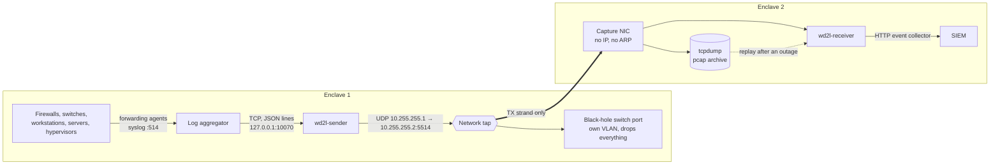

# Architecture

## Goal

Move logs from Enclave 1 to Enclave 2 **one way only**. Hosts in Enclave 1
(firewalls, switches, workstations, physical servers, a small virtualization cluster) send logs to
a central log server. The log server sends the combined stream toward a "black hole" switch port.
A network tap copies that cable to Enclave 2, where the logs are rebuilt from the raw packets and
indexed in a SIEM. Nothing can flow back: the fiber to Enclave 2 has only one strand.

The design is product-neutral. Where a product is named, it is only an example of a component
that fills that role (the proof of concept was built against Cribl Stream as the log aggregator
and Splunk as the SIEM).

## Picture

## Pieces

| Piece | Where | Job |
|---|---|---|
| Log forwarding agents / syslog | every Enclave 1 host | Send logs to the log aggregator, as today. |
| Log aggregator (e.g. Cribl Stream) | central log server | Collect, parse into events, set host, source, source type and index, hand every event to the sender. |
| `wd2l-sender` | central log server | Number each event, split big ones into packet-sized pieces, add checksums, send UDP to the black hole, send a heartbeat every second. |
| Egress NIC | central log server | Dedicated NIC. One /30 address, static ARP for the black hole, IPv6 off, firewall allows one flow. |
| Black-hole switch port | Enclave 1 switch | Keeps the log server's link up and throws every frame away. |
| Network tap | inline on that cable | Copies the log server → switch direction, filtered to the log flow, out a monitor port. |
| One-strand fiber | tap monitor port → Enclave 2 | The one-way guarantee. Enclave 2 has no transmit path back. |
| Capture NIC | Enclave 2 receiver host | Receive only: no IP, no ARP, promiscuous, egress dropped. |
| tcpdump | receiver host | Hourly pcap archive of everything that arrives (7 days by default). |
| `wd2l-receiver` | receiver host | Rebuild events, verify them, track sequence numbers, report gaps, send to the SIEM. |
| SIEM (e.g. Splunk) | Enclave 2 | Stores events with the original host, source, source type, index and time. |

## Design rules, and why

1. **UDP only on the tapped cable.** A port that drops everything never completes a TCP
   handshake, so any TCP-based forwarding (vendor forwarding protocols, TCP syslog) would never put
   a byte of log data on the wire.
2. **Static ARP on the log server.** Nothing answers ARP for the black-hole IP. Without a pinned
   entry the server would only ever send "who has 10.255.255.2?" and never the logs.
3. **The switch port is alone in its own VLAN, with no SVI (switched virtual interface, i.e. no IP
   address for that VLAN on the switch), dropping all ingress and sending no CDP (Cisco Discovery
   Protocol), LLDP (Link Layer Discovery Protocol) or STP (Spanning Tree Protocol) frames.**
   Otherwise the switch floods unknown-unicast frames to other ports (a leak) and its own chatter
   ends up on the "logs only" cable.
4. **The log server's egress NIC stays silent** apart from the log flow: IPv6 off, no DHCP, no LLDP,
   nftables allows only `wd2l-sender` → black hole.
5. **One way is enforced by physics, not configuration.** The tap monitor port's transmit strand
   is the only fiber connected to Enclave 2. This is the same method already accepted
   elsewhere. The switch and NIC settings are hygiene on top of it.
6. **Every event gets a sequence number, and the sender sends a heartbeat every second.** UDP loses
   packets without telling anyone. With numbers and heartbeats the receiver can prove it got
   everything, or name exactly what's missing. It can also tell "quiet" apart from "broken".
7. **No IP fragmentation.** Events that don't fit one packet are split by the sender and rebuilt by
   the receiver, which checks a SHA-256 of the whole event. (If one IP fragment is lost the whole
   packet is lost, and fragments are awkward to filter on the tap.)
8. **The receiver treats all input as hostile.** Sizes are capped, memory for part-built events is
   capped, only one fixed JSON shape is accepted, and malformed input is counted and dropped. The
   code uses only the Python standard library.
9. **Keep the raw packets.** The pcap archive means a receiver crash or restart loses nothing that
   reached Enclave 2: replay the archive and only the missing events are sent to the SIEM.

## Data path details

* **Log aggregator → sender**: newline-delimited JSON over TCP to `127.0.0.1:10070`, compression
  off. One optional header line (auth token), then one JSON event per line. (This is the format of
  Cribl Stream's TCP JSON destination. Any aggregator that can write JSON lines to a TCP socket
  works.) TCP gives backpressure: if the sender can't keep up, the aggregator blocks or queues
  (a persistent queue is recommended).
* **What crosses**: per event `_time, host, source, sourcetype, index, _raw` (plus any fields named
  with `--extra-field`, which become indexed fields in the SIEM). Other aggregator fields are
  dropped.
* **Sender → wire**: see [wire-format.md](wire-format.md). 68 bytes of overhead per packet; 1,404
  bytes of event per packet at MTU 1500; 8,904 at MTU 9000.
* **Big events**: capped at 256 KB (`--max-event`). Bigger events are cut to fit and flagged with
  indexed field `wd2l_truncated=<original size>`, the same idea as a SIEM's own line-length limit.
* **Receiver → SIEM**: an HTTP event collector interface (the proof of concept speaks Splunk's HEC
  format, `/services/collector/event`). Each event keeps its original metadata and gets indexed
  fields `wd2l_stream` and `wd2l_seq`. If the SIEM is unreachable, batches go to an on-disk spool
  and are resent automatically.
* **Health**: the receiver writes `sourcetype=wd2l:health` records: an immediate record for every
  gap, stale heartbeat, stream start/end/loss, plus a summary every 60 s. See
  [operations.md](operations.md).

## What happens when something breaks

| Failure | Effect on logs | What you see in Enclave 2 | Recovery |
|---|---|---|---|
| Packet loss on the wire (bad optic, overrun) | Those events lost | `type=gap` records with exact stream and sequence ranges | Pull the events again from Enclave 1 for that time window (see operations.md) |
| Receiver process stops or restarts | Nothing lost: tcpdump keeps capturing | `type=gap` after restart | Replay the pcap archive: only the gaps are sent |
| Receiver host down (capture down too) | Events sent during the outage never land in Enclave 2 | `type=gap` covering the outage once it's back (the next heartbeat carries the last sequence number) | Re-send from Enclave 1 |
| SIEM ingest down | Nothing lost | `hec_spool_files` > 0 in health (once the SIEM is back) | Automatic drain |
| Cable, tap or fiber down | Events sent during the outage lost | `heartbeat_stale`, then a gap for the exact range when it comes back | Re-send from Enclave 1 |
| `wd2l-sender` stops | Nothing sent. The aggregator blocks or queues (with a persistent queue nothing is lost) | `heartbeat_stale`, `stream_lost` (or `stream_end` if it stopped cleanly) | Restart. It starts a new stream (new `wd2l_stream`), so no false gaps |
| `wd2l-sender` crashes | Events the aggregator had already handed over but not yet sent are lost (well under a second's worth) | Not visible as a gap if they never got a sequence number | The aggregator's persistent queue narrows this. See accreditation notes |
| Log aggregator down | Hosts buffer or drop per their own settings (agents usually buffer; UDP syslog drops) | Heartbeats continue, no events | Enclave 1 monitoring of the aggregator |
| Garbage or foreign traffic on the tap | Ignored | `other_packets` / `bad_frames` in health | Investigate the Enclave 1 cable/switch |

Gaps are always reported, never silent. That was the requirement ("detect and report"). There is
no retransmission because nothing can come back.

## Capacity

The environment is under 1,000 events/s. At an average 1 KB/event that's about 8 Mbit/s, a small
fraction of a 1 G link. The lab ran 5,000 events/s through the full namespace path with no kernel
drops and no loss, using plain Python.

Loss on a link hits big events hardest: an event split into *n* packets is lost if any one of them
is lost. At 1% packet loss a 9 KB Windows event (7 packets at MTU 1500) survives about 93% of the
time. At MTU 9000 it needs only 2 packets (98%). **If every device on the path supports jumbo frames, use
MTU 9000 end to end** and start the sender with `--max-datagram 8972`. A healthy fiber link has
essentially zero loss, so this mostly matters when something is failing.

## What was verified

In the network-namespace lab (`lab/run-lab.sh`), which builds the full path in software:

* 5,001 events (short syslog, multi-KB Windows XML, non-ASCII, multi-line, one 300 KB event)
  arrive byte-for-byte identical to what the sender put on the wire. The 300 KB event arrives
  truncated and flagged.
* With 1% random packet loss on the cable, every lost event was reported as a gap with its exact
  sequence number. There were no false gaps and no unreported losses.
* With the receiver stopped for 2 seconds mid-run, the archive replay delivered exactly the
  missing events with no duplicates.
* Zero non-log packets reached Enclave 2, and zero frames came back from it.
* 5,000 events/s with no drops.

Not verified in the lab: the physical pieces (network tap, switch, fiber, NIC link behavior) and a
real log aggregator or SIEM. Those steps are in `docs/deployment/`.
