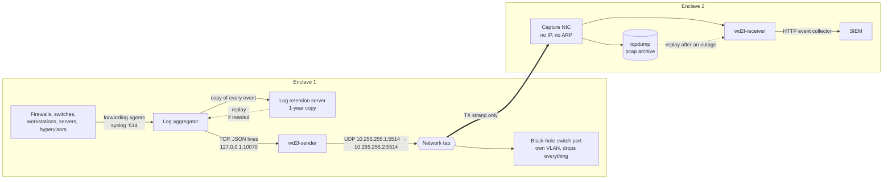

# Architecture

## Goal

Move logs from Enclave 1 to Enclave 2 **one way only**, and account for every one: delivered
intact, or reported lost by number. The [README](../README.md) states the problem and the
direction rule. Because nothing can flow back, Enclave 2 can't ask for a lost event again, so the
log aggregator also keeps a copy of every event on a log retention server in Enclave 1 for a
year; a lost window is replayed from there.

The design is product-neutral: Cribl Stream (aggregator) and Splunk (SIEM) are examples of a
role.

## Picture

## Pieces

| Piece | Where | Job |
|---|---|---|
| Forwarding agents / syslog | every Enclave 1 host | Send logs to the aggregator, as today |
| Log aggregator (e.g. Cribl Stream) | central log server | Collect, parse into events, set host, source, source type and index; hand every event to the sender and a copy to the retention server; replay a window from it when asked |
| Log retention server | Enclave 1, its own host | Keep every collected event for 1 year: the source for replays, and the proposed 1-year home of wd2l's Enclave 1 audit files. Not on the transfer path |
| `wd2l-sender` | central log server | Number each event, flag content that can't be inspected, split big events into packets, add checksums, send UDP to the black hole, send a heartbeat every second |
| Egress NIC | central log server | Dedicated: one /30 address, static ARP for the black hole, IPv6 off, a firewall allowing one flow |
| Black-hole switch port | Enclave 1 switch | Keeps the log server's link up and drops every frame |
| Network tap | inline on that cable | Copies the log server → switch direction, filtered to the log flow, out a monitor port |
| One-strand fiber | tap monitor port → Enclave 2 | The one-way guarantee: Enclave 2 has no transmit path back |
| Capture NIC | receiver host | Receive only: no IP, no ARP, promiscuous, egress dropped |
| tcpdump | receiver host | Hourly pcap archive of everything that arrives (7 days by default) |
| `wd2l-receiver` | receiver host | Rebuild and verify events, track sequence numbers, report gaps, send to the SIEM |
| Audit records | both hosts, and the SIEM | Hash-chained records of who started, stopped or changed what, and of what crossed or failed. Enclave 1's cross in-band, so the SIEM holds both trails, and a hash of every event shows any loss or change ([audit design](audit-and-health.md)) |
| Fault location | `wd2l-receiver`, and the dashboard | The receiver decides which of six segments a fault is in, by rule; the dashboard draws it ([state-of-health.md](state-of-health.md)) |
| SIEM (e.g. Splunk) | Enclave 2 | Stores events with their original host, source, source type, index and time |

The sender and receiver ship as RPMs and as a FIPS container image on Red Hat Hardened Images
([ADR-0004](decisions/0004-container-base-image.md), [releasing.md](releasing.md)).

## Design rules, and why

1. **UDP only on the tapped cable.** A port that drops everything never completes a TCP
   handshake, so TCP-based forwarding would never put a byte of log data on the wire.
2. **Static ARP on the log server.** Nothing answers ARP for the black-hole IP; without a pinned
   entry the server would only ever ask "who has 10.255.255.2?".
3. **The switch port is alone in its own VLAN**, with no SVI (no IP address for the VLAN on the
   switch), dropping all ingress, and sending no CDP, LLDP or STP. Otherwise the switch floods
   unknown-unicast frames to other ports (a leak), and its own chatter lands on the logs-only
   cable.
4. **The egress NIC stays silent** apart from the log flow: IPv6 off, no DHCP, no LLDP, and
   nftables allows only `wd2l-sender` → black hole.
5. **One way is enforced by physics, not configuration.** The tap monitor port's transmit strand
   is the only fiber connected to Enclave 2, the method already accepted elsewhere. The switch
   and NIC settings are hygiene on top.
6. **Every event gets a sequence number, and a heartbeat goes every second.** UDP loses packets
   silently; with numbers and heartbeats the receiver proves it got everything, or names what is
   missing, and tells "quiet" from "broken". Runs are chained (`boot`, `prev_stream`), so a whole
   missed run shows too.
7. **No IP fragmentation.** The sender splits big events and the receiver rebuilds them, checking
   a SHA-256 of the whole event. (One lost fragment loses the whole packet, and fragments are
   awkward to filter on a tap.)
8. **The receiver treats all input as hostile.** Sizes and buffered memory are capped, only one
   JSON shape is accepted, malformed input is counted and dropped, and the code uses only the
   Python standard library.
9. **Keep the raw packets.** With the pcap archive, a receiver crash or restart loses nothing that
   reached Enclave 2: a replay sends only the missing events.
10. **An event counts as delivered only once it is safe**: the SIEM accepted it, or it is on disk.
    Anything in memory at a crash is reported as a gap and filled by replay. Duplicates over loss:
    `wd2l_stream` and `wd2l_seq` make copies easy to remove.
11. **Keep a full copy in Enclave 1.** Loss is detected, not recovered, across a one-way link; the
    retention server lets a lost window be replayed. Its output in the aggregator has its own
    persistent queue, so a retention-server outage never holds up the transfer.
12. **Flag content that can't be inspected; don't drop it.** Long encrypted, compressed or
    random-looking blobs are tagged (`wd2l_opaque`), cross unchanged and raise an alert. Given the
    direction rule in the [README](../README.md), visibility is the goal, and dropping would break
    "detect and report". It is a tripwire, not proof that nothing is hidden
    ([ADR-0002](decisions/0002-opaque-content.md)).

## Data path details

* **Aggregator → sender:** newline-delimited JSON over TCP to `127.0.0.1:10070`, no compression:
  an optional header line (auth token), then one event per line (the format of Cribl Stream's TCP
  JSON destination; any aggregator that writes JSON lines to a socket works). TCP gives
  backpressure: if the sender falls behind, the aggregator blocks or queues (a persistent queue is
  recommended).
* **Aggregator → retention server:** a second output over the log server's normal network (never
  the egress NIC), carrying every event, including any filtered out of the crossing, with its own
  persistent queue. A replay reads a window back and routes it to the sender only; the events
  cross again as new events with new numbers ([retention-server.md](deployment/retention-server.md)).
* **What crosses:** `_time`, `host`, `source`, `sourcetype`, `index`, `_raw`, any fields named
  with `--extra-field`, the send time (`wd2l_tx_time`) and, on events with a blob,
  `wd2l_opaque` and `wd2l_opaque_bytes`. Other aggregator fields are dropped.
* **Sender → wire:** see [interface-description.md](interface-description.md) for every byte.
  68 bytes of overhead per packet; 1,404 bytes of event per packet at MTU 1500, 8,904 at MTU 9000.
  Events over 256 KB (`--max-event`) are cut to fit and flagged `wd2l_truncated=<original size>`.
* **Receiver → SIEM:** the SIEM's HTTP event collector (Splunk's HEC format). Each event keeps its
  metadata and gains `wd2l_stream`, `wd2l_seq` and `wd2l_rx_time` (arrival, or capture time for a
  replay). While the SIEM is unreachable, batches spool to disk and are resent. There is no message
  queue ([ADR-0001](decisions/0001-enclave-2-message-queue.md)), forwarder or event file to rotate
  ([ADR-0003](decisions/0003-receiver-to-siem-delivery.md)).
* **Timing:** three times on every event split the delay by segment: Enclave 1
  (`wd2l_tx_time − _time`), the link (`wd2l_rx_time − wd2l_tx_time`) and the SIEM (index time −
  `wd2l_rx_time`). `clock_offset_s`, from each heartbeat, tells a clock problem from a real delay
  ([operations.md](operations.md#measuring-delays)).
* **Health:** `wd2l:health` records for every gap, stale heartbeat and stream change, and a
  summary every 60 s ([operations.md](operations.md)).

## What happens when something breaks

| Failure | Effect on logs | What Enclave 2 sees | Recovery |
|---|---|---|---|
| Packet loss on the wire | Those events lost | `type=gap` with exact stream and sequence ranges | Replay the window from the retention server |
| Receiver stops cleanly | Nothing lost: tcpdump keeps capturing, queued events spool | `type=gap` after restart | Replay the archive: only the gaps are sent |
| Receiver crashes (killed, out of memory, reboot) | Nothing lost: events in memory are reported, not assumed delivered | `type=gap reason=receiver_restart` at startup | Replay the archive; a few events may arrive twice (`dedup wd2l_stream wd2l_seq`) |
| Receiver host down (capture too) | Events sent meanwhile never land | `type=gap` covering the outage once back | Replay the window from the retention server |
| SIEM ingest down | Nothing lost | `hec_spool_files` > 0 | Drains by itself |
| Receiver can't keep up with the SIEM, or the spool disk is full | Those events aren't sent | `type=gap reason=output_dropped` | Replay the archive once the SIEM or disk is healthy |
| Cable, tap or fiber down | Events sent meanwhile lost | `heartbeat_stale`, then a gap for the exact range | Replay the window from the retention server |
| `wd2l-sender` stops cleanly | It reads input already arriving (up to 2 s), sends a final heartbeat; the aggregator then blocks or queues | `stream_end`; `shutdown_unread_bytes` > 0 if input was still arriving | Restart: a new stream linked to the old one, no false gaps |
| `wd2l-sender` crashes | Input handed over but not yet numbered is lost (at most one 256 KB receive buffer); a lost numbered tail shows via the next run's link | Unnumbered input: invisible. Numbered tail: a gap once the new run starts | The aggregator's persistent queue narrows this; see the [accreditation notes](accreditation-notes.md) |
| Sender restarts while the link is down | That whole run never reaches Enclave 2 | `stream_missing` (with sender `--state`): its stream id and event count | Replay the window from the retention server |
| Aggregator down | Hosts buffer or drop by their own settings (agents buffer; UDP syslog drops) | Heartbeats continue, no events | Enclave 1 monitoring |
| Retention server down or full | Transfer unaffected; the aggregator queues the copy. If that queue fills, that window has no copy | Nothing: not on the transfer path | Enclave 1 monitoring of the server and its queue |
| Garbage or foreign traffic on the tap | Ignored | `other_packets` / `bad_frames` | Investigate the Enclave 1 cable and switch |

Gaps are always reported, never silent ("detect and report"). There is no retransmission, because
nothing can come back.

## Capacity

The environment is under 1,000 events/s: at about 1 KB an event, 8 Mbit/s, a small fraction of a
1 G link. The lab ran 5,000 events/s through the whole path with no drops or loss, in plain
Python.

Loss hits big events hardest: an event split into *n* packets is lost if any one is. At 1% packet
loss a 9 KB Windows event (7 packets at MTU 1500) survives about 93% of the time; at MTU 9000 it
needs 2 packets (98%). **If every device on the path supports jumbo frames, use MTU 9000 end to
end** with `--max-datagram 8972`. A healthy fiber has essentially no loss, so this matters mostly
when something fails.

## What was verified

In the network-namespace lab (`lab/run-lab.sh`, [running-the-lab.md](running-the-lab.md)):

* 5,001 events (short syslog, multi-KB Windows XML, non-ASCII, multi-line, one 300 KB event)
  arrive byte for byte as sent; the 300 KB event arrives truncated and flagged.
* Events carrying a random blob, a gzip blob and a PGP message arrive flagged `wd2l_opaque`; the
  17,624 real sample log lines produce no flags.
* With 1% random packet loss, every lost event is reported by its exact number, with no false
  gaps and none unreported.
* A receiver stopped for 2 s: the archive replay delivers exactly the missing events, no
  duplicates. A receiver killed mid-run: nothing lost, a few hundred duplicates, as designed.
* Planned downtime in the [runbook's](planned-downtime.md) order: two linked sender runs, no
  input left unread, no gaps, nothing to replay.
* No non-log packet reaches Enclave 2, and no frame comes back.

Not verified in the lab: the physical tap, switch, fiber and NICs, and a real aggregator,
retention server or SIEM (checks in `docs/deployment/`).
