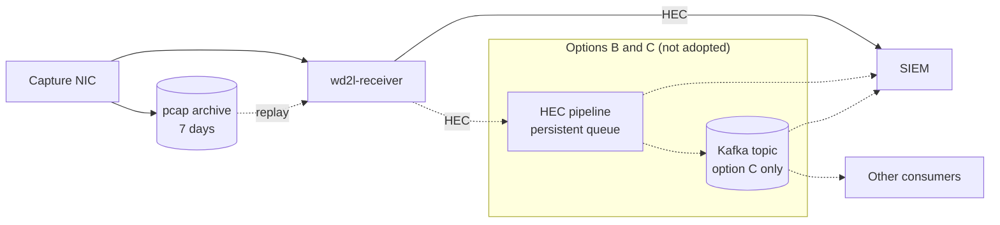

# ADR-0001: No message queue in Enclave 2 for now

**Status:** Accepted (2026-10-13, shipped in 1.0.0)
**Date:** 2026-10-04
**Deciders:** System owner. The security owner before any new component is added in Enclave 2.

## Context

The question: should Enclave 2 put a message queue (Kafka or similar) between `wd2l-receiver`
and the SIEM?

How Enclave 2 works today ([architecture.md](../architecture.md)):

* The capture NIC feeds two things. tcpdump keeps an hourly pcap archive for 7 days.
  `wd2l-receiver` rebuilds the events and sends them to the SIEM's HTTP event collector (HEC).
* The receiver holds up to 100,000 events in memory (`--hec-queue`). While the SIEM is
  unreachable, batches go to an on-disk spool capped at 10 GiB. The cap is a default in
  `wd2l/outputs.py`, not a command-line option yet.
* An event counts as delivered once the SIEM answers HTTP 200, or once it is in the spool. If the
  memory queue or the spool overflows, the event is reported as a gap (`reason=output_dropped`)
  and recovered by replaying the pcap archive.
* Every event carries `wd2l_stream` and `wd2l_seq`, so replays are safe: events already
  delivered are skipped, and duplicates can be removed in searches.

Constraints:

* The link is one-way UDP. Nothing in Enclave 2 can slow the sender down.
* Under 1,000 events/s (about 8 Mbit/s), and one consumer: the SIEM (Splunk in practice).
* The receiver uses only the Python standard library. The
  [accreditation notes](../accreditation-notes.md) count that as a security property.
* NIST SP 800-53 Rev 5, Moderate. Every new Enclave 2 component has to be hardened, patched and
  monitored.

## Decision

Don't add a message queue between the receiver and the SIEM now. The pcap archive stays the
replayable log for Enclave 2. Revisit when one of the triggers under
[Consequences](#consequences) appears.

Solid lines are today's design. The boxed part shows where options B and C would sit.

## Options considered

### Option A: keep the current design, with small fixes if needed (chosen)

| Dimension | Assessment |
|---|---|
| Complexity | Low. Nothing new to run |
| Cost | None |
| Scalability | Well above need: the lab ran 5,000 events/s |
| Team familiarity | High: it's the current design |
| Accreditation | No change |
| "Delivered" means | The SIEM answered HTTP 200, or the event is in the spool |

**Pros:** nothing new to accredit, patch or monitor. The receiver stays standard-library only.
Gap tracking runs all the way to the SIEM.

**Cons:** a SIEM outage longer than the spool (about 2–3 hours at peak) turns events into
`output_dropped` gaps, and someone has to replay the pcap archive within its 7 days. Only one
consumer.

Small fixes that need no queue:

* a `--spool-max` option, so the spool can be sized for the longest expected SIEM outage;
* HEC indexer acknowledgment, so "delivered" means "indexed" rather than "received". It needs
  receiver support: a channel header on each request, and polling the acknowledgment endpoint.

### Option B: HEC pipeline with a persistent queue

An HEC-compatible log pipeline (for example Cribl Stream or Vector) between the receiver and the
SIEM. The receiver's existing HEC output points at it.

| Dimension | Assessment |
|---|---|
| Complexity | Medium: one more service |
| Cost | A host, disk for its queue, and a license if the product needs one |
| Scalability | Fan-out to several destinations. Buffering limited only by its disk |
| Team familiarity | Medium to high, if it's the same product as the Enclave 1 aggregator |
| Accreditation | One more Enclave 2 component. No receiver change |
| "Delivered" means | The pipeline accepted the HEC request. Safe only if it accepts after writing to its persistent queue |

**Pros:** no code change. Routing and fan-out. Longer buffering.

**Cons:** another system to run. The receiver's gap tracking ends at the pipeline, so the
pipeline → SIEM leg needs its own check.

### Option C: Kafka, or a Kafka-compatible broker such as Redpanda

A topic between the receiver (through option B, or a Kafka output built into the receiver) and
its consumers (for example the Splunk Connect for Kafka sink).

| Dimension | Assessment |
|---|---|
| Complexity | High: a cluster of 3 brokers for availability, TLS, authentication (SASL), access lists, retention and partition settings |
| Cost | 3 hosts, storage for the retention period, staff time |
| Scalability | Far above need. Many independent consumers, each able to replay from its own position |
| Team familiarity | Assume low unless Kafka already runs in Enclave 2 |
| Accreditation | A major new component (a Java runtime, unless Redpanda) with its own hardening guide. A Kafka output inside the receiver would add a third-party client library and end the standard-library-only property |
| "Delivered" means | Kafka acknowledged the write (with `acks=all`). Gap tracking ends at the topic |

**Pros:** many consumers with independent replay. Long retention. A common enterprise data bus.

**Cons:** a large operational and accreditation cost for one consumer at under 1,000 events/s.
It duplicates the archive's role.

## Trade-off analysis

* **The archive already does a queue's main job.** A queue's main value is a durable, ordered log
  that consumers can replay. The pcap archive is that, for exactly what crossed the wire, and
  replaying it is safe. A queue after the receiver would keep a second copy one step later.
* **A queue can't push back across a one-way link.** It can only absorb slowness after the
  receiver. The spool and the archive already do that.
* **The real limit is the spool.** At the planned peak, 10 GiB holds about 2–3 hours of events.
  Making it configurable is a one-option change. It doesn't need a cluster.
* **"Delivered" would move to the queue.** Today the receiver's gap tracking ends at the SIEM.
  With a queue it ends at the queue. The planned reconciliation
  ([audit design](../audit-and-health.md), section 7) would then prove "the queue has
  everything", not "the SIEM has everything".
* **Standard library only.** A Kafka client inside the receiver breaks a property the
  accreditation notes rely on. Option B avoids that.
* **Never across the boundary.** Kafka producers need two-way TCP, so a queue can only live inside
  Enclave 2. A commercial data diode with Kafka support is a different design: the listed
  cross-domain product route in the accreditation notes.

## Consequences

* **Easier:** no new cluster to build, accredit, patch or monitor. The delivery guarantee stays
  end to end, from the sender to the SIEM.
* **Harder:** SIEM outages longer than the spool need a manual archive replay
  ([operations.md](../operations.md#replay-from-the-capture-archive)) within the archive's 7 days.
  A second consumer would need new work.
* **Revisit** when any of these happens:
  1. Something besides the SIEM needs the full stream in Enclave 2.
  2. Kafka (or similar) becomes an Enclave 2 enterprise service.
  3. SIEM outages routinely outlast the spool, even after it's resized.

## If this is revisited

* Put option B in front, so the receiver stays unchanged and standard-library only. Add Kafka
  behind it only if needed.
* The pipeline accepts the receiver's HEC request only after a durable write (its persistent
  queue, or Kafka with `acks=all`).
* Keep `wd2l_stream` and `wd2l_seq` on every event, end to end, so duplicates can still be removed
  and losses still traced.
* Check the queue → SIEM leg: consumer lag, and event counts per `wd2l_stream` / `wd2l_seq` in the
  SIEM against what the receiver delivered.
* Keep the pcap archive.
* Keep the queue inside Enclave 2.

## Action items

Follow-ups, not part of this decision:

1. [ ] Optional: add a `--spool-max` option to `wd2l-receiver` (today a 10 GiB default in
   `wd2l/outputs.py`).
2. [ ] Decide whether to use HEC indexer acknowledgment (needs receiver support).
