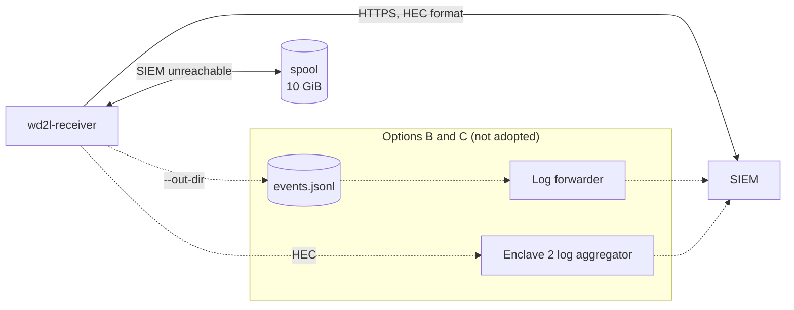

# ADR-0003: Send rebuilt events straight to the SIEM; no event files to rotate

**Status:** Proposed
**Date:** 2026-10-04
**Deciders:** System owner. The Enclave 2 SIEM owner, for the collector token and the indexes.

## Context

Two questions, asked together:

* How do the rebuilt logs get from `wd2l-receiver` to the SIEM? Does a log forwarder, or a second
  log aggregator in Enclave 2, have to carry them?
* Do the rebuilt logs need log rotation?

Both turn on one choice. Either the receiver hands events to the SIEM over the network, or it
writes them to files for something else to pick up. Only files need rotating, and only a file
needs a forwarder.

How the receiver works today ([architecture.md](../architecture.md)):

* **Sending.** It sends events to the SIEM's HTTP event collector, in the format Splunk calls HEC
  (`wd2l/outputs.py`, `HecOutput`). A background thread posts them over HTTPS to
  `/services/collector/event`, in batches of up to 500 events or 1 MB.
* **What each event keeps.** Its original time, host, source, sourcetype and index. The `wd2l_*`
  fields (`wd2l_stream`, `wd2l_seq`, `wd2l_tx_time`, `wd2l_rx_time` and the rest) go in the
  collector's `fields` object, which the SIEM stores as indexed fields.
* **When the SIEM is unreachable.** Batches go to an on-disk spool, capped at 10 GiB, and are
  retried oldest first. Events the SIEM refuses go to `spool/rejected/` for a person to review.
* **What "delivered" means.** The SIEM answered HTTP 200, or the event is in the spool. Anything
  not yet delivered at a crash is reported as a gap and filled from the pcap archive
  ([ADR-0001](0001-enclave-2-message-queue.md)).
* **The file output.** `--out-dir` also exists. It writes `events.jsonl` and `health.jsonl`, and
  there an event counts as delivered once it is fsync'd to the file. The receiver opens both
  files once at startup and appends to them for as long as it runs. The lab and the tests use
  this output.

Constraints:

* Detect and report: every event is either delivered or reported lost, never silently missing.
* The receiver uses only the Python standard library. The
  [accreditation notes](../accreditation-notes.md) count that as a security property.
* NIST SP 800-53 Rev 5, Moderate: every new Enclave 2 component has to be hardened, patched and
  monitored.
* Under 1,000 events/s, and one consumer: the SIEM.

## Decision

The receiver sends rebuilt events **straight to the SIEM's HTTP event collector**. In production:

* **Nothing in between.** No log forwarder, second log aggregator or message queue
  ([ADR-0001](0001-enclave-2-message-queue.md)) sits between the receiver and the SIEM.
* **No event files.** The receiver writes the rebuilt events to no file, so log rotation has
  nothing to manage. How long events are kept is the SIEM's index retention.
* **A SIEM that doesn't accept the HEC format.** Put an HEC-compatible pipeline in front of it
  (option C). The receiver doesn't change.
* **The file output** (`--out-dir`) is for the lab and the tests. It isn't for production until it
  can be rotated without losing events (see [Action items](#action-items)).

Solid lines are today's design. The boxed part shows where options B and C would sit.

## Options considered

### Option A: straight to the SIEM's HTTP event collector (chosen; already built)

| Dimension | Assessment |
|---|---|
| Complexity | Low. Nothing extra to run |
| Cost | None |
| Components in Enclave 2 | The receiver host and the SIEM |
| "Delivered" means | The SIEM answered HTTP 200, or the event is in the spool |
| Log rotation | Not needed: no event files. Spool files are deleted once sent |
| Accreditation | No change |
| Works with | Any SIEM that accepts the HEC format (Splunk natively), or any SIEM behind option C |

**Pros:** one hop, so the receiver's gap tracking runs all the way to the SIEM. Nothing to rotate.
Nothing new to accredit, patch or monitor. The receiver stays standard-library only.

**Cons:** the SIEM must accept the HEC format, or have option C in front of it. The spool is the
only buffer for SIEM outages: about 2–3 hours at the planned peak
([ADR-0001](0001-enclave-2-message-queue.md)).

### Option B: write files, and a log forwarder ships them

The receiver writes `events.jsonl` (`--out-dir`). A log forwarder on the receiver host (for
example Splunk's Universal Forwarder) tails the file and sends it to the SIEM.

| Dimension | Assessment |
|---|---|
| Complexity | Medium: a forwarder, plus log rotation |
| Cost | A forwarder agent, and disk for the files |
| Components in Enclave 2 | The receiver host (with a forwarder) and the SIEM |
| "Delivered" means | fsync'd to the file. The receiver's gap tracking ends there; after that, it depends on the forwarder's own guarantees |
| Log rotation | Needed. The receiver never reopens its files, so the only rotation that works today is logrotate's `copytruncate`. It can drop lines written between the copy and the truncate, after the receiver has already counted them delivered |
| Accreditation | One more agent, though one is often installed already |
| Works with | Any SIEM that can ingest files |

**Pros:** works with any SIEM that reads files. Keeps a local copy of the events.

**Cons:** rotation can lose events with no gap record, which breaks detect and report. Proving
that the SIEM has everything needs a reconciliation of the file against the SIEM. There are two
copies on disk.

### Option C: an Enclave 2 log aggregator in between

The receiver's HEC output points at an HEC-compatible log pipeline in Enclave 2 (for example
Cribl Stream, Vector or Fluent Bit), which sends on to the SIEM. This is option B of
[ADR-0001](0001-enclave-2-message-queue.md), seen from the delivery side.

| Dimension | Assessment |
|---|---|
| Complexity | Medium: one more service |
| Cost | A host, disk for its queue, and a license if the product needs one |
| Components in Enclave 2 | The receiver host, the pipeline and the SIEM |
| "Delivered" means | The pipeline accepted the request. Safe only if it accepts after writing to its persistent queue |
| Log rotation | None for the receiver. The pipeline manages its own queue |
| Accreditation | One more Enclave 2 component. No receiver change |
| Works with | Any SIEM the pipeline can send to |

**Pros:** works with any SIEM. Routing, transformation and fan-out. No receiver change.

**Cons:** another system to run. The receiver's gap tracking ends at the pipeline, so the
pipeline → SIEM leg needs its own check.

## Trade-off analysis

* **The fewest hops keep "delivered" meaning "in the SIEM".** With A the receiver knows the SIEM
  has each event. With B its knowledge ends at a file; with C, at a pipeline.
* **With files, rotation is a loss risk, not housekeeping.** In B, rotation happens after the
  receiver has counted an event delivered, so anything a rotation drops is lost with no gap
  record. A has no event files to rotate.
* **No forwarder or aggregator is needed** when the SIEM accepts the HEC format. A forwarder (B)
  only exists to read files. An aggregator (C) only earns its place for a SIEM that needs a
  different input, or when the events have to go to more than one place.
* **Disk in Enclave 2 is already bounded.** Without event files, this is everything the receiver
  host keeps:

| What | How it's bounded |
|---|---|
| `/var/lib/wd2l/pcap/` | Hourly files, deleted after 7 days by `wd2l-pcap-prune.timer` |
| `/var/lib/wd2l/spool/` | Only fills while the SIEM is unreachable. Files are deleted once sent; 10 GiB cap |
| `/var/lib/wd2l/spool/rejected/` | Manual: an operator reviews the files and moves them back ([operations.md](../operations.md)) |
| `/var/lib/wd2l/state.json` | One small file, rewritten in place |
| The receiver's own log messages | The system journal, rotated by journald's settings |

## Consequences

* **Easier:**
  * One hop from the receiver to the SIEM, with nothing extra to accredit, patch or monitor.
  * No log rotation for the rebuilt events.
  * The delivery guarantee runs end to end.
* **Harder:**
  * The SIEM has to accept the HEC format, or option C has to sit in front of it.
  * SIEM outages are limited by the spool ([ADR-0001](0001-enclave-2-message-queue.md)).
* **Revisit** when any of these happens:
  1. The SIEM can't take the HEC format, and a pipeline in front of it (C) isn't acceptable.
  2. Something besides the SIEM needs the rebuilt events in Enclave 2 (see ADR-0001's triggers).
  3. A policy requires a local file copy of the imported events in Enclave 2.

## Action items

Follow-ups, not part of this decision:

1. [ ] Only if the file output (`--out-dir`) is ever used in production: make the receiver reopen
   its files on a signal (or write one file per hour), so they can be rotated without losing
   events. Then document the logrotate setup.
