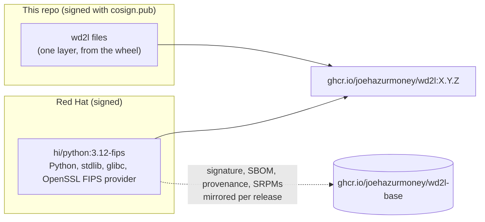

# ADR-0004: Container base image: Red Hat Hardened Images, FIPS variant

**Status:** Proposed
**Date:** 2026-10-08
**Deciders:** System owner. The security owner, for the cryptography and patching commitments.

## Context

wd2l now also ships as a container image: `wd2l-sender` and `wd2l-receiver`, run by systemd
([ADR-0005](0005-quadlet.md)). The **base image** is everything in that image that isn't wd2l:
the C library, Python, OpenSSL and whatever else the base brings. Every package in it is:

* something to patch, scan and accredit;
* after a compromise, something an attacker can use.

What wd2l needs from a base is small:

* **Python ≥ 3.9 and its standard library.** wd2l has no other dependencies, and the
  [accreditation notes](../accreditation-notes.md) count that as a security property. The image
  should keep it: the runtime is Python, the standard library and the C libraries they need.
* **OpenSSL, for two things.** HTTPS to the SIEM, and SHA-256, which every frame and audit
  record uses.
* **Nothing else at run time.** No shell, package manager, compiler or network tools.

Constraints:

* **RPM-based.** The hosts run RHEL. The same packaging, scanners and security data should cover
  the image.
* **FIPS 140 cryptography** where the platform can provide it. The security owner wants FIPS
  wherever possible.
* **Offline enclaves.** Images arrive as files and are verified without the internet
  ([ADR-0006](0006-release-artifacts-and-signing.md)).
* **Least privilege.** The receiver needs one capability (`CAP_NET_RAW`, to capture), and the
  sender needs none.
* **No cost, and redistributable.** Releases are attached to GitHub and carried into enclaves.

## Decision

* **Run on `registry.access.redhat.com/hi/python:3.12-fips`**, the FIPS variant of
  [Red Hat Hardened Images](https://www.redhat.com/en/blog/red-hat-hardened-images) (formerly
  [Project Hummingbird](https://hummingbird-project.io/docs/using/overview/)).
* **Install with `…/hi/python:3.12-fips-builder`.** It is only the build stage, which
  pip-installs the wheel. Nothing from the builder ships except wd2l's own files.
* **Pin both by digest** in `packaging/container/Containerfile`. Dependabot proposes new
  digests. The image pipeline verifies each base's Red Hat signature and SLSA provenance before
  every build. Each release copies the base into our registry, with its signature, SBOM,
  provenance and source image ([ADR-0006](0006-release-artifacts-and-signing.md)).
* **The image adds wd2l and nothing else.** The pipeline fails if the image's RPM database
  differs from the base's by one byte.

## Options considered

The numbers below come from the measured comparison at the end of this section.

### Option A: Red Hat Hardened Images, `hi/python:3.12-fips` (chosen)

| Dimension | Assessment |
|---|---|
| Attack surface | Distroless: no shell, no package manager; 64 OS packages, only what Python and the FIPS configuration need |
| Least privilege | Runs as UID 65532 by default. With Quadlet: no capabilities except `NET_RAW` on the receiver, read-only root filesystem, no new privileges |
| Flaw remediation | 4 known CVEs, none fixable at High or Critical. Rebuilt under the same tag as soon as a fix lands; built to ship with no known CVEs |
| Supply chain | Signed with Red Hat's release key 3. SLSA provenance and an SPDX SBOM from Red Hat's Konflux pipeline. Source images (`<release>-source`) hold the SRPMs. Built to be reproducible |
| Cryptography | OpenSSL loads only the FIPS provider (the frozen 3.0.7 module, as on RHEL 10). MD5 and other non-approved algorithms are refused. **Validated only on a RHEL host installed in FIPS mode**; elsewhere it is FIPS-configured |
| Fit | RPM-based, scannable with the same tools as the hosts. Packages are rebuilt from Fedora spec files in Red Hat's own build system, not RHEL packages |
| Cost and redistribution | No cost. Under the UBI EULA, so images built on it can be redistributed |
| Lifecycle risk | New: GA on 2026-05-12. Floating tags, so we pin digests. Red Hat plans optional paid long-term-support images |

**Pros:** the smallest attack surface of the RPM-based options, a non-root default, the fastest
fixes, and a full supply-chain record from Red Hat. It has FIPS cryptography with the same
module RHEL uses.

**Cons:** a new product. No `chronyc` and no `tcpdump` in its repositories. No CA bundle in the
FIPS variant. pip is present (the base installs it). Its packages aren't the RHEL builds.

### Option B: UBI 10 micro, with python3 added from the UBI 10 repositories

| Dimension | Assessment |
|---|---|
| Attack surface | No package manager, but a shell (bash); 55 OS packages once Python is added |
| Least privilege | Root unless the Containerfile sets a user (the measured build sets 65532) |
| Flaw remediation | 104 known CVEs, none fixable at High or Critical; fixes follow RHEL errata |
| Supply chain | Signed by Red Hat. We assemble and maintain the Python layer ourselves (`dnf --installroot`) |
| Cryptography | RHEL's OpenSSL, with no FIPS configuration in the image; FIPS depends on the host and on configuration we would add |
| Fit | RHEL 10 packages and errata: the same lineage as the hosts |
| Cost and redistribution | No cost; [UBI EULA](https://access.redhat.com/articles/4238681) |
| Lifecycle risk | Low: follows RHEL 10's lifecycle |

### Option C: UBI 10 `python-312-minimal`

| Dimension | Assessment |
|---|---|
| Attack surface | A shell and a package manager (microdnf, rpm); 108 OS packages |
| Least privilege | Runs as UID 1001 |
| Flaw remediation | 178 known CVEs, none fixable at High or Critical; RHEL errata |
| Supply chain | Signed by Red Hat; a ready Python, nothing to assemble |
| Cryptography | RHEL's OpenSSL, no FIPS configuration in the image |
| Fit | RHEL lineage |
| Cost and redistribution | No cost; UBI EULA |
| Lifecycle risk | Low |

### Option D: UBI 9 micro, with python3 3.9

| Dimension | Assessment |
|---|---|
| Attack surface | A shell (bash), no package manager; 52 OS packages |
| Least privilege | As option B |
| Flaw remediation | 108 known CVEs, none fixable at High or Critical; RHEL 9 errata |
| Supply chain | As option B |
| Cryptography | As option B |
| Fit | RHEL 9 lineage; Python 3.9 is wd2l's floor, so no room below it |
| Cost and redistribution | No cost; UBI EULA |
| Lifecycle risk | Low, but RHEL 9 is the older stream |

### Option E: non-RPM minimal images

[Google distroless](https://github.com/GoogleContainerTools/distroless) (`python3-debian12`),
[Chainguard](https://images.chainguard.dev/directory/image/python/overview) (`python`, built on
Wolfi) and [Docker's official image](https://hub.docker.com/_/python) (`python:3.12-slim`, on
Debian).

| Dimension | Assessment |
|---|---|
| Attack surface | Distroless and Chainguard: no shell, no package manager, 34 and 29 OS packages. `python:3.12-slim`: a shell and apt, 87 packages |
| Least privilege | Chainguard: 65532. Distroless (this tag) and `python:3.12-slim`: root |
| Flaw remediation | Chainguard: 3 known CVEs, 0 fixable High/Critical. Distroless: 161 known, **27 fixable High/Critical**. `python:3.12-slim`: 80 known, 0 fixable High/Critical |
| Supply chain | Each vendor signs and publishes in its own way; see the linked pages |
| Cryptography | No FIPS configuration in the images measured; FIPS offerings and their terms are per vendor (see the linked pages) |
| Fit | Not RPM-based: a different package ecosystem and different vulnerability data from the RHEL hosts |
| Cost and redistribution | Per vendor's terms (see the linked pages) |
| Lifecycle risk | Per vendor |

### Measured comparison

Measured 2026-10-08 on x86_64 by `packaging/container/compare-bases.sh`
(`.github/workflows/compare-bases.yml`). Each candidate is measured as we would ship on it:
Python 3 and its standard library. "Known CVEs" counts every match Grype reports, fixed or not;
the last column counts those with a fix available at High or Critical. The numbers are a snapshot:
they change with every rebuild and every new disclosure.

| Candidate | Image | Size | OS packages | Shell | Package manager | Default user | FIPS crypto policy | Known CVEs | Fixable High/Critical |
|---|---|---|---|---|---|---|---|---|---|
| A. Hardened Images, FIPS (chosen) | `registry.access.redhat.com/hi/python:3.12-fips@sha256:42c1aef78750…` | 116 MB | 64 | no | none | 65532 | FIPS | 4 | 0 |
| A. Hardened Images, non-FIPS (reference) | `registry.access.redhat.com/hi/python:3.12@sha256:f95c9e955f37…` | 110 MB | 55 | no | none | 65532 | DEFAULT | 4 | 0 |
| B. UBI 10 micro + python3 | built from `candidates/ubi10-micro-python.Containerfile` | 128 MB | 55 | yes | none | 65532 | DEFAULT | 104 | 0 |
| C. UBI 10 python-312-minimal | `registry.access.redhat.com/ubi10/python-312-minimal:latest@sha256:9b9f5d9cf3ee…` | 179 MB | 108 | yes | microdnf,rpm | 1001 | DEFAULT | 178 | 0 |
| D. UBI 9 micro + python3 (3.9) | built from `candidates/ubi9-micro-python.Containerfile` | 117 MB | 52 | yes | none | 65532 | DEFAULT | 108 | 0 |
| E. Google distroless python3 | `gcr.io/distroless/python3-debian12:latest@sha256:2fdb05402a2c…` | 55 MB | 34 | no | none | 0 | n/a | 161 | 27 |
| E. Chainguard python | `cgr.dev/chainguard/python:latest@sha256:b6248c85ba9b…` | 69 MB | 29 | no | none | 65532 | n/a | 3 | 0 |
| E. python:3.12-slim (Debian) | `docker.io/library/python:3.12-slim@sha256:05cda9777409…` | 124 MB | 87 | yes | apt,apt-get,dpkg | root | n/a | 80 | 0 |

## Trade-off analysis

* **Least functionality** (e.g. NIST CM-7).
  * No shell and no package manager means a compromised wd2l process can't start a shell,
    install tools or live off the land with binaries that aren't there.
  * Option A is the only RPM-based candidate with neither (measured table). Options B and D
    carry a shell; option C carries a shell and a package manager.
* **Fewer flaws to fix** (e.g. NIST SI-2, RA-5).
  * Option A had 4 known CVEs against 104–178 for the UBI options. Each CVE left out is one
    that never needs an assessment, an exception or an emergency rebuild.
  * The packages that are there get rebuilt as soon as fixes land, and the weekly rescan
    (`image-rescan.yml`) catches anything disclosed after a release.
* **Least privilege** (e.g. NIST AC-6).
  * A non-root default means a mistake in the unit file doesn't silently run wd2l as root.
  * With [ADR-0005](0005-quadlet.md), the receiver holds exactly one capability, and the sender
    none.
* **Integrity and provenance** (e.g. NIST SR-3, SR-4, CM-14).
  * Red Hat signs the base and publishes how it was built (SLSA provenance) and what is in it
    (SBOM).
  * We verify both before every build, sign our layer, and keep the base's records and sources
    for as long as a release is supported ([ADR-0006](0006-release-artifacts-and-signing.md)).
* **Cryptographic protection** (e.g. NIST SC-13).
  * The FIPS variant uses the same validated OpenSSL module as RHEL 10. On a RHEL host installed
    in FIPS mode, wd2l's SHA-256 and its TLS to the SIEM run in a validated module.
  * wd2l uses nothing outside the approved set: CI runs the whole test suite under the FIPS
    provider. It is the only candidate whose image sets the FIPS crypto policy itself.
* **Why not UBI micro (B, D).** It has RHEL lineage and RHEL errata, which is a real strength.
  But we would assemble and maintain the Python layer ourselves, it carries a shell, it has far
  more known CVEs (measured), and it has no FIPS configuration of its own. B stays the fallback
  if a policy requires RHEL-built packages (see Revisit).
* **Why not the non-RPM images (E).** Chainguard's measured as well as option A, and
  distroless's size is the smallest. But they move the image to a different packaging and
  vulnerability-data ecosystem than the hosts, which doubles the work for patching and
  assessment. And none of the measured tags set a FIPS policy.

## Consequences

* **Easier:**
  * The smallest runtime to patch, scan and accredit, with nothing in it we didn't ask for.
  * The base's provenance and sources come with it.
  * FIPS cryptography with no extra work.
* **Harder:**
  * `chronyc` isn't available, so the containers ask chronyd directly over UDP
    (`--chrony-addr`, `wd2l/hostinfo.py`).
  * `tcpdump` isn't available, so the capture archive stays on the host for now (see Action
    items).
  * The FIPS variant has no CA bundle, so the receiver must be given `--hec-ca`, which
    `receiver.env` already does.
  * pip comes with the base. It can't install anything: the root filesystem is read-only and the
    user is non-root.
  * Tags float, so we pin digests, take Dependabot's updates and rescan weekly. (The `3.12-fips`
    index changed between 2026-10-07 and 2026-10-08.)
  * The packages are Fedora-derived, not RHEL errata.
* **Revisit** when any of these happens:
  1. Red Hat changes the Hardened Images terms, or drops the FIPS variant.
  2. A policy requires RHEL-built packages inside the image (move to option B).
  3. FIPS validation is needed on hosts that aren't RHEL in FIPS mode.
  4. wd2l needs a package the Hardened Images repositories don't have.

## Action items

1. [ ] **Receiver capture container.** The tcpdump archive stays on the host until one of these
   is chosen. The archive is the recovery source, so it must stay independent of the receiver.
   * **(a)** A tcpdump image on UBI 10 micro (tcpdump and libpcap from UBI 10), run under
     Quadlet as non-root with `NET_RAW`, through the same image pipeline. Recommended if wanted
     now.
   * **(b)** Contribute libpcap, tcpdump and a tcpdump image to Project Hummingbird. This is the
     best attack-surface story, on their timeline. Pursue it alongside (a).
   * **(c)** A standard-library archiver in wd2l. Not recommended: if one bug hit both the live
     path and the recovery path, recovery would fail exactly when it's needed.
