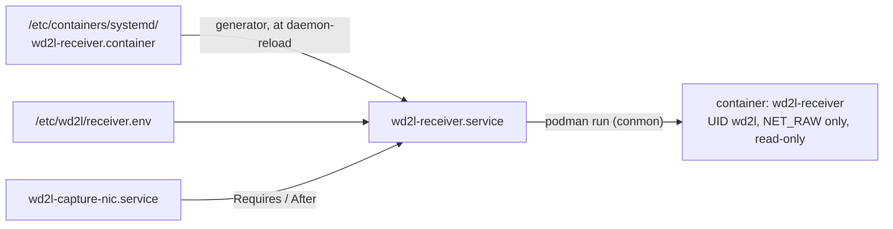

# ADR-0005: Run the containers under systemd with Quadlet

**Status:** Accepted (2026-10-13, shipped in 1.0.0)
**Date:** 2026-10-08
**Deciders:** System owner. Host administrators of both enclaves.

## Context

[ADR-0004](0004-container-base-image.md) makes wd2l available as an image. Something has to start
it at boot, keep it running and stop it cleanly. The hosts already run wd2l under systemd, and
the design leans on that:

* **Ordering.** `wd2l-receiver` requires `wd2l-capture-nic.service`; `wd2l-sender` requires
  `wd2l-egress-nic.service` and the network.
* **Clean stops.** The sender sends its final heartbeat on SIGTERM within 30 s. The receiver
  writes a final health record and flushes to the SIEM within 60 s
  ([planned-downtime.md](../planned-downtime.md)).
* **The journal and auditd.** The operational logs go to the journal. Host auditd rules record
  who changes the units and the settings.
* **Restart on failure,** and nothing else running that wasn't accredited.

Constraints:

* RHEL 9.2+ and RHEL 10 ship Podman with Quadlet, and don't ship Docker Engine.
* The enclaves may be offline: images are loaded from files, and nothing may pull at start.
* Change control: what runs must be a specific, verified image.

## Decision

Run each container with a **Quadlet unit**:

* `deploy/log-server/wd2l-sender.container`;
* `deploy/receiver/wd2l-receiver.container`.

At boot, a systemd generator turns each into an ordinary service with the same name as the
native unit. Use one or the other on a host, never both. The Quadlet units read the same
`/etc/wd2l/*.env` files as the native units, so the options are in one place either way.

## Options considered

### Option A: Quadlet `.container` units (chosen)

| Dimension | Assessment |
|---|---|
| Fit with systemd | Native. The generated unit keeps `Requires=`/`After=`, `Restart=`, `TimeoutStopSec=`, `systemctl` and the journal |
| Daemon | None. Podman runs under systemd through conmon; no root daemon listens on a socket |
| Hardening in the file | `DropCapability=all`, `AddCapability=NET_RAW` (receiver only), `NoNewPrivileges=true`, `ReadOnly=true`, `User=`, plus SELinux `container_t` |
| Offline | `Pull=never`: runs only an image already loaded (and verified) |
| Change control | `Image=` names one version, or a digest; nothing updates it automatically. Rollback is the previous image and a restart |
| Support | Podman ≥ 4.4 (RHEL 9.2+, RHEL 10). Red Hat's recommended way |

### Option B: a hand-written unit that runs `podman run`

| Dimension | Assessment |
|---|---|
| Fit with systemd | Works, but `Type=`, `KillMode=`, the conmon PID file and cleanup after a crash are ours to get right |
| Daemon | None |
| Hardening in the file | The same flags, written as a long `ExecStart=` |
| Offline | `--pull=never` |
| Change control | As A |
| Support | Easy to drift from what Podman expects as it changes |

### Option C: `podman generate systemd`

| Dimension | Assessment |
|---|---|
| Fit with systemd | Generates option B's unit for you, once |
| Support | Deprecated in favor of Quadlet: urgent fixes only, no new features |

### Option D: Docker Engine with restart policies, or compose

| Dimension | Assessment |
|---|---|
| Fit with systemd | Ordering against the NIC units happens outside systemd |
| Daemon | `dockerd`, a root daemon to accredit, patch and monitor |
| Support | Not shipped by RHEL |

### Option E: Kubernetes, MicroShift or `podman kube play`

| Dimension | Assessment |
|---|---|
| Fit with systemd | Indirect: a scheduler sits between systemd and the process |
| Daemon | An API server and a control plane (Kubernetes, MicroShift); `kube play` adds a YAML layer over option A |
| Support | More components to accredit, for one process per host |

## Trade-off analysis

* **Least functionality** (e.g. NIST CM-7). Quadlet adds no service to the host: it is a
  generator that runs at boot. Docker adds a root daemon, and Kubernetes adds a control plane.
* **The same operations, native or container.**
  * `systemctl stop wd2l-receiver` and `journalctl -u wd2l-receiver` work the same either way.
  * The planned-downtime runbook doesn't change.
  * auditd still sees who changes `/etc/wd2l/` (the settings), the units, and the Quadlet files
    (`/etc/containers/systemd/wd2l-*.container`, a rules file of its own: the watch needs Podman's
    directory, so a host without Podman doesn't get it).
* **Hardening, two layers** (e.g. NIST AC-6, SC-39).
  * **For a native unit,** systemd's sandbox options (`ProtectSystem`, `CapabilityBoundingSet`
    and the rest) confine wd2l.
  * **Under Quadlet,** namespaces, the capability set, SELinux `container_t` and a read-only image
    confine it. systemd's options now confine Podman itself.
  * Both give the receiver one capability and the sender none. On a GitHub runner, a non-root
    container user with only `NET_RAW` captures, and without it is refused (Phase 0 check 1 of
    the [release plan](https://github.com/JoeHazurmoney/architecture-wiredata-to-log/blob/813b334/docs/superpowers/plans/2026-10-07-release-packaging/phase-0-checks.md)).
* **Change control** (e.g. NIST CM-3, CM-14).
  * The unit names the image.
  * Podman runs only what is already loaded, and that was verified with `cosign.pub` before
    loading ([ADR-0006](0006-release-artifacts-and-signing.md)).
  * Rolling back is naming the previous image.

## Consequences

* **Easier:** one way to start, stop and read wd2l on a host, native or container. The hardening
  is declared in one short file. No daemon.
* **Harder:**
  * **Signals.** An operator's `podman kill --signal USR1` shows as pid 0 inside the container.
    The host's auditd records who ran it.
  * **User names.** Audit records name the user only if the container can see the host's
    `/etc/passwd`. The units mount `/etc/passwd` and `/etc/group` read-only and run as
    `User=wd2l`.
  * **SELinux.** The shared directories (`/var/lib/wd2l`, `/var/log/wd2l`) are mounted with
    `:z`, because host tcpdump and the audit seal timer use them too.
  * **Podman version.** It needs Podman 4.4 or later.
* **Confirmed on 0.3.0rc5** (AlmaLinux 10, SELinux enforcing; [containers.md](../deployment/containers.md#user-selinux-and-fips)),
  as planned for the first release candidate (the
  [release plan's](https://github.com/JoeHazurmoney/architecture-wiredata-to-log/blob/813b334/docs/superpowers/plans/2026-10-07-release-packaging/phase-0-checks.md) Phase 0 checks 2–4, moved to [Task 6.5](https://github.com/JoeHazurmoney/architecture-wiredata-to-log/blob/813b334/docs/superpowers/plans/2026-10-07-release-packaging/phase-6-release.md) because no VM was available yet):
  * that `Exec=… $WD2L_*_ARGS` expands the env file's options;
  * that `:z` doesn't stop host tcpdump writing the archive;
  * that `User=wd2l` resolves with the passwd mount.

  Each had a fallback ready: options written in `Exec=`; a small SELinux policy module; numeric
  `User=`/`Group=`. Only `:z` needed it (the update below).
* **Update (0.3.0rc5):** `:z` did stop host tcpdump: it relabelled the archive. `/var/lib/wd2l`
  is now mounted without it; a small module in the RPM labels the directory for containers and
  lets them read the archive only ([containers.md](../deployment/containers.md#user-selinux-and-fips)).
* **Revisit** when wd2l runs on a platform without systemd, or when more than one container per
  host needs coordinating.
