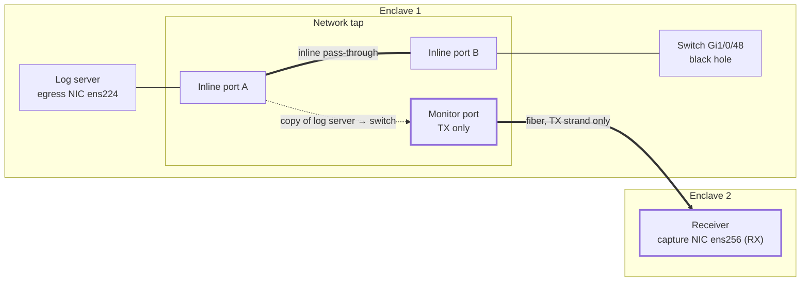

# Network: black-hole switch port, network tap, one-strand fiber

## Cabling

The network tap sits inline on the cable between the log server and the black-hole switch port, so
the log server has a real link partner (the switch) and transmits normally. The tap's monitor port sends
a copy to Enclave 2.

## Black-hole switch port

Example config: [`deploy/switch/blackhole-port.ios.txt`](../../deploy/switch/blackhole-port.ios.txt)
(written for one common switch platform, Cisco IOS; the comments at the top list the intent so it
can be adapted to any vendor).

* Own VLAN (3999 in the example) with **no other members and no SVI**, pruned from every trunk.
  Unknown-unicast flooding then has nowhere to go.
* Drop everything arriving: IP ACL `deny ip any any` plus MAC ACL `deny any any`.
* Silence the switch on that port: no CDP, no LLDP, BPDU filter, no DTP, no UDLD. This keeps the
  raw cable carrying only the log server's frames.
* Leave the port up. The log server's NIC needs link to transmit.

Why not skip the switch and point the log server's fiber straight at Enclave 2? Most NICs
won't transmit without link, and link needs light coming back. The switch provides that in
Enclave 1, where it's harmless.

## Network tap

Any tap that can sit inline on the cable and copy one direction out a separate monitor port works:
a passive fiber tap, an active copper tap, or a packet broker with filtering (for example, the
Gigamon equipment this design was first sketched around). Exact commands depend on the product, so
this is the intent.

1. **Inline (network) ports** on the log-server ↔ switch cable. If it's copper or an active tap,
   use bypass/failsafe so a tap power loss doesn't take the link down.
2. **Filter** to the Enclave 2 monitor port, if the tap can filter. Pass only:
   * direction: log server → switch (the copy of the switch's receive side), and
   * IPv4, source `10.255.255.1`, destination `10.255.255.2`, UDP source and destination port
     `5514`.

   Drop everything else. A tap that can't filter is also fine: the switch-port isolation keeps
   that cable nearly silent anyway, and the receiver counts any stray packets (`other_packets`), so
   unexpected traffic shows up in the SIEM.
3. **Monitor port → Enclave 2: TX strand only.** Same method as the enclave you already have
   approved. Two things to confirm on this hardware:
   * the tap's monitor port keeps transmitting with **no light on its RX**. Some products need
     link forced up or a unidirectional setting on the port (passive fiber taps have no such
     issue);
   * the receiver NIC reports link with **only RX light**. 10GBASE-SR/LR optics usually do. With
     1000BASE-SX/LX, auto-negotiation normally has to be turned off on both ends
     (`ethtool -s ens256 autoneg off speed 1000 duplex full`).
4. If the tap has a management interface, it is Enclave 1 equipment. It must not be reachable
   from Enclave 2.
5. **MTU**: if you use jumbo frames, the log server NIC, tap ports, switch port and receiver NIC
   must all accept 9000-byte frames.

## Checks

* On the switch: `show access-lists WD2L-DROP-ALL`. The deny counter climbs at the log rate.
  `show lldp neighbors`: the log server isn't listed.
* On the receiver: `tcpdump -i ens256 -nn -c 20` shows only
  `10.255.255.1.5514 > 10.255.255.2.5514: UDP`.
* In the Enclave 2 SIEM: `other_packets` stays 0 in `sourcetype=wd2l:health`.
* Physically: with the fiber pulled at the receiver end, check with a light meter that no light is
  coming from the receiver NIC's TX port toward Enclave 1. Better still, that strand isn't
  connected at all.
