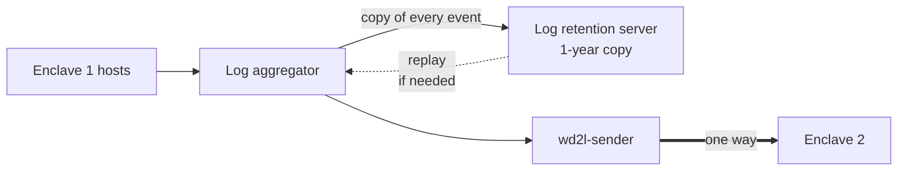

# Enclave 1: log retention server

Keeps a copy of every event the log aggregator collects for **1 year**, the audit record retention
period (for example NIST SP 800-53 AU-11, or the period a SOC 2 retention policy sets). It has two
jobs:

1. **Replay source.** Enclave 2 can't ask for lost events again across a one-way link. When it
   reports a loss, the aggregator reads that time window back from this server and sends it
   through `wd2l-sender` again.
2. **1-year home for wd2l's Enclave 1 audit files** (see [section 6](#6-wd2l-audit-files) and
   [audit-and-health.md](../audit-and-health.md)). Confirm this home with the
   security owner ([open item 5](../accreditation-notes.md#open-items-for-the-security-and-system-owners)).

It isn't on the transfer path. If it's down, logs still reach Enclave 2; only the Enclave 1 copy
falls behind.



Examples use `/srv/log-retention` as the data directory. Replace it with yours.

## 1. What it needs

Any storage the aggregator can write to **and read back from** works: a Linux host with local
disk, an NFS export, or S3-compatible object storage. For example, Cribl Stream writes to a
filesystem or S3 destination and replays the data with a collector (see
[log-server.md](log-server.md#example-cribl-stream)). Other aggregators can write files or S3
objects and read them back with a file or S3 input.

| Requirement | Value |
|---|---|
| What it stores | Every event the aggregator collects, including any that are filtered out of the crossing |
| Fields | At least `_time`, `host`, `source`, `sourcetype`, `index` and `_raw`: the fields that cross, so a replay produces the same events |
| Layout | Compressed files (or objects) split by time, at least by day, so a time window can be found and read back quickly. JSON lines with gzip is a good default |
| Network | Reached from the central log server's normal Enclave 1 NIC. Never through the egress NIC: its firewall allows only the one wd2l flow. Use TLS where the protocol supports it |
| Aggregator side | Its own output with its **own persistent queue**, so an outage here never holds up the sender |
| Retention | 1 year (audit record retention), then delete |
| Time | chrony from the Enclave 1 time source, like every other host (time stamps) |

## 2. Size the storage

At the planned peak of 1,000 events/s and about 1 KB per event:

* about **86 GB a day**, or **31 TB a year**, before compression;
* log text usually compresses 5–10× with gzip, so plan for roughly **3–6 TB a year**, plus
  headroom.

Most hours run below the peak. After the first week, measure the real daily size and adjust.

## 3. Keep 1 year, then delete

Delete data once it is more than a year old, using the storage's own tool: a lifecycle rule on
object storage, or a daily job that removes day directories older than 366 days. Don't delete
earlier: these are audit records.

## 4. Protect it

It holds a full copy of Enclave 1's logs, and wd2l's audit files, so treat it as audit
storage (protection of audit information):

* Only the aggregator's service account can write. Only the delete job (or lifecycle rule) can
  delete. Administrators and analysts who need the data get read access.
* Use write-once storage (object lock) if you have it. It's optional unless your framework or
  assessor requires it.

## 5. Replay a time window

The full procedure is in [operations.md](../operations.md#re-sending-from-enclave-1). In short:

1. Take the time window from the Enclave 2 gap record (and the host, if only one host is
   affected).
2. In the aggregator, read that window back from the retention server and route it to the
   `wd2l-sender` output **only**. Not back to the retention server, or that window is stored
   twice.
3. The events cross again as new events with new sequence numbers.

## 6. wd2l audit files

`wd2l-sender` writes audit files to `/var/log/wd2l/audit-*.jsonl` on the central log server. The
aggregator also reads those files and routes them to the retention server only. Enclave 2 already
gets the same records in-band from the sender. Keep every line unchanged, so the hash chain still
verifies on the copy. wd2l starts a new file when one gets large and never renames them, so a file
input that picks up new files by name pattern is enough.

Keeping them here for 1 year is still to be confirmed by the security owner ([open item 5](../accreditation-notes.md#open-items-for-the-security-and-system-owners)
in the accreditation notes). Until then the official copy is the one on the log server.

To check a copy:

```bash
wd2l-audit-report verify --dir <copy>
```

It prints a JSON result: `result` is `ok`, or `failed` with what is wrong with the chain. It
exits 1 on a problem, and 2 if it can't read the copy. See
[operations.md](../operations.md#audit-records).

## 7. Checks

```bash
ls -lt /srv/log-retention | head      # new data keeps arriving (adjust to your layout)
df -h /srv/log-retention              # disk use against the estimate above
```

* The aggregator's queue for this output stays near empty.
* **wd2l's audit files arrive.** The copy's newest `audit-*.jsonl` keeps growing (the sender
  writes at least an hourly `reconcile` record), and `wd2l-audit-report verify --dir <copy>`
  gives `"result": "ok"`. Nothing arriving usually means the aggregator's service account can't
  read `/var/log/wd2l`: it must be in group `wd2l-audit`
  ([log-server.md](log-server.md#1-install-wd2l)).
* **Practice a replay** at deployment and after changes: replay a 5-minute window and confirm the
  events arrive in the Enclave 2 SIEM.
