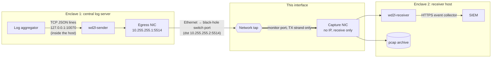

# Interface description: Enclave 1 → Enclave 2 log transfer

What crosses the one-way link, packet by packet, written as input for the interface control
document (ICD). It covers every layer, from the fiber up to the JSON inside each packet:

* Each field gets its size, its value or range, and who sets it.
* Rates, error handling and security characteristics are covered.
* Two annotated captures show what is actually on the wire.

The source of truth is the code: `wd2l/wire.py` (frame), `wd2l/sender.py` (what gets sent),
`wd2l/receiver.py` and `wd2l/packets.py` (what is accepted). This page describes **WD2L version
1** with the configuration in `deploy/`. [wire-format.md](wire-format.md) is the shorter
developer reference and holds the receiver's sequencing rules.

## 1. Summary

| Item | Value |
|---|---|
| Interface | Log transfer, Enclave 1 central log server → Enclave 2 receiver host |
| Direction | One way (simplex), Enclave 1 → Enclave 2. No return path at any layer |
| Sensitivity levels | See the [README](../README.md) |
| How one-way is enforced | Physically: only the network tap monitor port's transmit strand is connected to Enclave 2 |
| Protocol stack | WD2L v1 frame / UDP / IPv4 / Ethernet II / fiber |
| Sender | `wd2l-sender` on the central log server, egress NIC, `10.255.255.1`, UDP port `5514` |
| Addressed to | `10.255.255.2`, UDP port `5514`: a "black hole" address that exists nowhere (static ARP) |
| Actual consumer | Enclave 2 capture NIC (no IP address, receive only) → `wd2l-receiver` |
| Messages | DATA (one log event, split over several packets if needed); HEARTBEAT (sender status, every second). With `--audit-dir` (deployed: yes), each sender run has a second stream, the **records stream**, carrying the sender's own audit and health records ([§9](#9-streams-and-sequence-numbers)). |
| Sessions, handshakes, acknowledgements | None. Nothing is ever resent |
| Data carried | Log events collected in Enclave 1, chosen by the log aggregator. Each one keeps its original text and its time, host, source, source type and index |
| Expected volume | Under 1,000 events/s, about 8 Mbit/s |
| Integrity | CRC-32 per packet, SHA-256 per event (accidental corruption only) |
| Confidentiality / authenticity | Not encrypted, not authenticated (see [§12](#12-security-characteristics)) |
| Loss handling | Sequence numbers and heartbeats: every loss is detected and reported in Enclave 2, then replayed from Enclave 1 |



The aggregator → sender connection and the receiver → SIEM connection are inside one enclave
each. They are not part of this interface. [§14](#14-after-the-link-inside-enclave-2)
summarizes the Enclave 2 side.

## 2. Physical layer

| Item | Value | Notes |
|---|---|---|
| Medium | Fiber, **one strand** | The tap monitor port's TX to the receiver NIC's RX. The other strand isn't connected |
| Speed and optics | Site value (1 G or 10 G) | 10GBASE-SR/LR optics usually report link with receive light only. 1000BASE-SX/LX usually needs auto-negotiation off at both ends. See [deployment/network.md](deployment/network.md) |
| Source of the signal | Network tap monitor port | Copies the log server → switch direction of the cable between the log server and the black-hole switch port |
| MTU | 1500 (default) or 9000 | 9000 only if every device on the path accepts it. The sender's `--max-datagram` must match (1472 or 8972) |
| Signal toward Enclave 1 | None | No strand. Enclave 2 equipment can't send anything back |

## 3. Data link layer: Ethernet II

| Field | Size (bytes) | Value | Set by | Notes |
|---|---:|---|---|---|
| Destination MAC | 6 | `02:00:00:00:00:02` | Static ARP entry on the log server | Made up and locally administered. No device has it, so the switch never learns it |
| Source MAC | 6 | The egress NIC's MAC (site value) | Log server NIC | `02:00:00:00:00:01` in the lab |
| 802.1Q tag | 0 | none | | The log server sends untagged frames (access port). The receiver accepts up to two tags (`0x8100`, `0x88A8`, `0x9100`), in case a tap or packet broker adds one |
| EtherType | 2 | `0x0800` (IPv4) | Log server OS | |
| Payload | 97–1500 | The IPv4 packet | | Up to 9000 at MTU 9000 |
| FCS | 4 | CRC-32 | NIC hardware | Checked by the receiver NIC. A bad frame is dropped there and shows up as a gap |

Frame size, header plus payload without FCS: **111 to 1514 bytes** at MTU 1500 (up to 9014 at
MTU 9000). The lab capture ranged from 112 to 1514.

**No other frames are on this cable.** The log server's egress NIC sends only the frames
described here:

| Traffic | Why there is none |
|---|---|
| ARP | Static neighbor entry, plus nftables drops ARP on that NIC |
| IPv6 | Turned off on that NIC (no router solicitations, no neighbor discovery) |
| DHCP | No DHCP; the address is static |
| LLDP | lldpd is turned off for that port; the kernel 5.16+ egress filter drops anything else |
| CDP, LLDP, STP and other traffic from the switch | Silenced on the black-hole port. The tap also copies only the log server → switch direction |

A tap that filters passes only IPv4/UDP `10.255.255.1:5514 → 10.255.255.2:5514`. If anything
else arrives, the receiver counts it (`other_packets`) and reports it in the SIEM.

## 4. Network layer: IPv4

Values seen in the lab capture are those of the Linux kernel. wd2l itself sets only the "don't
fragment" bit.

| Field | Bits | Value | Set by | Notes |
|---|---:|---|---|---|
| Version | 4 | 4 | OS | |
| IHL | 4 | 5 (20-byte header, no options) | OS | The receiver accepts options but none are sent |
| DSCP / ECN | 8 | 0 | OS | |
| Total length | 16 | 97–1500 (up to 9000) | OS | 20 + 8 + UDP payload |
| Identification | 16 | 0 in the lab capture | OS | Meaningless with DF set. Not used by the receiver |
| Flags | 3 | DF = 1, MF = 0 | wd2l-sender (`IP_PMTUDISC_DO`) | The sender never fragments. A datagram too big for the MTU fails to send and is counted (`send_errors`) |
| Fragment offset | 13 | 0 | OS | The receiver drops fragments (`other_packets`, reason `ip fragment`) |
| TTL | 8 | 64 | OS default (`net.ipv4.ip_default_ttl`) | |
| Protocol | 8 | 17 (UDP) | OS | |
| Header checksum | 16 | computed | OS | Not checked by the receiver (the WD2L CRC covers the payload) |
| Source address | 32 | `10.255.255.1` | Egress NIC configuration | `/30` with the black hole |
| Destination address | 32 | `10.255.255.2` | `wd2l-sender --dst` | No host has it |

## 5. Transport layer: UDP

| Field | Size (bytes) | Value | Set by | Notes |
|---|---:|---|---|---|
| Source port | 2 | `5514` | `wd2l-sender --bind 10.255.255.1:5514` | Fixed, the same after every restart |
| Destination port | 2 | `5514` | `wd2l-sender --dst` | |
| Length | 2 | 77–1480 (up to 8980) | OS | 8 + WD2L frame |
| Checksum | 2 | computed | Sending host, usually the NIC (checksum offload) | Not checked by the receiver. Captures taken on virtual NICs (the lab) show it as wrong, because no hardware fills it in |
| Payload | 69–1472 (up to 8972) | One WD2L frame | wd2l-sender | `--max-datagram` sets the maximum |

## 6. Application layer: WD2L frame

Every UDP payload is exactly one WD2L frame. All integers are unsigned and big-endian. Offsets
are from the start of the UDP payload. Add 42 for the offset in the Ethernet frame, or 50 if one
VLAN tag is present.

| Offset | Size | Field | Type | Value or range | Notes |
|---:|---:|---|---|---|---|
| 0 | 4 | `magic` | ASCII | `WD2L` (`57 44 32 4C`) | |
| 4 | 1 | `version` | uint8 | `1` | Any other value is dropped (`bad_frames`) |
| 5 | 1 | `type` | uint8 | `1` DATA, `2` HEARTBEAT | Any other value is dropped |
| 6 | 2 | `flags` | uint16 | `0` (data stream) or `1` (records stream) | Bit 0 marks the records stream. The other bits are reserved: sent as 0, ignored by the receiver |
| 8 | 8 | `stream_id` | uint64 | random, never 0 | New every time the sender starts. Identifies one sender run |
| 16 | 8 | `seq` | uint64 | DATA: 1, 2, 3, … HEARTBEAT: last DATA `seq` sent (0 before the first) | Never wraps within a run (see [§9](#9-streams-and-sequence-numbers)) |
| 24 | 2 | `chunk_idx` | uint16 | 0 … `chunk_count` − 1 | |
| 26 | 2 | `chunk_count` | uint16 | 1 … 187 at MTU 1500 (1 … 30 at 9000) with the default 256 KB event limit | Pieces in this event. HEARTBEAT: always 1 |
| 28 | 4 | `event_len` | uint32 | 11 … 262,144 | Length of the whole event (all pieces joined). HEARTBEAT: length of its body |
| 32 | 32 | `digest` | bytes | SHA-256 | Of the whole event (DATA) or of the body (HEARTBEAT). FIPS 180-4 |
| 64 | n | `payload` | bytes | DATA: 1 … `max_datagram` − 68. HEARTBEAT: the whole body | |
| 64 + n | 4 | `crc32` | uint32 | CRC-32 | Over bytes 0 … 63 + n (header and payload) |

**CRC-32** is the common Ethernet/zlib variant (CRC-32/ISO-HDLC): polynomial `0x04C11DB7`
(reflected `0xEDB88320`), initial value `0xFFFFFFFF`, final XOR `0xFFFFFFFF`, as computed by
`zlib.crc32`. It is sent big-endian.

**Overhead** is 68 bytes per packet, so one packet carries up to 1,404 bytes of event at MTU 1500,
or 8,904 at MTU 9000.

## 7. DATA message

### Splitting

* The sender turns each event into one byte string, the **event body** (below).
* It cuts the body into pieces of `max_datagram − 68` bytes. With the default `--max-datagram`
  of 1472 that is 1,404 bytes. The last piece is shorter.
* Every piece carries the same `stream_id`, `seq`, `chunk_count`, `event_len` and `digest`.
* All pieces of one event are sent back to back, in order (`chunk_idx` 0, 1, 2 …). No other
  frame, not even a heartbeat, is sent between them.
* The receiver reassembles by (`stream_id`, `seq`, `chunk_idx`), so it would also accept them
  out of order.
* It holds a part-built event for up to 5 s (`--reasm-timeout`). It then checks the length
  against `event_len` and the SHA-256 against `digest`. If any piece is lost, the whole event is
  lost and reported as a gap.

### Event body

UTF-8 JSON ([RFC 8259](https://www.rfc-editor.org/rfc/rfc8259)), exactly one object, compact (no
spaces). Characters outside ASCII are sent as UTF-8, not as `\u` escapes. Keys appear in this
order, each only if present:

```json
{"_time":1727265600.0,"host":"fw01","source":"udp:514","sourcetype":"pan:traffic","index":"enclave1","_raw":"<14>Sep 25 12:00:00 fw01 1,2026/09/25 12:00:00,TRAFFIC,end,0,10.1.0.0,10.2.0.5,allow,tcp,443","fields":{"wd2l_tx_time":1791130193.968}}
```

### Data elements: top level

The sender passes the first six values through from the log aggregator unchanged. It doesn't
check their types. The receiver keeps a value only if it has the type shown and ignores it
otherwise. Any other top-level key is dropped by the sender, and the receiver ignores it too.

| Name | Type | Size or range | Units | Required | Set by | Meaning |
|---|---|---|---|---|---|---|
| `_time` | number | any | seconds since 1970-01-01 UTC, fraction allowed | no | Log aggregator | When the event happened, as parsed in Enclave 1 |
| `host` | string | ≤ 1,024 characters | | no | Log aggregator | The host that produced the log |
| `source` | string | ≤ 1,024 characters | | no | Log aggregator | The file, port or channel it came from |
| `sourcetype` | string | ≤ 1,024 characters | | no | Log aggregator | Its format, which picks the SIEM's parsing |
| `index` | string | ≤ 1,024 characters | | no | Log aggregator | The SIEM index it belongs in |
| `_raw` | string | up to the event limit | | **yes** | Log source (via the aggregator) | The log record itself, unchanged. If the aggregator's event has no `_raw`, the sender puts the whole event here as JSON |
| `fields` | object | flat; string or number values | | no | wd2l-sender | Extra searchable fields, below |

### Data elements: `fields`

| Name | Type | Range | Units | When present | Meaning |
|---|---|---|---|---|---|
| `wd2l_tx_time` | number | 3 decimal places | seconds since 1970-01-01 UTC | Every event (unless `--no-tx-time`) | Sender's clock when it sent the event. Used to measure delays ([operations.md](operations.md#measuring-delays)) |
| `wd2l_opaque` | string | `encrypted`, `compressed`, `high-entropy` | | Only on events carrying a blob that can't be inspected (unless `--no-opaque-check`) | What kind of blob ([ADR-0002](decisions/0002-opaque-content.md)) |
| `wd2l_opaque_bytes` | integer | ≥ 256, except armor blocks (PGP message, encrypted private key, age file), which are flagged at any size | bytes | With `wd2l_opaque` | The blob's decoded size (estimated from the text for armor blocks) |
| `wd2l_truncated` | integer | > 262,144 in practice | bytes | Only on events cut to fit the size limit | Original size of `_raw` (UTF-8) |
| `wd2l_src_seq` | integer | 1, 2, 3, … | | Only with `--source-seq` (off in the deployed unit) | Line number per (host, source) within one sender run ([multiple-files.md](multiple-files.md)) |
| any `--extra-field` name | string or number | | | Only if the unit names it (none in the deployed unit) | An aggregator field carried as is |

Only the sender can set `wd2l_opaque` and `wd2l_opaque_bytes`. It removes any value the aggregator
supplied. The receiver keeps only `fields` entries whose values are strings or numbers. It ignores
booleans, lists and nested objects.

**With the deployed unit**, an ordinary event carries the six top-level keys and one field,
`wd2l_tx_time`. Events with a blob also carry `wd2l_opaque` and `wd2l_opaque_bytes`. Oversized
ones also carry `wd2l_truncated`.

### Size limit and truncation

The whole body is at most 262,144 bytes (`--max-event`). If an event is bigger, the sender:

1. cuts `_raw` from the end, on a UTF-8 character boundary, until the body fits;
2. adds `wd2l_truncated` with the original size of `_raw`, and counts it (`truncated` in the
   heartbeat).

If the metadata alone is too big, the body becomes `{"_time":…,"_raw":"","fields":{"wd2l_truncated":…}}`.

## 8. HEARTBEAT message

Sent every second (`--heartbeat`) and once more on clean shutdown. One packet, `chunk_count` 1.
`seq` in the header is the last DATA `seq` sent. That's how the receiver notices events lost at
the very end of a burst, when nothing newer arrives to show the gap.

The body is compact UTF-8 JSON with **keys in sorted order**, about 600–800 bytes with
the deployed unit, so the datagram is about 670–870 bytes. It is always one packet: if the
snapshot keys would not fit `--max-datagram`, they are left out of that heartbeat and
`heartbeat_trimmed` counts it. A snapshot value the sender can't read is left out too: "always"
on a snapshot key means whenever the snapshot is sent and the value can be read. Numbers are
cumulative for this sender run unless noted.

| Name | Type | Units | When present | Meaning |
|---|---|---|---|---|
| `audit_n` | integer | records | with `--audit-dir` | Records in the sender's audit chain |
| `audit_ok` | boolean |  | with `--audit-dir` | The audit file is being written and has free space |
| `bad_input` | integer | lines | always | Input lines from the aggregator that weren't a JSON object, or were over 16 MiB |
| `boot` | integer ≥ 1 | | with `--state` (deployed: yes) | Sender run counter, kept in its state file |
| `clients` | integer | connections | always | Aggregator connections to the sender |
| `cpu_pct` | number | % | always | Sender process CPU over the last heartbeat interval |
| `datagrams_sent` | integer | packets | always | Datagrams handed to the OS so far, not counting this one |
| `events_hash` | string, 64 hex digits | | always (wd2l ≥ 0.2.0) | Set hash of this run's events 1 … `seq` (the heartbeat's `seq` is the cut): the sum modulo 2²⁵⁶ of SHA-256(`seq` as 8 bytes big-endian ‖ the event's SHA-256 `digest`). Enclave 2 compares it with its own value to prove it delivered exactly these events ([audit design §7](audit-and-health.md#7-reconciliation)). Never dropped from a trimmed heartbeat. |
| `events_in` | integer | lines | always | Input lines that were events or were rejected |
| `events_sent` | integer | events | always | Events numbered and sent |
| `final` | `true` | | last heartbeat only | Clean shutdown. Always the last frame of a run |
| `heartbeat_trimmed` | integer | heartbeats | always | Heartbeats sent without the snapshot because it wouldn't fit |
| `input_backlog_bytes` | integer | bytes | always | Handed over by the aggregator, not yet read |
| `nic_carrier` | boolean |  | with `--egress-iface` | The egress NIC has link |
| `nic_tx_dropped` | integer | packets | with `--egress-iface` | The egress NIC's transmit drop counter |
| `nic_tx_errors` | integer | packets | with `--egress-iface` | The egress NIC's transmit error counter |
| `nic_tx_packets` | integer | packets | with `--egress-iface` | The egress NIC's transmit packet counter |
| `opaque_events` | integer | events | always | Events flagged `wd2l_opaque` |
| `prev_last_seq` | integer ≥ 0 | | with `--state`, from the second run on | Last `seq` the previous run recorded (saved at each heartbeat) |
| `prev_stream` | integer, 0 … 2⁶⁴−1 | | with `--state`, from the second run on | The previous run's `stream_id`. Up to 20 digits; parse it as an integer, not a double |
| `rss_mb` | number | MiB | when `/proc/self/statm` can be read (normally always) | Sender memory |
| `send_errors` | integer | packets | always | Sends that failed with an error other than "buffer full" (for example, too big for the MTU) |
| `sender_drops` | integer | packets | always | Datagrams the sender gave up on (buffer full after retries, or an error) |
| `sender_time` | number, 3 decimals | seconds since 1970-01-01 UTC | always | Sender's clock. Enclave 2 compares it to its own clock (`clock_offset_s`) |
| `shutdown_unread_bytes` | integer | bytes | always | Input the aggregator had handed over that the sender couldn't read before stopping. 0 except, at worst, on the final heartbeat |
| `stall_s` | number | seconds | always | Cumulative time waiting on pacing or a full send buffer |
| `time_offset_ms` | number | ms | when chrony answers | Clock offset from chrony on the log server |
| `time_stratum` | integer |  | when chrony answers | Clock stratum from chrony on the log server |
| `time_synced` | boolean |  | when chrony answers | Chrony reports the clock as synchronised |
| `time_unavailable` | `true` |  | when chrony can't be read | The sender couldn't read chrony (missing, hanging or blocked), so the other `time_*` keys are left out. Enclave 2 raises a time alarm ("sender: unavailable") |
| `truncated` | integer | events | always | Events cut to fit the size limit |
| `uptime` | number, 1 decimal | seconds | always | Time since this run started |

### Records stream heartbeat

Same frame, with `flags` bit 0 set. Sent every second and once more at shutdown. Its keys:

| Name | Type | Meaning |
|---|---|---|
| `events_sent` | integer | Records sent on the records stream |
| `records_too_big` | integer | Records kept out of the stream because they don't fit one event. They are still in the local audit file |
| `outbox_dropped` | integer | Records not queued for sending because more than 10,000 were waiting |
| `sender_time` | number, 3 decimals | Sender's clock, seconds since 1970-01-01 UTC |
| `uptime` | number, 1 decimal | Seconds since this run started |
| `final` | `true` | Last heartbeat only. Clean shutdown |

There is no `boot` and there are no `prev_*` keys. Records streams aren't linked across runs.

## 9. Streams and sequence numbers

* A **stream** is one sender run. Its `stream_id` is drawn at random when the sender starts.
* `seq` numbers the events in the order the sender received them, from 1. It is 64 bits and
  restarts only with a new stream, so the pair (`stream_id`, `seq`) names one event.
* Runs are chained by `boot`, `prev_stream` and `prev_last_seq`. Enclave 2 can therefore tell a
  lost tail of one run, or a whole run it never saw.
* Each heartbeat's `events_hash` lets Enclave 2 reconcile the data stream end to end; the records
  stream doesn't carry one.
* The receiver's rules for gaps, duplicates and links are in
  [wire-format.md](wire-format.md#receiver-rules).

**Records stream**

* It has its own random `stream_id`, its own `seq` from 1 and its own heartbeat.
* Its DATA bodies are records, not logs. `host` is the log server, `source` is `wd2l-sender`, and
  `sourcetype` is `wd2l:sender:audit` or `wd2l:sender:health`. `_raw` is the record as canonical
  JSON, the same bytes as the line in the local audit file. There is no `index`: Enclave 2
  chooses it.
* The receiver routes by the flag, never by `sourcetype`. It passes on only records whose
  `enclave` is 1 and `component` is `sender`: Enclave 1 can't speak for Enclave 2. Anything else
  is dropped and counted in `records_bad`.
* Volume is bounded: summaries, about one record a minute, plus events.
* Loss shows up as a gap marked `records: true`.
* Receivers older than wd2l 0.2.0 ignore `flags` and would treat the records stream as one more
  data stream. **Update the receiver first.**

## 10. Rates and timing

| Item | Value | Set by |
|---|---|---|
| DATA | As events arrive from the aggregator, with no batching or delay | |
| HEARTBEAT | Every 1 s, plus one at shutdown. With `--audit-dir`, the records stream adds a second heartbeat every second | `--heartbeat` |
| Packet rate cap | 20,000 packets/s, bursts up to 2,000 packets. Covers DATA and HEARTBEAT | `--rate-pps` |
| Maximum bandwidth at the cap | About 245 Mbit/s with 1,514-byte frames. At MTU 9000 the cap allows more than a 1 G link carries | |
| Expected load | Under 1,000 events/s × about 1 KB ≈ 8 Mbit/s. Two heartbeats a second per run (data and records streams) add about 8 kbit/s | |
| Delay, sender to receiver | A few milliseconds. Lab: median under 1 ms, p99 about 4 ms | |
| Clocks | Each enclave from its own GPS receiver. Every event carries the sender's time (`wd2l_tx_time`), and the receiver adds its own (`wd2l_rx_time`) | |

## 11. Error detection and handling

Nothing can be resent across a one-way link. Every problem is detected and reported in Enclave
2. Lost events are then replayed from Enclave 1 ([operations.md](operations.md)).

| Layer | Check | Done by | If it fails |
|---|---|---|---|
| Ethernet | FCS | Receiver NIC | Frame dropped by the NIC (NIC error counters). The event becomes a gap |
| IPv4 / UDP | Header checksum, UDP checksum | Not checked | Covered by the WD2L CRC-32 and SHA-256 |
| IPv4 / UDP | IPv4, not a fragment, protocol UDP, expected addresses and ports | Receiver | Counted as `other_packets` (with a reason), dropped |
| WD2L frame | Length ≥ 68, CRC-32, magic, version, type, chunk fields | Receiver | Counted as `bad_frames`, dropped |
| WD2L frame | `event_len` ≤ the receiver's `--max-event` | Receiver | Counted as `event_too_big`, dropped |
| Event | All pieces within 5 s; total held under 64 MB | Receiver | `reasm_expired` / `reasm_evicted`. The event becomes a gap |
| Event | Joined length = `event_len`, SHA-256 = `digest` | Receiver | `digest_mismatch`, dropped. The event becomes a gap |
| Event | Valid JSON (not too deeply nested to read) with a `_raw` string | Receiver | `bad_events`, dropped |
| Heartbeat | Body is a JSON object (not too deeply nested to read) | Receiver | Counted as `bad_frames` (`bad heartbeat json`), dropped |
| Record | A JSON object naming the Enclave 1 sender (`enclave` 1, `component` `sender`) | Receiver | Counted as `records_bad`, dropped |
| Sequence | Every `seq` of every stream arrives | Receiver | `gap` record naming the stream and `seq` range, after 2 s (`--gap-window`) |
| Liveness | A heartbeat at least every 5 s | Receiver | `heartbeat_stale` record |
| Sender run | Every run reaches Enclave 2 | Receiver (via `boot` / `prev_stream`) | `stream_missing` record |

All of these go to the SIEM as `sourcetype=wd2l:health` records, with alerts
([deployment/receiver.md](deployment/receiver.md)).

## 12. Security characteristics

* **One-way:** enforced physically by the single transmit strand. On top of that:
  * the receiver's capture NIC has no IP address and no ARP;
  * an egress filter on it drops anything the host tries to send;
  * the black-hole switch port drops all ingress.
* **Confidentiality:** not encrypted. The log server, cable and tap are under Enclave 1 physical
  and administrative controls.
* **Integrity:** CRC-32 per packet and SHA-256 per event detect accidental corruption. They use no
  key, so they don't prove who sent the data.
* **Authenticity:** none on the wire. Physical and administrative controls on the log server,
  cable and tap cover injection. An HMAC per event is the option if reviewers want more
  ([accreditation-notes.md](accreditation-notes.md#integrity-and-authenticity)).
* **What crosses:** log events only, chosen by the log aggregator in Enclave 1. Anything that
  shouldn't cross is filtered there; wd2l doesn't drop events for their content.
* **Opaque content:** long encrypted, compressed or random-looking blobs are flagged
  (`wd2l_opaque`) and alerted on in Enclave 2, but still cross
  ([ADR-0002](decisions/0002-opaque-content.md)).
* **Hostile input:** the receiver treats everything as hostile. Sizes and memory are capped,
  only the shapes described here are accepted, and the rest is counted and dropped.

## 13. Worked example: two captured packets

These are from the lab (`sudo lab/run-lab.sh`), captured by Enclave 2's tcpdump. The lab's
MACs are `02:00:00:00:00:01` (sender) and `02:00:00:00:00:02` (black hole). The UDP checksum is a
leftover of the virtual NIC (see [§5](#5-transport-layer-udp)).

To inspect a production capture the same way, on the receiver host:

```bash
P=/var/lib/wd2l/pcap/cap-20261004160908.pcap         # any archive file
sudo tcpdump -r $P -nn -XX -c 1 'udp[13] = 1'        # first DATA frame (type byte = 1)
sudo tcpdump -r $P -nn -XX -c 1 'udp[13] = 2'        # first HEARTBEAT frame (type byte = 2)
sudo tcpdump -r $P -nn -XX 'udp[24:4] = 0 and udp[28:4] = 1'   # every frame with seq 1
sudo tcpdump -r $P -nn -vv -c 5                      # IP and UDP header values
```

`udp[13]` is UDP header (8 bytes) plus WD2L offset 5, the `type` byte. `udp[24:4]` and
`udp[28:4]` are the high and low halves of `seq`. If the tap adds a VLAN tag, put `vlan and` in
front of the filter.

### DATA frame: event 1, in one piece (354 bytes)

```
0x0000:  0200 0000 0002 0200 0000 0001 0800 4500  ..............E.
0x0010:  0154 0000 4000 4011 2597 0aff ff01 0aff  .T..@.@.%.......
0x0020:  ff02 158a 158a 0140 1554 5744 324c 0101  .......@.TWD2L..
0x0030:  0000 fc9c b690 6003 6d8f 0000 0000 0000  ......`.m.......
0x0040:  0001 0000 0001 0000 00f4 0f56 3009 0ade  ...........V0...
0x0050:  5084 e7f6 985c e5d4 9eb9 303c 2dab 1386  P....\....0<-...
0x0060:  69a2 0a16 c8e1 2041 d232 7b22 5f74 696d  i......A.2{"_tim
0x0070:  6522 3a31 3732 3732 3635 3630 302e 302c  e":1727265600.0,
0x0080:  2268 6f73 7422 3a22 6677 3031 222c 2273  "host":"fw01","s
0x0090:  6f75 7263 6522 3a22 7564 703a 3531 3422  ource":"udp:514"
0x00a0:  2c22 736f 7572 6365 7479 7065 223a 2270  ,"sourcetype":"p
0x00b0:  616e 3a74 7261 6666 6963 222c 2269 6e64  an:traffic","ind
0x00c0:  6578 223a 2265 6e63 6c61 7665 3122 2c22  ex":"enclave1","
0x00d0:  5f72 6177 223a 223c 3134 3e53 6570 2032  _raw":"<14>Sep.2
0x00e0:  3520 3132 3a30 303a 3030 2066 7730 3120  5.12:00:00.fw01.
0x00f0:  312c 3230 3236 2f30 392f 3235 2031 323a  1,2026/09/25.12:
0x0100:  3030 3a30 302c 5452 4146 4649 432c 656e  00:00,TRAFFIC,en
0x0110:  642c 302c 3130 2e31 2e30 2e30 2c31 302e  d,0,10.1.0.0,10.
0x0120:  322e 302e 352c 616c 6c6f 772c 7463 702c  2.0.5,allow,tcp,
0x0130:  3434 3322 2c22 6669 656c 6473 223a 7b22  443","fields":{"
0x0140:  7764 326c 5f74 785f 7469 6d65 223a 3137  wd2l_tx_time":17
0x0150:  3931 3133 3031 3933 2e39 3638 7d7d 488d  91130193.968}}H.
0x0160:  315c                                     1\
```

| Frame offset | Bytes | Field | Value |
|---|---|---|---|
| 0x00 | `02 00 00 00 00 02` | Ethernet destination | black-hole MAC |
| 0x06 | `02 00 00 00 00 01` | Ethernet source | sender NIC (lab) |
| 0x0C | `08 00` | EtherType | IPv4 |
| 0x0E | `45 00` | IP version / IHL, DSCP | 4 / 20 bytes, 0 |
| 0x10 | `01 54` | IP total length | 340 |
| 0x12 | `00 00 40 00` | IP identification, flags | 0, DF |
| 0x16 | `40 11` | TTL, protocol | 64, UDP |
| 0x1A | `0a ff ff 01` → `0a ff ff 02` | IP source → destination | 10.255.255.1 → 10.255.255.2 |
| 0x22 | `15 8a` → `15 8a` | UDP source → destination port | 5514 → 5514 |
| 0x26 | `01 40` | UDP length | 320 |
| 0x2A | `57 44 32 4c` | `magic` | `WD2L` |
| 0x2E | `01 01` | `version`, `type` | 1, DATA |
| 0x30 | `00 00` | `flags` | 0 |
| 0x32 | `fc9c b690 6003 6d8f` | `stream_id` | this sender run |
| 0x3A | `0000 0000 0000 0001` | `seq` | 1 |
| 0x42 | `00 00 00 01` | `chunk_idx`, `chunk_count` | 0 of 1 |
| 0x46 | `00 00 00 f4` | `event_len` | 244 bytes |
| 0x4A | `0f56 3009 … 2041 d232` | `digest` | SHA-256 of the 244-byte body |
| 0x6A | `7b 22 5f 74 …` | `payload` | the event body (JSON), 244 bytes |
| 0x15E | `48 8d 31 5c` | `crc32` | over frame offsets 0x2A–0x15D |

### HEARTBEAT frame (308 bytes)

```
0x0000:  0200 0000 0002 0200 0000 0001 0800 4500  ..............E.
0x0010:  0126 0000 4000 4011 25c5 0aff ff01 0aff  .&..@.@.%.......
0x0020:  ff02 158a 158a 0112 1526 5744 324c 0102  .........&WD2L..
0x0030:  0000 fc9c b690 6003 6d8f 0000 0000 0000  ......`.m.......
0x0040:  07e9 0000 0001 0000 00c6 dadb e513 fbd7  ................
0x0050:  55c8 7969 20b4 fee8 40cd 9e7d 228a df89  U.yi....@..}"...
0x0060:  0743 e72b bbc9 5253 fbba 7b22 6261 645f  .C.+..RS..{"bad_
0x0070:  696e 7075 7422 3a30 2c22 626f 6f74 223a  input":0,"boot":
0x0080:  312c 2264 6174 6167 7261 6d73 5f73 656e  1,"datagrams_sen
0x0090:  7422 3a33 3432 332c 2265 7665 6e74 735f  t":3423,"events_
0x00a0:  7365 6e74 223a 3230 3235 2c22 6f70 6171  sent":2025,"opaq
0x00b0:  7565 5f65 7665 6e74 7322 3a32 2c22 7365  ue_events":2,"se
0x00c0:  6e64 5f65 7272 6f72 7322 3a30 2c22 7365  nd_errors":0,"se
0x00d0:  6e64 6572 5f64 726f 7073 223a 302c 2273  nder_drops":0,"s
0x00e0:  656e 6465 725f 7469 6d65 223a 3137 3931  ender_time":1791
0x00f0:  3133 3031 3935 2e39 3933 2c22 7368 7574  130195.993,"shut
0x0100:  646f 776e 5f75 6e72 6561 645f 6279 7465  down_unread_byte
0x0110:  7322 3a30 2c22 7472 756e 6361 7465 6422  s":0,"truncated"
0x0120:  3a30 2c22 7570 7469 6d65 223a 332e 307d  :0,"uptime":3.0}
0x0130:  4fd3 a15d                                O..]
```

The Ethernet, IP and UDP headers match the DATA frame, apart from the lengths: IP 294, UDP 274.
The WD2L fields are:

| Frame offset | Bytes | Field | Value |
|---|---|---|---|
| 0x2E | `01 02` | `version`, `type` | 1, HEARTBEAT |
| 0x32 | `fc9c b690 6003 6d8f` | `stream_id` | same run as the DATA frame above |
| 0x3A | `0000 0000 0000 07e9` | `seq` | 2025: the last event sent so far |
| 0x42 | `00 00 00 01` | `chunk_idx`, `chunk_count` | 0 of 1 |
| 0x46 | `00 00 00 c6` | `event_len` | 198 bytes of body |
| 0x4A | `dadb e513 … 5253 fbba` | `digest` | SHA-256 of the body |
| 0x6A | `7b 22 62 61 …` | `payload` | `{"bad_input":0,"boot":1,…,"uptime":3.0}` |
| 0x130 | `4f d3 a1 5d` | `crc32` | |

This was the sender's first run with a new state file (`boot` 1), so there is no `prev_stream`
or `prev_last_seq` yet.

Captured before wd2l 0.2.0; current heartbeats carry more keys (§8).

## 14. After the link (inside Enclave 2)

Not part of this interface, for context. For each event, the receiver sends the SIEM's HTTP event
collector the same top-level values (`index` can be filled in or overridden with the receiver's
`--default-index` / `--force-index`). Its `fields` are those that crossed plus three more:

| Name | Type | Meaning |
|---|---|---|
| `wd2l_stream` | string, 16 hex digits | `stream_id` |
| `wd2l_seq` | integer | `seq` |
| `wd2l_rx_time` | number, seconds since 1970-01-01 UTC, 3 decimals | Receiver's clock when the event arrived (for an archive replay: when it was captured) |

Records-stream events go to the audit index (`wd2l_audit`, its own token) or the health index,
never to the data index.

It also writes its own status records (`sourcetype=wd2l:health`) to a separate index. See
[deployment/receiver.md](deployment/receiver.md) and [operations.md](operations.md).

## 15. Site values to fill in

| Item | Default in this repo | Site value |
|---|---|---|
| Fiber type, connector, optics, speed | | |
| Strand, patch panel and cable IDs | | |
| Network tap make, model, ports | | |
| Black-hole switch, port, VLAN | `Gi1/0/48`, VLAN 3999 (example) | |
| Log server egress NIC name and MAC | `ens224` | |
| Receiver capture NIC name | `ens256` | |
| Sender address and port | `10.255.255.1:5514` | |
| Black-hole address, MAC and port | `10.255.255.2`, `02:00:00:00:00:02`, `5514` | |
| MTU / `--max-datagram` | 1500 / 1472 | |
| Maximum event size (`--max-event`) | 262,144 bytes | |

## 16. Configuration that changes what is on the wire

| Setting | Effect |
|---|---|
| `--max-datagram` (sender) | Packet size and the number of pieces per event. Must fit the MTU |
| `--max-event` (sender and receiver) | Largest event body. Bigger events are cut and flagged |
| `--bind`, `--dst` (sender) | Addresses and ports. The firewall, the tap filter and the receiver's filter must match |
| `--heartbeat`, `--rate-pps` (sender) | Heartbeat interval, packet rate cap |
| `--no-tx-time`, `--no-opaque-check`, `--source-seq`, `--extra-field` (sender) | Which `fields` are present |
| `--state` (sender) | Whether heartbeats carry `boot`, `prev_stream`, `prev_last_seq` |
| `--audit-dir` (sender) | Adds the records stream (flags bit 0) |
| `--egress-iface` (sender) | Adds `nic_*` keys to the heartbeat |

## 17. Changing the format

* `version` (now 1) changes only for a change the current receiver can't read: a different header
  layout, or a different meaning for a field. The receiver drops frames of a version it doesn't
  know (`bad_frames`, reason `unsupported version`), so **update the receiver first**.
* `flags` bit 0 marks the records stream. The other bits are reserved and sent as 0.
* New optional keys in the event body or the heartbeat don't need a new version. The receiver
  ignores top-level keys it doesn't know. New string or number `fields` pass through to the
  SIEM.
* Any change on this page is an ICD change. Code changes to `wd2l/wire.py` or to what
  `wd2l/sender.py` puts in the event body should update this page in the same change.
