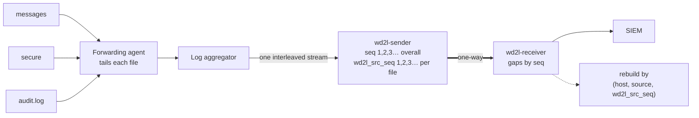

# Several live log files at once: tracking and reconstruction

In production, files like `messages`, `secure` and `audit.log` are written continuously. A log
forwarding agent (for example a Splunk Universal Forwarder) tails them and sends new lines to the
log aggregator (for example Cribl Stream) within seconds. Lines from all the files therefore arrive
at `wd2l-sender` **interleaved**, in roughly the order they were written. This page explains how
wd2l keeps track of what was sent and received, and how Enclave 2 separates the stream back into
files.



## What the sender keeps track of (Enclave 1)

| Item | What it is | Where it goes |
|---|---|---|
| `stream_id` | Random ID for this sender run | every packet |
| `seq` | 1, 2, 3… for **every** event in the run, in the order the aggregator delivered them | every packet; SIEM field `wd2l_seq` |
| `wd2l_src_seq` | 1, 2, 3… **per file** (per `host` + `source`), with `--source-seq` | SIEM indexed field |
| `boot`, `prev_stream`, `prev_last_seq` | Restart count and the previous run, with `--state` | heartbeat |
| Counters | events sent, drops, truncations, bad input, send errors, unread input at shutdown | heartbeat, every second |
| `last_seq` | Highest `seq` sent so far | heartbeat header, every second |

`seq` and `wd2l_src_seq` are assigned together under one lock, so both orders always agree.

## What the receiver keeps track of (Enclave 2)

* **Which `seq` numbers arrived**, per stream. A missing number becomes a **gap** once something
  newer shows it should exist. That's either a later event, or a heartbeat's `last_seq`, which
  catches losses at the very end of a burst.
* **Delivered means durable:** an event counts as delivered only after the SIEM accepted it or it
  is safely on disk. That status is saved in the state file, so it survives restarts.
* **Duplicates** are dropped. Events inside a reported gap are accepted later (archive replay).
* **Sender runs are linked** through `boot` / `prev_stream`, so a run that never reached Enclave 2
  at all is reported too.
* Every event keeps its original `host`, `source`, `sourcetype`, `index` and time, plus
  `wd2l_stream`, `wd2l_seq`, the send and arrival times `wd2l_tx_time` / `wd2l_rx_time`, and
  (with `--source-seq`) `wd2l_src_seq`.

## Rebuilding several files from one stream

1. **Separate:** take the events whose `host` and `source` match the file.
2. **Order:** sort them by `wd2l_src_seq`. Line *N* of the file is the event with
   `wd2l_src_seq` = *N*.
3. **Check completeness:** every number from 1 to the last one must be present. A gap in the
   stream names `seq` numbers; with `wd2l_src_seq` the rebuild names the **file and line
   numbers** instead.
4. **Join** the lines and hash the result.

Without `--source-seq` the stream still detects every loss, but it can't say which file a lost
event belonged to. `lab/rebuild_files.py` refuses to rebuild interleaved files in that case
(`NO-LINE-NUMBERS`) rather than guess.

`wd2l_src_seq` starts again at 1 when the sender restarts (new stream). To rebuild a file across
sender restarts, process each stream in turn, following the `boot` / `prev_stream` chain. The lab
tool reports `MULTIPLE-RUNS` instead of joining runs.

## Adding hosts and sources

Nothing in wd2l changes when hosts or logs are added. Going from 10 logs on 5 hosts to adding a
new host with 3 logs, or one more log on an existing host, needs no code change and no wd2l
setting:

* **Sender:** it keeps one counter per (`host`, `source`) pair and creates it the first time that
  pair appears. A new log simply starts at `wd2l_src_seq` = 1, in the same sender run.
* **Receiver:** it doesn't track sources at all. `wd2l_src_seq` goes to the SIEM like any other
  indexed field.
* **Rebuild:** files are picked by (`host`, `source`) from the data itself.

What does change is upstream, as for any new log: the forwarder on that host has to collect the
file, and the aggregator has to set `host` and `source` on its events.

Keep in mind:

* **Names must stay the same.** The counter is keyed on the exact `host` and `source` strings. If
  a host shows up as `web01` one day and `web01.example.org` the next, wd2l sees two different
  files, each counted from 1.
* **Counts are lines sent, not file line numbers.** A log added while its file already has
  content starts at 1 with the first line the forwarder sends. If the forwarder starts at the end
  of an existing file, line 1 of the rebuilt copy is that first line sent.
* **A sender restart starts every count again** (above).

`tests/test_file_roundtrip.py::test_adding_hosts_and_logs_mid_stream_needs_no_change` covers
this: 5 hosts with 2 logs each, then a new host with 3 logs and a new log on an existing host
starting mid-stream, all in one sender run. All 14 files rebuild byte for byte, and a line lost
from one of the new logs is named exactly.

## Live files: comparing a moving target

A file that is still being written keeps growing, so its hash keeps changing. At any moment, the
copy rebuilt in Enclave 2 is a **prefix** of the source: its first *N* lines. To compare, hash the
same *N* lines on the source side:

```bash
# Enclave 2: how many lines arrived, and their hash
wc -l < rebuilt/secure;  sha256sum rebuilt/secure
# Enclave 1: hash the same number of lines of the live file
head -n <N> /var/log/secure | sha256sum
```

## Interleaved simulation in the lab

```bash
sudo lab/run-lab.sh --interleave --files samples/logs/messages samples/logs/secure samples/logs/audit.log
```

`--interleave` merges the three files by each line's own timestamp: syslog time for `messages`
and `secure`, the `msg=audit(…)` time for `audit.log`. That reproduces the order they were
written in. Each file's own line order is always kept, even where its timestamps go backwards.
The sender runs with `--source-seq`.

Result: 17,624 lines from three files, with the source file changing 501 times between
consecutive events, and all three files rebuilt with matching SHA-256 hashes. With `--loss 1`
added, each damaged file is reported as `INCOMPLETE` with its missing line numbers. Those numbers
match the receiver's stream gaps exactly.

Here is a slice of what Enclave 2 received. One failed SSH login lands in all three logs within
two seconds:

```
seq   time      file       file line  text
494   00:22:38  audit.log  460        type=USER_AUTH msg=audit(1790900558.169:4704): pid=5633 …
495   00:22:39  messages   12         Oct  2 00:22:39 sample-host sshd[5633]: Failed password fo…
496   00:22:39  audit.log  461        type=USER_LOGIN msg=audit(1790900559.589:4705): pid=5633 …
497   00:22:40  messages   13         Oct  2 00:22:40 sample-host sshd[5633]: Connection closed …
498   00:22:40  messages   14         Oct  2 00:22:40 sample-host sshd[5640]: Invalid user admin…
499   00:22:40  secure     24         Oct  2 00:22:40 sample-host sshd[5640]: pam_unix(sshd:auth…
```

## What it takes in the real pipeline

The lab carries each line exactly, line ending included. In production, byte-for-byte
reconstruction also depends on how the forwarder and aggregator are set up:

* **One event per line.** The forwarder sends file data in chunks. The aggregator's event breaking
  must split on every newline and never merge lines into multi-line events (no stack-trace
  joining for these sources).
* **Line endings.** Event breaking normally removes the newline from each event. The rebuild then
  has to add `\n` back after every line. That restores LF files exactly, but not CRLF line
  endings or a final line without a newline. These are rare in Linux logs.
* **Order per file.** The aggregator must keep each file's lines in order. It does when one
  forwarder connection carries the file through one pipeline.
* **Re-sends.** After a forwarder restart, or with indexer acknowledgement turned on, a forwarder
  can re-send lines it already sent. They arrive as new events with new numbers and would appear
  twice in the rebuilt file. The rebuild can't tell a re-send from a line that genuinely repeats.
* **Log rotation.** When `secure` rotates, the new file keeps the name `secure`, so a rebuild keyed
  on `source` produces one continuous file across rotations.
* **Size and encoding.** Lines over 256 KB are truncated and flagged (`wd2l_truncated`). Bytes that
  aren't valid UTF-8 may be replaced by the aggregator before wd2l sees them.

The SIEM copy of each event is unaffected by any of this. These points only matter when you need
the original files rebuilt bit for bit.
