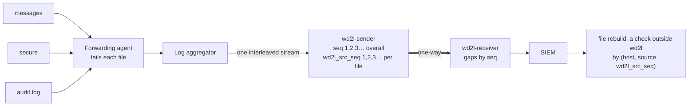

# Several live log files at once: tracking and reconstruction

In production, files like `messages`, `secure` and `audit.log` are written continuously. A
forwarding agent tails them and sends new lines to the log aggregator within seconds, so lines
from all the files reach `wd2l-sender` **interleaved**, roughly in the order they were written.
This page explains how wd2l tracks what was sent and received, and how the files can be rebuilt
from the events. The receiver itself never writes files: it sends each event to the SIEM.
Rebuilding a file is a separate check, which `lab/rebuild_files.py` runs in the lab.



## What each side tracks

| Item | What it is | Where it goes |
|---|---|---|
| `stream_id` | Random ID for this sender run | every packet |
| `seq` | 1, 2, 3… for **every** event in the run, in the aggregator's order | every packet; SIEM field `wd2l_seq` |
| `wd2l_src_seq` | 1, 2, 3… **per file** (per `host` + `source`), with `--source-seq` | SIEM indexed field |
| `boot`, `prev_stream`, `prev_last_seq` | Restart count and the previous run, with `--state` | heartbeat |

`seq` and `wd2l_src_seq` are assigned together under one lock, so both orders always agree. The
receiver tracks only `seq`: a missing number becomes a gap, a duplicate is dropped, and a replay
fills gaps ([the rules](interface-description.md#9-streams-and-sequence-numbers)). Every event
keeps its original `host`, `source`, `sourcetype`, `index` and time.

## Rebuilding several files from one stream

From the events (the SIEM's copy, or the receiver's JSONL output in the lab):

1. **Separate:** take the events whose `host` and `source` match the file.
2. **Order:** sort them by `wd2l_src_seq`. Line *N* of the file is the event with
   `wd2l_src_seq` = *N*.
3. **Check completeness:** every number from 1 to the last must be present. A stream gap names
   `seq` numbers; with `wd2l_src_seq` the rebuild names the **file and line numbers** instead.
4. **Join** the lines and hash the result.

Without `--source-seq` the stream still detects every loss but can't say which file it hit, so
`lab/rebuild_files.py` refuses to rebuild interleaved files (`NO-LINE-NUMBERS`) rather than guess.
`wd2l_src_seq` starts again at 1 when the sender restarts; to rebuild across restarts, take each
stream in turn along the `boot` / `prev_stream` chain (the lab tool reports `MULTIPLE-RUNS`
instead).

## Adding hosts and sources

Nothing in wd2l changes when hosts or logs are added. The sender creates a counter the first time
a (`host`, `source`) pair appears, starting at 1 in the same run; the receiver doesn't track
sources; a rebuild picks files from the data. Only the upstream steps change, as for any new
log: the forwarder collects the file and the aggregator sets `host` and `source`.

* **Names must stay the same:** `web01` one day and `web01.example.org` the next are two files,
  each counted from 1.
* **Counts are lines sent, not file line numbers:** if the forwarder starts at the end of an
  existing file, line 1 of the rebuilt copy is the first line it sent.

`tests/test_file_roundtrip.py::test_adding_hosts_and_logs_mid_stream_needs_no_change` covers it:
14 files on 6 hosts, two of them starting mid-stream, all rebuilt byte for byte, and a line lost
from a new log named exactly.

## Live files: comparing a moving target

A file still being written keeps growing, so at any moment the rebuilt copy is a **prefix** of the
source. Hash the same number of lines on both sides:

```bash
wc -l < rebuilt/secure;  sha256sum rebuilt/secure          # Enclave 2: N lines, and their hash
head -n <N> /var/log/secure | sha256sum                     # Enclave 1: the same N lines
```

In the lab, `--interleave` merges the sample files by each line's own timestamp
([running-the-lab.md](running-the-lab.md#8-run-real-log-files-through-and-verify-byte-for-byte)):
17,624 lines, the source file changing 501 times between consecutive events, all three rebuilt
with matching hashes; with `--loss 1`, each damaged file lists exactly the missing line numbers
the receiver's gaps imply.

## What it takes in the real pipeline

The lab carries each line exactly. In production, rebuilding a file byte for byte from the SIEM's
events also depends on the forwarder and aggregator:

* **One event per line.** Event breaking must split on every newline and never merge lines (no
  stack-trace joining for these sources).
* **Line endings.** Event breaking normally removes the newline, so a rebuild adds `\n` after
  every line. That restores LF files exactly, but not CRLF endings or a missing final newline,
  both rare in Linux logs.
* **Order per file.** The aggregator must keep each file's lines in order, as it does when one
  forwarder connection carries the file through one pipeline.
* **Re-sends.** After a forwarder restart, or with indexer acknowledgement on, a forwarder can
  re-send lines. They arrive under new numbers and appear twice in the rebuild, which can't tell
  them from lines that genuinely repeat.
* **Log rotation.** The new `secure` keeps its name, so a rebuild keyed on `source` gives one
  continuous file across rotations.
* **Size and encoding.** Lines over 256 KB are truncated and flagged (`wd2l_truncated`); the
  aggregator may replace bytes that aren't valid UTF-8 before wd2l sees them.

None of this affects the SIEM copy of each event; it matters only when you need the original files
rebuilt bit for bit.
