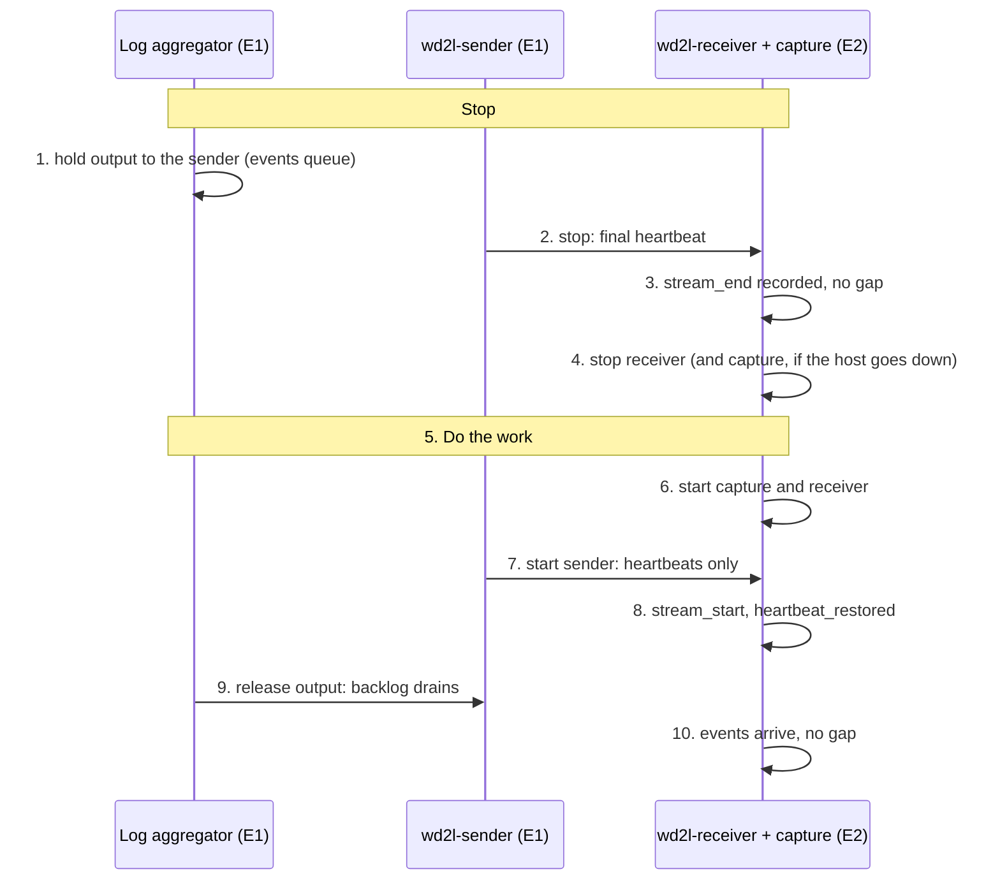

# Planned downtime: stopping and starting wd2l cleanly

For patching, reboots, hardware or link work: anything where you know in advance that the sender,
the receiver or the link will be down. Done in this order, nothing is lost, nothing needs
replaying, and Enclave 2 sees two linked sender runs with no gap. Package upgrades (`dnf upgrade`)
don't restart wd2l: stop and start each side here afterwards.

## The rule

**Stop from the source end. Start from the far end.**

* **Stopping:** hold the log aggregator, then stop the sender, then the receiver.
* **Starting:** start the capture and the receiver, then the sender, then release the aggregator.

The aggregator's persistent queue holds events while anything downstream is down. Two things lose
events, and the order avoids both: the sender stopping while the aggregator still writes to it
(input already acknowledged but unread is lost, and counted as `shutdown_unread_bytes`), and the
sender sending while Enclave 2 isn't capturing (nothing can ask for those packets again).



The lab runs this order end to end (`sudo lab/run-lab.sh --maintenance`, also in CI): two linked
sender runs, 0 bytes unread, 0 gaps, no replay, every event byte for byte.

## Before you start

* **Agree the window with the other enclave's team**, by phone or ticket: Enclave 2 can't send
  anything to Enclave 1, so several steps below are "tell the other side".
* **Mute three alerts for the window:** "WD2L - Heartbeat stale", "WD2L - Receiver silent" and
  "WD2L - Fault segment". While the sender is stopped cleanly the dashboard shows amber,
  `e1-sender`, rule 2 ([state-of-health.md](state-of-health.md#reading-it)). In Splunk: Settings →
  Searches, reports, and alerts → disable, and enable afterwards. Or over REST, once per alert
  (`disabled=0` afterwards):
  ```bash
  curl -k -u admin https://<splunk>:8089/servicesNS/nobody/<app>/saved/searches/WD2L%20-%20Heartbeat%20stale -d disabled=1
  ```
* **Check the aggregator's queue is big enough** for the window: at 1,000 events/s and about 1 KB
  each, about 3.6 GB an hour. wd2l itself has no time limit.
* **Leave the state files alone:** `/var/lib/wd2l/sender.json` (log server) and
  `/var/lib/wd2l/state.json` (receiver). They link the two runs and record what was delivered.
  If the work could wipe `/var/lib`, back them up first.

## Full procedure (both sides, or link work)

The commands are the same on RHEL and Ubuntu, and for the container units
([containers.md](deployment/containers.md)): `systemctl stop` stops a container cleanly. The NIC
names are the defaults (`ens224` on the log server, `ens256` on the receiver).

### Stop

**1. Enclave 1: hold the aggregator's output to the sender**, keeping the events:

* If the log server itself is being patched, stop the aggregator service. Forwarding agents
  buffer meanwhile; plain UDP syslog sources (firewalls, switches) usually don't, as in any
  aggregator outage.
* Otherwise pause or disable its output to the sender, so events wait in its persistent queue.
  Check in its documentation that this **queues** rather than drops, and try it once when quiet.
  rsyslog: `sudo systemctl stop rsyslog` (its disk queue and its journal position are kept).

Then check the sender's input is quiet:

```bash
ss -tn state established '( sport = :10070 )'   # Recv-Q 0, or no line
sudo tcpdump -i ens224 -nn -c 5                 # about two packets a second: one heartbeat per stream
```

**2. Enclave 1: stop the sender**, and read its final counters:

```bash
sudo systemctl stop wd2l-sender
journalctl -u wd2l-sender -n 50 -o cat | grep -o 'final: last_seq=[0-9]*'
journalctl -u wd2l-sender -n 50 -o cat | grep -o 'shutdown_unread_bytes[^,]*'   # must end in 0
```

Note `last_seq` and tell Enclave 2. If `shutdown_unread_bytes` isn't 0, input was still arriving:
see [If something went wrong](#if-something-went-wrong). If the log server will **reboot while
Enclave 2 is still down**, also `sudo systemctl disable wd2l-sender`, so it doesn't start at boot
and send while nothing captures.

**3. Enclave 2: confirm the clean end.** In the SIEM:

```
index=wd2l sourcetype=wd2l:health earliest=-15m type IN (stream_end, gap)
| table _time type stream last_seq first_seq count reason sender.shutdown_unread_bytes
```

One `stream_end` with the `last_seq` from step 2, and no `gap`.

**4. Enclave 2: stop the receiver**, and the capture if the host is going down:

```bash
sudo systemctl stop wd2l-receiver      # final health record, up to 15 s for the SIEM, state saved
sudo systemctl stop wd2l-capture       # only if the host goes down
```

Events the SIEM didn't take in those 15 s wait in the spool and go at the next start.

**5. Do the work:** patch, reboot, replace the optic, and so on.

### Start

**6. Enclave 2 first: the capture and the receiver.** After a reboot they start on their own.
Otherwise:

```bash
sudo systemctl start wd2l-capture wd2l-receiver     # wd2l-capture-nic starts with them
ip -d link show ens256                  # UP, PROMISC, NOARP, no address
sudo nft list table netdev wd2l_notx    # the capture NIC's egress drop (kernel 5.16+)
ls -lt /var/lib/wd2l/pcap | head -3     # a new capture file
journalctl -u wd2l-receiver -b --no-pager | tail -5
```

The log shows `loaded state for … streams` and `capturing on ens256`, and must **not** warn that
events "were handed to the output but not confirmed before the last stop" (an unclean stop: see
below). A `heartbeat_stale` record is expected: the sender is still stopped. If the log server
rebooted, an aggregator that starts at boot is no longer held: hold it again before step 7. Tell
Enclave 1 the receiver is up.

**7. Enclave 1: check the egress NIC, then start the sender:**

```bash
systemctl is-active wd2l-egress-nic
ip neigh show dev ens224                # 10.255.255.2 lladdr 02:00:00:00:00:02 PERMANENT
sudo nft list table inet wd2l | head    # the egress firewall is loaded
sudo systemctl enable --now wd2l-sender
journalctl -u wd2l-sender -n 5 --no-pager
```

The log shows `boot <B> after stream <old id> (last seq <N>)`: the new run names the old one.
Only heartbeats flow so far.

**8. Enclave 2: confirm heartbeats arrive:** a `stream_start` for the new run, then
`heartbeat_restored`. Tell Enclave 1.

**9. Enclave 1: release the aggregator's output.** The queue drains through the sender; every
minute `journalctl -u wd2l-sender` shows `last_seq` climbing.

**10. Enclave 2: check, then unmute the alerts.**

```
index=wd2l sourcetype=wd2l:health earliest=-1h type!=health
| table _time type stream last_seq first_seq count reason
index=enclave1 earliest=-15m | stats count by host
```

Expected: `stream_end` (old run), `stream_start` (new run), `heartbeat_stale`,
`heartbeat_restored`. **Not expected:** `gap`, `stream_lost`, `stream_missing`,
`sender_boot_reset`. Queued events keep their original `_time`, so the Enclave 1 delay is high
for the backlog and then falls back ([measuring delays](operations.md#measuring-delays)).

For auditors (the `wd2l_auditor` role is needed):

```
index=wd2l_audit earliest=-2h event IN (stop, start, state_loaded, config_changed) | table _time host component event actor
```

Expect a `stop` and a `start` on each side you restarted, and `state_loaded`. A `state_reset` is
expected only on the first start after install; otherwise the state file was lost. A
`config_changed` only if you changed something.

## Shorter variants

| Work | Steps | Notes |
|---|---|---|
| **Log server only** (patch or reboot in Enclave 1) | 1, 2, 3, work, 7, 8, 9, 10 | The receiver keeps running; `heartbeat_stale` while the sender is down is expected |
| **Receiver host only** (patch or reboot in Enclave 2) | All of them | Enclave 1 still holds and stops the sender (1–2) and starts it afterwards (7–9), because the capture is down too. Without Enclave 1, see the next row |
| **Receiver host, without Enclave 1** | 4, work, 6 | Everything sent while the capture is down is lost to Enclave 2. A `gap` with `reason=not_received` names the range: ask Enclave 1 to [re-send](operations.md#re-sending-from-enclave-1) it |
| **Receiver process only** (configuration change, wd2l update; the host stays up) | `sudo systemctl restart wd2l-receiver` | The capture and the sender keep running. The restart shows as a gap; [replay](operations.md#replay-from-the-capture-archive) fills it |
| **Link work** (tap, fiber, black-hole port, optics) | 1, 2, work, 7, 8, 9, 10 | The receiver can stay up. Step 8 is the link test. Also check `other_packets` stays 0 and `sudo tcpdump -i ens256 -nn -c 5` shows only `10.255.255.1.5514 > 10.255.255.2.5514` |
| **SIEM down** | None | The receiver spools up to 10 GB and sends it when the SIEM is back. Watch `hec_spool_files` return to 0 |
| **Updating wd2l** | As for the host being updated | Both sides speak wire version 1, so either can be updated alone. If a release ever changes the wire version, update the receiver first |

## If something went wrong

| You see | It means | Do |
|---|---|---|
| `shutdown_unread_bytes` > 0 (the sender's last line, or `sender.shutdown_unread_bytes` in `stream_end`) | The aggregator was still writing when the sender stopped. That input was acknowledged but never sent, and no gap points to it | Re-send the window around the stop from the log retention server |
| `gap`, `reason=not_received` | Events were sent while Enclave 2 wasn't capturing, or the link was down | [Re-send](operations.md#re-sending-from-enclave-1) that window from Enclave 1 |
| `gap`, `reason=receiver_restart`; `uncommitted_at_start` > 0; or the "not confirmed" warning | The receiver didn't stop cleanly (killed, power loss, or the stop timed out) | [Replay](operations.md#replay-from-the-capture-archive) the capture archive |
| `stream_lost` instead of `stream_end` | The sender didn't stop cleanly | Check for `gap` records and re-send any from Enclave 1 |
| `stream_missing` | A sender run started and ended while Enclave 2 wasn't capturing (e.g. the log server rebooted with the sender enabled while the receiver was down) | Re-send that window from Enclave 1 |
| `sender_boot_reset` | The sender's state file was lost or replaced | Nothing lost by itself. Find out why `/var/lib/wd2l/sender.json` didn't survive, and protect it |
