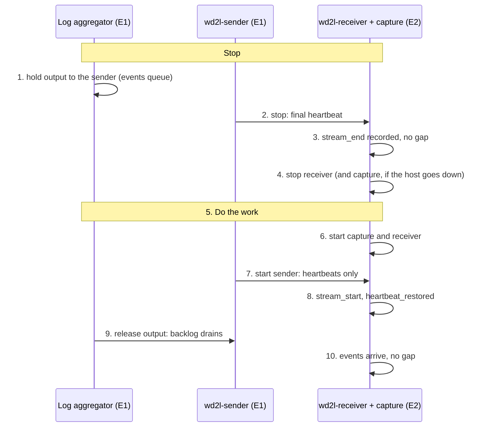

# Planned downtime: stopping and starting wd2l cleanly

Use this for patching, reboots, hardware or link work: anything where you know in advance that
the sender, the receiver or the link will be down. Done in this order, nothing is lost, nothing
needs replaying, and Enclave 2 sees two linked sender runs with no gap.

## The rule

**Stop from the source end. Start from the far end.**

* **Stopping:** hold the log aggregator, then stop the sender, then the receiver.
* **Starting:** start the capture and the receiver, then the sender, then release the aggregator.

The log aggregator's persistent queue holds events while anything downstream is down. Two things
lose events, and the order avoids both:

* **The sender stopping while the aggregator is still writing to it.** The sender reads what is
  already arriving for up to 2 s, then stops. Input still unread then was already acknowledged
  to the aggregator, so it is lost. The sender reports it as `shutdown_unread_bytes`.
* **The sender sending while Enclave 2 isn't capturing.** Packets sent while the receiver host
  is down never land anywhere. The link is one way, so they can't be asked for again.



The lab runs this order end to end (`sudo lab/run-lab.sh --maintenance`, also in CI). Half the
events are sent, then everything is stopped, including the capture, and started again. The rest
of the events are then sent. Result: two linked sender runs, 0 bytes unread, 0 gaps, no replay,
and every event byte for byte.

## Before you start

* **Agree the window with the other enclave's team**, by phone or ticket. Enclave 2 can't send
  anything to Enclave 1, so the people have to coordinate. Several steps below are "tell the
  other side".
* **Mute three SIEM alerts for the window:** "WD2L - Heartbeat stale" (fires while the sender is
  stopped), "WD2L - Receiver silent" (fires if the receiver is down for more than 15 minutes)
  and "WD2L - Fault segment" (fires on any fault status that isn't `ok`). While the sender is
  stopped cleanly, the dashboard shows amber, `e1-sender`, rule 2, not red
  ([state-of-health.md](state-of-health.md#planned-downtime-sender-stopped-cleanly-rule-2)).
  In Splunk: Settings → Searches, reports, and alerts → disable, then re-enable afterwards.
* **Check the aggregator's queue is big enough** for the window. At 1,000 events/s and about
  1 KB each, that's about 3.6 GB per hour. wd2l itself has no time limit on the window.
* **Leave the state files alone:** `/var/lib/wd2l/sender.json` (log server) and
  `/var/lib/wd2l/state.json` (receiver). They are how the two runs get linked and how the
  receiver knows what it already delivered. If patching or rebuilding would wipe `/var/lib`, back
  them up first.

## Full procedure (both sides, or link work)

Commands are for RHEL; they're the same on Ubuntu. Interface names are the defaults (`ens224`
on the log server, `ens256` on the receiver). With the container units
([containers.md](deployment/containers.md)) the commands are the same: `systemctl stop wd2l-sender`
stops the container cleanly (it waits `StopTimeout`).

### Stop

**1. Enclave 1: hold the log aggregator's output to the sender.** The aggregator must stop
writing to `127.0.0.1:10070` while keeping the events:

* If the log server itself is being patched, stop the aggregator service. Hosts' forwarding
  agents buffer while it is down. Plain UDP syslog sources (firewalls, switches) usually don't,
  so their messages from that time are lost. That's true of any aggregator outage, not just wd2l.
* Otherwise, pause or disable the aggregator's output to the sender so that events wait in its
  persistent queue. How depends on the product. Check in its documentation that this **queues**
  events rather than dropping them, and try it once in a quiet period.

Then check that the sender's input is quiet:

```bash
ss -tn state established '( sport = :10070 )'   # Recv-Q 0 on the 127.0.0.1:10070 line, or no line
sudo tcpdump -i ens224 -nn -c 5                 # only ~1 packet per second: heartbeats
```

**2. Enclave 1: stop the sender.**

```bash
sudo systemctl stop wd2l-sender
journalctl -u wd2l-sender -n 50 --no-pager
```

The sender's last line (systemd may log a few lines of its own about the unit after it) reads
`final: last_seq=<N> {… "shutdown_unread_bytes": 0 …}`. With
`--log-format json` the line is a JSON object, and this shows the message from `final:` on:

```bash
journalctl -u wd2l-sender -n 50 -o cat | grep -o 'final: last_seq=.*'
```

In JSON logs the quotes inside the counters appear escaped, so look for
`\"shutdown_unread_bytes\": 0`.

Note `<N>` and tell Enclave 2. If `shutdown_unread_bytes` isn't 0, input was still arriving: see
[If something went wrong](#if-something-went-wrong).

If the log server will **reboot while Enclave 2 is still down**, also keep the sender from
starting at boot. Otherwise it comes back, the aggregator reconnects to it, and events go out
while nothing is capturing:

```bash
sudo systemctl disable wd2l-sender
```

**3. Enclave 2: confirm the clean end.** In the SIEM:

```
index=wd2l sourcetype=wd2l:health earliest=-15m type IN (stream_end, gap)
| table _time type stream last_seq first_seq count reason sender.shutdown_unread_bytes
```

You should see one `stream_end` with `last_seq` = `<N>`, and no `gap`.

**4. Enclave 2: stop the receiver**, and the capture if the receiver host is going down:

```bash
sudo systemctl stop wd2l-receiver      # final health record, up to 15 s to deliver to the SIEM, state saved
sudo systemctl stop wd2l-capture       # only if the host goes down (a reboot stops it anyway)
journalctl -u wd2l-receiver -n 5 --no-pager
```

Events the SIEM didn't take within those 15 s go to the spool (`/var/lib/wd2l/spool`) and are
sent at the next start. Nothing is lost.

**5. Do the work:** patch, reboot, replace the optic, and so on.

### Start

**6. Enclave 2 first: capture and receiver.** After a reboot they start on their own (the units
are enabled). Otherwise:

```bash
sudo systemctl start wd2l-capture wd2l-receiver     # wd2l-capture-nic starts with them
systemctl is-active wd2l-capture-nic wd2l-capture wd2l-receiver
ip -d link show ens256                  # UP, PROMISC, NOARP, no inet address
sudo nft list table netdev wd2l_notx    # egress drop on the capture NIC (kernel 5.16+)
ls -lt /var/lib/wd2l/pcap | head -3     # a new capture file
journalctl -u wd2l-receiver -b --no-pager | tail -5
```

The receiver's log shows `loaded state for … streams` and `capturing on ens256`. It must **not**
warn that events "were handed to the output but not confirmed before the last stop". That
warning means the last stop wasn't clean (see below). A `heartbeat_stale` record is expected
now, because the sender is still stopped. Tell Enclave 1 the receiver is up.

**7. Enclave 1: check the egress NIC, then start the sender.**

```bash
systemctl is-active wd2l-egress-nic
ip neigh show dev ens224                # 10.255.255.2 lladdr 02:00:00:00:00:02 PERMANENT
sudo nft list table inet wd2l | head    # the egress firewall is loaded
sudo systemctl enable --now wd2l-sender # enable again if step 2 disabled it
journalctl -u wd2l-sender -n 5 --no-pager
```

The log shows `boot <B> after stream <old id> (last seq <N>)`: the new run names the old one,
which is how Enclave 2 knows nothing went missing in between. Only heartbeats flow so far,
because the aggregator is still held.

**8. Enclave 2: confirm heartbeats arrive.** A `stream_start` record for the new run, then
`heartbeat_restored`. Tell Enclave 1.

**9. Enclave 1: release the aggregator's output.** Start the aggregator, or resume its output to
the sender. The queued events drain through the sender. Every minute
`journalctl -u wd2l-sender` shows `last_seq` climbing.

**10. Enclave 2: check, then unmute the alerts.**

```
index=wd2l sourcetype=wd2l:health earliest=-1h type!=health
| table _time type stream last_seq first_seq count reason
index=enclave1 earliest=-15m | stats count by host
```

Expected: `stream_end` (old run), `stream_start` (new run), `heartbeat_stale` and
`heartbeat_restored`. **Not expected:** `gap`, `stream_lost`, `stream_missing` or
`sender_boot_reset`.

Events from the queue carry their original `_time`, so `wd2l_tx_time − _time` (the Enclave 1
delay, see [operations.md](operations.md#measuring-delays)) is high for the backlog and falls back
to normal once it has drained.

For auditors, check that the restart is on record (the `wd2l_auditor` role is needed):

```
index=wd2l_audit earliest=-2h event IN (stop, start, state_loaded, config_changed) | table _time host component event actor
```

Expect a `stop` and a `start` on each side you restarted, and `state_loaded`, not `state_reset`
(a reset means the state file was lost). A `config_changed` is expected only if you changed
something. Re-enable the three alerts.

## Shorter variants

| Work | Steps | Notes |
|---|---|---|
| **Log server only** (patch or reboot in Enclave 1) | 1, 2, 3, work, 7, 8, 9, 10 | The receiver keeps running. `heartbeat_stale` while the sender is down is expected |
| **Receiver host only** (patch or reboot in Enclave 2) | All of them | Enclave 1 still has to hold and stop the sender (steps 1–2) and start it afterwards (7–9), because the capture is down too. If Enclave 1 can't take part, see the next row |
| **Receiver host, without Enclave 1** | 4, work, 6 | Everything sent while the capture is down is lost to Enclave 2. After the restart a `gap` with `reason=not_received` names the exact range. Ask Enclave 1 to re-send that time window ([operations.md](operations.md#re-sending-from-enclave-1)) |
| **Receiver process only** (configuration change, wd2l update; the host stays up) | `sudo systemctl restart wd2l-receiver` | The capture and the sender keep running. The restart window shows up as a gap; fill it from the archive ([operations.md](operations.md#replay-from-the-capture-archive)). Nothing is lost |
| **Link work** (tap, fiber, black-hole switch port, optics) | 1, 2, work, 7, 8, 9, 10 | The receiver can stay up. Step 8 is the link test: heartbeats must arrive before the aggregator is released. Also check `other_packets` stays 0 and `sudo tcpdump -i ens256 -nn -c 5` on the receiver shows only `10.255.255.1.5514 > 10.255.255.2.5514` |
| **SIEM down** | None | Nothing to stop. The receiver spools up to 10 GB and sends it when the SIEM is back. Watch `hec_spool_files` go back to 0 |
| **Updating wd2l** | As for the host being updated | Both sides speak wire version 1, so either can be updated alone. If a release ever changes the wire version, update the receiver first. For the fixed source port, see [deployment/log-server.md](deployment/log-server.md#4-sender-service) |

## If something went wrong

| You see | It means | Do |
|---|---|---|
| `shutdown_unread_bytes` > 0 (sender's last log line, or `sender.shutdown_unread_bytes` in `stream_end`) | The aggregator was still writing when the sender stopped. That input was acknowledged but never sent, and no gap record points to it | Re-send the time window around the stop from the log retention server |
| `gap`, `reason=not_received` | Events were sent while Enclave 2 wasn't capturing, or the link was down | Re-send that window from Enclave 1 ([operations.md](operations.md#re-sending-from-enclave-1)) |
| `gap`, `reason=receiver_restart`; `uncommitted_at_start` > 0; or the "not confirmed" warning at receiver start | The receiver didn't stop cleanly (killed, power loss, or the stop timed out) | Replay the capture archive ([operations.md](operations.md#replay-from-the-capture-archive)) |
| `stream_lost` instead of `stream_end` | The sender didn't stop cleanly (killed, crashed, power loss) | Check for `gap` records and re-send any from Enclave 1 |
| `stream_missing` | A sender run started and ended while Enclave 2 wasn't capturing, e.g. the log server rebooted with the sender enabled while the receiver was down | Re-send that window from Enclave 1 |
| `sender_boot_reset` | The sender's state file was lost or replaced | Nothing lost by itself. Find out why `/var/lib/wd2l/sender.json` didn't survive and protect it |
