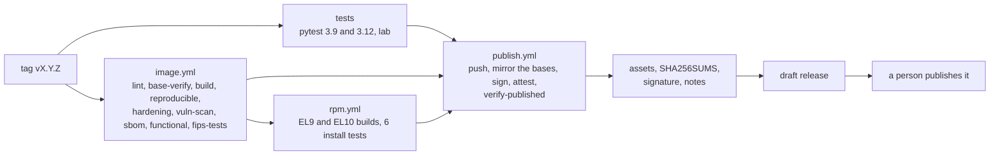

# Releasing wd2l

A release is RPMs for RHEL 9 and RHEL 10, the wheel and sdist, and a signed container image on
the FIPS variant of Red Hat Hardened Images. Every file can be checked offline, inside an
enclave. Why it is built this way: [ADR-0004](decisions/0004-container-base-image.md) (the base
image), [ADR-0005](decisions/0005-quadlet.md) (running it under systemd) and
[ADR-0006](decisions/0006-release-artifacts-and-signing.md) (the artifacts and how they are
signed).

## How a release is built

A version tag starts [`release.yml`](../.github/workflows/release.yml). It runs every check
again from the tag, publishes, and stops at a **draft** release. A person reviews the draft and
publishes it.



One wheel, built once, is in every package (`wd2l/BUILD` names the commit). What each job
proves:

* **tests** ([`tests.yml`](../.github/workflows/tests.yml)): the unit tests pass on Python 3.9
  and 3.12, and the namespace lab passes ([running-the-lab.md](running-the-lab.md)).
* **lint**: hadolint and Trivy accept the Containerfile, and every `FROM` is a Hardened Image,
  a FIPS variant, pinned by digest
  ([`check_containerfile.py`](../packaging/container/check_containerfile.py)).
* **base-verify**: each base image carries Red Hat's signature, SLSA provenance from Red Hat's
  build pipeline, and an SBOM, all for the pinned digest. The result is
  `base-image-record.json` ([`base_record.py`](../packaging/container/base_record.py), keys in
  [`packaging/container/keys/`](../packaging/container/keys/README.md)).
* **build**: the wheel and the image ([`build.sh`](../packaging/container/build.sh)).
* **reproducible**: a second build from the same inputs gives the same wheel and the same image
  ID.
* **hardening**: the image runs as 65532, has no shell, no package manager (pip included), no
  setuid file, the FIPS crypto policy, the base's RPM database byte for byte, and wd2l's files
  exactly as in the wheel ([`check_image.py`](../packaging/container/check_image.py)).
* **vuln-scan**: Grype and Trivy find no fixable High or Critical vulnerability and no secret,
  apart from approved exceptions ([`vuln_gate.py`](../packaging/container/vuln_gate.py)).
* **sbom**: the image's SBOM is the base's, plus wd2l, less pip
  ([`sbom_diff.py`](../packaging/container/sbom_diff.py)).
* **functional**: the lab passes with the sender and receiver running from the image.
* **fips-tests**: the whole test suite passes in the FIPS builder image.
* **rpm** ([`rpm.yml`](../.github/workflows/rpm.yml)): the RPMs build on UBI 9 and UBI 10
  ([`build-rpms.sh`](../packaging/rpm/build-rpms.sh)), and install cleanly on a fresh system,
  over a manual install, and as an upgrade ([`install-test.sh`](../packaging/rpm/install-test.sh)).
* **publish** ([`publish.yml`](../.github/workflows/publish.yml), tags only): pushes the image by
  digest; copies its base images, with their signatures, SBOMs, provenance and sources, to
  `ghcr.io/joehazurmoney/wd2l-base/python`; signs the image; attaches the SBOM, our SLSA
  provenance ([`provenance.py`](../packaging/release/provenance.py)), the scan results and the
  base record; and saves it all as `wd2l-<version>-image-oci.tar`.
* **verify-published**: checks the pushed image and the saved copy as a consumer would, the
  second time with no network.
* **release**: `SHA256SUMS` over every asset, signed with our key; the notes
  ([`notes.py`](../packaging/release/notes.py)); the draft release.

**Dry runs.** `release.yml` also runs from `workflow_dispatch` (once it is on `main`) and from
a branch push that changes it. A dry run builds and checks everything, but pushes, signs and
releases nothing. The assets and notes are in the run's `release-assets` artifact.

## Cutting a release

1. Set `__version__` in `wd2l/__init__.py`, and the `Image=` tag in both `.container` files
   (`tests/test_deploy.py` keeps them equal).
2. Merge to `main` through a PR, with CI green.
3. Tag `main` and push the tag:

   ```bash
   git tag -a vX.Y.Z -m "wd2l X.Y.Z"
   git push origin vX.Y.Z
   ```

4. Watch `release.yml`.
5. Review the draft release:
   * the assets list, and the notes;
   * the `vuln-scan` gate summary, the `hardening` result and the `reproducible` result in the
     run.
6. Edit the notes if needed (a short "What changed" section on top), then publish.

Pre-releases are `X.Y.ZrcN` (tag `vX.Y.ZrcN`). Their RPMs sort before the release
(`X.Y.Z~rcN`).

## One-time setup

* **The signing key.** The security owner makes it on a trusted machine. The private key never
  leaves that machine except into the repository's secrets
  ([ADR-0006, key management](decisions/0006-release-artifacts-and-signing.md#key-management)):

  ```bash
  podman run --rm -it --userns=keep-id -v "$PWD:/work" -w /work registry.access.redhat.com/hi/cosign:latest generate-key-pair
  gh secret set COSIGN_PRIVATE_KEY < cosign.key
  gh secret set COSIGN_PASSWORD           # paste the password
  ```

  Keep `cosign.key` offline, or destroy it: the secret is then the only copy. Commit
  `cosign.pub`.
* **Immutable releases.** Turn them on if the repository's settings offer it.
* **Packages.** `wd2l` and `wd2l-base` live in the repository's packages, and are private while
  the repository is. Enclaves use the release assets, not the registry.

## Bringing a release into an enclave

**What to carry in:**

* the release's assets;
* `cosign.pub`, from a trusted channel (the repository at the release tag, or the security
  owner), not only the copy attached to the release;
* cosign itself: `registry.access.redhat.com/hi/cosign` saved with `podman save`, or the binary
  from your approved software source.

**The commands:**

```bash
cosign verify-blob --key cosign.pub --insecure-ignore-tlog --bundle SHA256SUMS.sigstore.json SHA256SUMS
sha256sum -c SHA256SUMS
tar -xf wd2l-<version>-image-oci.tar
cosign verify --key cosign.pub --insecure-ignore-tlog --local-image wd2l-oci
cosign verify-attestation --key cosign.pub --insecure-ignore-tlog --type slsaprovenance1 --local-image wd2l-oci | jq -r .payload | base64 -d | jq .predicate.buildDefinition.resolvedDependencies
sudo skopeo copy oci:wd2l-oci containers-storage:ghcr.io/joehazurmoney/wd2l:<version>
sudo dnf install ./wd2l-<version>-1.el10.noarch.rpm ./wd2l-receiver-<version>-1.el10.noarch.rpm
```

**What they prove:**

* `verify-blob` and `sha256sum -c`: every file is the one the workflow built and signed.
* `verify`: the image is signed with our key.
* `verify-attestation`: the provenance names the commit and the exact Red Hat base images.

`--insecure-ignore-tlog` is expected: while the repository is private, nothing goes to a public
transparency log, so there is no log entry to check.

The RPMs aren't GPG-signed. `SHA256SUMS`, signed, covers them
([ADR-0006](decisions/0006-release-artifacts-and-signing.md)).

Then install as the deployment guides say: [log server](deployment/log-server.md),
[receiver](deployment/receiver.md), or [containers](deployment/containers.md).

## After a release

* **Weekly rescan.** [`image-rescan.yml`](../.github/workflows/image-rescan.yml) rescans every
  released image with fresh vulnerability data, and opens an issue for a new fixable High or
  Critical. Then rebuild on a newer base, as a patch release.
* **Dependabot** PRs move the base, tool and action pins. Merge them when the pipeline is green.
* **Vulnerability exceptions** are in
  [`packaging/container/vuln-exceptions.json`](../packaging/container/vuln-exceptions.json).
  Only the security owner approves one, and its `expires` is at most 90 days out. The gate fails
  on an expired exception, used or not.

## Keys

Rotation, and what to do if the key is compromised:
[ADR-0006, key management](decisions/0006-release-artifacts-and-signing.md#key-management).
