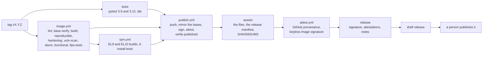

# Releasing wd2l

A release is RPMs for RHEL 9 and RHEL 10, the wheel and sdist, and a signed container image on
the FIPS variant of Red Hat Hardened Images. Every file can be checked offline, inside an
enclave. Why it is built this way: [ADR-0004](decisions/0004-container-base-image.md) (the base
image), [ADR-0005](decisions/0005-quadlet.md) (running it under systemd) and
[ADR-0006](decisions/0006-release-artifacts-and-signing.md) (the artifacts and how they are
signed), and [ADR-0008](decisions/0008-release-manifest.md) (the release manifest).

## How a release is built

A version tag starts [`release.yml`](../.github/workflows/release.yml). It runs every check
again from the tag, publishes, and stops at a **draft** release. A person reviews the draft and
publishes it.



One wheel, built once, is in every package (`wd2l/BUILD` names the commit). The image is built
for linux/amd64 and linux/arm64, each natively on its own GitHub-hosted runner, and every image
check below runs for both. What each job
proves:

* **tests** ([`tests.yml`](../.github/workflows/tests.yml)): the unit tests pass on Python 3.9
  and 3.12, and the namespace lab passes ([running-the-lab.md](running-the-lab.md)).
* **lint**: hadolint and Trivy accept the Containerfile, and every `FROM` is a Hardened Image,
  a FIPS variant, pinned by digest
  ([`check_containerfile.py`](../packaging/container/check_containerfile.py)).
* **base-verify**: each base image carries Red Hat's signature, SLSA provenance from Red Hat's
  build pipeline, and an SBOM for each platform, all for the pinned digest. The result is
  `base-image-record.json` ([`base_record.py`](../packaging/container/base_record.py), keys in
  [`packaging/container/keys/`](../packaging/container/keys/README.md)).
* **build**: the wheel and the image ([`build.sh`](../packaging/container/build.sh)).
* **reproducible**: a second build from the same inputs gives the same wheel and the same image
  ID.
* **hardening**: the image runs as 65532, has no shell, no package manager (pip included), no
  setuid file, the FIPS crypto policy, the base's RPM database byte for byte, and wd2l's files
  exactly as in the wheel ([`check_image.py`](../packaging/container/check_image.py)).
* **vuln-scan**: Grype and Trivy find no fixable High or Critical vulnerability and no secret,
  apart from approved exceptions ([`vuln_gate.py`](../packaging/container/vuln_gate.py)).
* **sbom**: the image's SBOM is the base's, plus wd2l, less pip
  ([`sbom_diff.py`](../packaging/container/sbom_diff.py)).
* **functional**: the lab passes with the sender and receiver running from the image.
* **fips-tests**: the whole test suite passes in the FIPS builder image.
* **rpm** ([`rpm.yml`](../.github/workflows/rpm.yml)): the RPMs build on UBI 9 and UBI 10
  ([`build-rpms.sh`](../packaging/rpm/build-rpms.sh)), and install cleanly on a fresh system,
  over a manual install, and as an upgrade ([`install-test.sh`](../packaging/rpm/install-test.sh)).
* **publish** ([`publish.yml`](../.github/workflows/publish.yml), tags only): pushes one image
  index for both platforms, and checks it holds exactly the two images that were tested
  ([`image_index.py`](../packaging/release/image_index.py)); copies the base images, with their
  signatures, SBOMs, provenance and sources, to `ghcr.io/joehazurmoney/wd2l-base/python`; signs
  the index and each platform image, each platform image also in cosign's older `.sig` format,
  which Podman's signature policy reads; attaches our SLSA provenance
  ([`provenance.py`](../packaging/release/provenance.py)) and the base record to all three, and
  each platform's SBOM and scan results to its own image; and saves each platform's image, with
  its signatures and attestations, as `wd2l-<version>-image-<arch>-oci.tar`.
* **verify-published**: checks the pushed images (each platform image's older `.sig` too) and the
  saved copies as a consumer would, the second time with no network.
* **import-check**: on each platform's own runner, imports that platform's tar offline and
  pulls the image from the registry under Podman's signature policy.
* **assets**: every release file; the changelog (git-cliff, [`cliff.toml`](../cliff.toml)), a
  full-history `git bundle` of the source, and `verify-release`
  ([`verify_release.py`](../packaging/release/verify_release.py)); then the **release manifest**
  ([`manifest.py`](../packaging/release/manifest.py),
  [ADR-0008](decisions/0008-release-manifest.md)), then `SHA256SUMS` over them all, made once for
  the two jobs below.
  * **What the manifest lists:**
    * the commit;
    * every pull request since the previous final release, and the issues it resolves;
    * known open bugs;
    * every file with its SHA-256;
    * the image and its bases;
    * the pinned actions and tool images;
    * the approvals so far.
  * **How it's checked:** against [its schema](../packaging/release/release-manifest.schema.json),
    and an invalid one fails the run. `wd2l-<version>-release-manifest.json` is the
    authoritative copy; `.md` is the readable view (the customer's version description), shown
    in the run's summary for whoever approves the `release` gate.
  * **Permissions:** the job has no secrets, and only reads git and the forge's API.
  * **A self-check:** last, the job runs the `verify-release` it ships against its own files,
    the way a customer would. The signature check is skipped there, because signing comes
    later.
* **attest** ([`attest.yml`](../.github/workflows/attest.yml), tags only): GitHub build
  provenance (SLSA Build Level 3) for every file, the image index and each platform image, and
  keyless signatures on all three. It is the only workflow that gets an OIDC token, so the build steps can't reach
  what signs the provenance ([ADR-0007](decisions/0007-slsa-build-l3.md)).
* **release**: `SHA256SUMS` signed with our key; the notes
  ([`notes.py`](../packaging/release/notes.py)), generated in full: the summary and the issues
  resolved from the manifest, then how to install and verify; the draft release, with
  `wd2l-<version>-attestations.jsonl`, the GitHub attestations for offline checks.

**Dry runs.** `release.yml` also runs from `workflow_dispatch` (once it is on `main`) and from
a branch push that changes it. A dry run builds and checks everything, but pushes, signs,
attests and releases nothing. The assets and notes are in the run's `release-assets` artifact.

**When CI runs.** `tests.yml` runs once for each commit on a PR, and for each push to `main`.
To run it on a branch with no PR: `gh workflow run tests.yml --ref <branch>`. A newer commit
on a PR cancels its older run, and a newer dry run of a branch cancels the older one. Runs on
`main` and tag runs are never cancelled; a second run of the same tag waits for the first. Every
job has a time limit well above its usual time: 30 minutes for the lab, which takes about 11.

## Conventions

Every change reaches `main` as one squash commit, and that commit is what a release's history
is made of. The repository allows only squash merges, which land the PR's title as the commit
subject and its description as the body, unchanged. So:

* **The PR title is a [Conventional Commit](https://www.conventionalcommits.org/):**
  `<type>[(scope)][!]: <description>`, with `<type>` one of `feat`, `fix`, `security`, `docs`,
  `build`, `ci`, `test`, `refactor`, `perf`, `chore`, `revert`. Examples:
  `fix(receiver): keep the spool on a full disk`, `chore(release): 1.0.0`.
* **The description says which issue it closes**: `Closes #N`, as the
  [PR template](../.github/pull_request_template.md) starts. That line lands in the commit too,
  so the link survives in git history alone.

Three layers enforce the title:
* **Blocking:** [`pr-title.yml`](../.github/workflows/pr-title.yml) checks it on every PR, and
  `main`'s ruleset requires that check.
* **What lands:** the squash setting lands the checked title unchanged.
* **Warn only:** `tests.yml`'s `landed-title` job checks what landed on `main` and warns, for a
  title edited after the check passed.

All three use one script, [`check_title.py`](../packaging/ci/check_title.py). Dependabot's
titles follow it too (`build(deps): bump …`). The changelog in each release groups the
commits by these types ([`cliff.toml`](../cliff.toml)). Commits from before the convention are
grouped by pattern instead.

**Issues** carry one category label, which groups them in the release manifest
([ADR-0008](decisions/0008-release-manifest.md)): `enhancement`, `bug`, `security`,
`documentation`, `dependencies` or `release`. `retroactive` marks an issue recorded after its
work had merged. It's linked from that PR's description and dated by the PR's merge.

## Cutting a release

1. Bring the pins up to date ([Keeping the pins current](#keeping-the-pins-current)). Merge any
   open Dependabot PR for the base images, or say in the release's summary why it ships on an
   older base. Then check that every pin still resolves:

   ```bash
   packaging/ci/pin-images.sh --check packaging/container/Containerfile packaging/ci/tools.Containerfile
   ```

2. Set `__version__` in `wd2l/__init__.py`, and the `Image=` tag in both `.container` files
   (`tests/test_deploy.py` keeps them equal). Write the release's summary in
   `docs/releases/<version>.md`: what changed, and how to upgrade. It heads the notes and the
   manifest. A tag without it stops in the first job, and the version bump's PR fails its tests
   first.
3. Merge to `main` through a PR, with CI green.
4. Tag `main` and push the tag:

   ```bash
   git tag -a vX.Y.Z -m "wd2l X.Y.Z"
   git push origin vX.Y.Z
   ```

5. Watch `release.yml`. It waits twice for your approval (the `release` environment): before
   `publish` signs the image, and before `release` signs `SHA256SUMS` and drafts the release.
   Approve on the run's page with **Review deployments**.
6. Open **the draft the workflow made**: Releases, the draft named "wd2l X.Y.Z" (by
   github-actions), **Edit**. Never use **Draft a new release**: that makes a second release on
   the tag, with none of the files. Once published it's immutable, so files can't be added to
   it, and deleting it retires the tag name for good (0.3.0rc6, #27).
7. Review the draft:
   * the assets list, and the notes;
   * the `vuln-scan` gate summary, the `hardening` result and the `reproducible` result in the
     run.
8. **Publish release**. The notes are complete as generated, so there's nothing to paste.
9. Check that what was published is the draft: `gh release view vX.Y.Z --json assets,author`
   shows every file, and github-actions as the author.

Pre-releases are `X.Y.ZrcN` (tag `vX.Y.ZrcN`). Their RPMs sort before the release
(`X.Y.Z~rcN`). GitHub doesn't allow `~` in an asset's name, so the files are named
`…-X.Y.Z.rcN-…rpm`; the package inside is still `X.Y.Z~rcN`, and `SHA256SUMS` lists the
names as served.

## When a release run fails

* **Never delete the run.** Its artifacts go with it, and its failed jobs can then never be
  re-run.
* **A job failed for a reason outside the code** (a registry timeout, a forge outage): use
  **Re-run failed jobs** on the run's page. The re-run keeps the run's artifacts and the
  outputs of the jobs that passed, so nothing is built or pushed twice.
* **The run stalls**, e.g. a job sits queued at an approval gate with no **Review
  deployments** button (0.3.0rc5, during a forge outage). Cancel it and wait until it shows
  completed; a re-run before that is refused. Then use **Re-run failed jobs**.
* **The code has to change:**
  * **Before `publish` has run,** delete the tag, fix the code through a PR, and tag again.
    Cancel the old run if it's still going: the new tag's run waits until it ends.
  * **After `publish` has run,** cut a new version. A new run of the same version can't
    succeed: the build is reproducible, so it pushes the same image digests, which already
    carry the first run's signatures. The older-format `.sig` among them would then break the
    offline tar.
  * **Unless `publish` ran but signed nothing** (1.0.1's second run: the key reached it empty,
    #103). cosign keeps what it signs under `sha256-<digest>` tags (and `.sig`, `.att`), so
    check that there are none for the three digests it pushed. The registry's referrers API
    returns nothing on GHCR even for a signed image, so it proves nothing:

    ```bash
    docker buildx imagetools inspect ghcr.io/joehazurmoney/wd2l:X.Y.Z   # the index and both platform images
    gh api --paginate "/users/JoeHazurmoney/packages/container/wd2l/versions?per_page=100" \
      --jq '.[].metadata.container.tags[]' | grep -E '^sha256-(<index hex>|<amd64 hex>|<arm64 hex>)'
    ```

    If it finds nothing, delete the tag, fix the code through a PR, and tag the new commit.
    The image records its commit, so the new run pushes new digests. The first run's images
    are left untagged; delete them from the package if you like.

## One-time setup

* **The signing key.** The security owner makes it on a trusted machine with Podman, in a
  checkout of this repository. The private key never leaves that machine except into the
  `release` environment's secrets
  ([ADR-0006, key management](decisions/0006-release-artifacts-and-signing.md#key-management)).
  `packaging/ci/tool` runs the pinned `hi/cosign` image as your own user, so it can write the
  key files here:

  ```bash
  read -rsp "Password for the new key: " COSIGN_PASSWORD; echo; export COSIGN_PASSWORD
  TOOL_ENV=COSIGN_PASSWORD packaging/ci/tool cosign generate-key-pair
  gh secret set COSIGN_PRIVATE_KEY --env release < cosign.key
  printf '%s' "$COSIGN_PASSWORD" | gh secret set COSIGN_PASSWORD --env release
  unset COSIGN_PASSWORD
  ```

  Keep `cosign.key` offline, or destroy it: the secret is then the only copy. Commit
  `cosign.pub` (`.gitignore` keeps `cosign.key` out). Don't keep the two as repository
  secrets: any workflow on any branch can read those. `tests.yml`'s `signing-key-scope` job
  fails on `main` if the key is one. `release.yml` still passes the two to `publish.yml` by
  name: a reusable workflow's job gets an environment secret only if its caller passes it, and
  an empty string otherwise, with no error (#103). Before it pushes anything, `publish` checks
  that the key's public half is `cosign.pub`.
* **Who can cause a signature.** These settings are in place:
  * **`main`:** a ruleset with no bypass, even for the owner. Every change goes through a PR
    whose `ci-ok` check passed (`tests.yml`); no force-push, no deletion.
  * **`v*` tags:** a ruleset; only the admin role can create, move or delete them.
  * **The `release` environment:** only `v*` tags may use it, and the owner approves each run
    before anything is signed. `publish.yml`'s `publish` job and `release.yml`'s `release` job
    run in it, and the signing secrets live in it. `attest.yml` has no gate of its own. It runs
    only after `publish` was approved, and only for a `v*` tag in this repository.
  * **Actions:** every action must be pinned to a commit SHA, and a PR from any outside
    contributor waits for approval before its workflows run (they never get secrets).
  * **Secret scanning** with push protection, and Dependabot alerts and security updates.

  `release.yml` also refuses a tag whose commit isn't on `main`.
* **Immutable releases.** On (Settings, General, Releases).
  * Once a release is published, its tag and assets are locked. The title, the notes and the
    pre-release flag can still be edited.
  * So review the draft's assets before you publish. A bad file means a new rc or patch
    release.
  * GitHub also attests each published release. `gh release verify v<version>` and
    `gh release verify-asset v<version> FILE` check it (gh 2.81.0 or later).
* **Packages.** `wd2l` and `wd2l-base/python` are public, like the repository. Enclaves still
  use the release assets, not the registry.

## Bringing a release into an enclave

**What to carry in:**

* the release's assets;
* `cosign.pub`, from a trusted channel (the repository at the release tag, or the security
  owner), not only the copy attached to the release;
* cosign itself: `registry.access.redhat.com/hi/cosign` saved with `podman save`, or the binary
  from your approved software source;
* for `verify-release`, `git` from the host's own repositories. A minimal install has none;
  `git-core` is enough (one package).

**cosign from the saved image.** Load it, then put a `cosign` script on your `PATH`. It runs
with no network and mounts the current directory at its own path, so run it from the directory
of release files. The temporary directory's mount is for the `verify-release` of 1.0.1 and
earlier, which extracts the image there (#109):

```bash
podman load -i cosign.tar                      # prints the image's name, or its ID
podman tag <that name or ID> localhost/cosign
mkdir -p ~/bin && cat > ~/bin/cosign <<'EOF'
#!/bin/sh
T=${TMPDIR:-/tmp}
exec podman run --rm --network none --userns=keep-id --user "$(id -u):$(id -g)" \
  --security-opt label=disable --tmpfs /cosign-home:rw,mode=1777 -e HOME=/cosign-home \
  -v "$PWD:$PWD" -v "$T:$T" -w "$PWD" localhost/cosign "$@"
EOF
chmod +x ~/bin/cosign
```

**The commands:**

```bash
cosign verify-blob --key cosign.pub --insecure-ignore-tlog --bundle SHA256SUMS.sigstore.json SHA256SUMS
sha256sum -c SHA256SUMS
tar -xf wd2l-<version>-image-<arch>-oci.tar
cosign verify --key cosign.pub --insecure-ignore-tlog --local-image wd2l-oci
cosign verify-attestation --key cosign.pub --insecure-ignore-tlog --type slsaprovenance1 --local-image wd2l-oci | jq -r .payload | base64 -d | jq .predicate.buildDefinition.resolvedDependencies
sudo skopeo copy oci:wd2l-oci containers-storage:ghcr.io/joehazurmoney/wd2l:<version>
sudo dnf install ./wd2l-<version>-1.el10.noarch.rpm ./wd2l-receiver-<version>-1.el10.noarch.rpm
```

**Or in one step**, with the script every release ships (Python 3, standard library only, plus
`cosign` and `git`). With cosign from the image, add `--cosign ~/bin/cosign`:

```bash
python3 wd2l-<version>-verify-release.py --key cosign.pub --image-tar wd2l-<version>-image-<arch>-oci.tar
```

It checks five things and prints one line for each, exiting 0 only if none fail:
* the signature on `SHA256SUMS`;
* every checksum;
* that the release manifest agrees with both;
* that the source bundle's tag is the manifest's commit;
* the image tar's signature.

**The source, with its full history,** comes from the bundle, so it can be retrieved without
the forge (e.g. GitHub, GitLab) that built it. The release ships its changelog
(`wd2l-<version>-changelog.md`); regenerating it from the bundle needs git-cliff as well, with
`cliff.toml`:

```bash
git clone wd2l-<version>-source.bundle wd2l && git -C wd2l checkout v<version>
```

**What they prove:**

* `verify-blob` and `sha256sum -c`: every file is the one the workflow built and signed.
* `verify`: the image is signed with our key.
* `verify-attestation`: the provenance names the commit and the exact Red Hat base images.

`<arch>` is `amd64` or `arm64` (`uname -m` says `x86_64` or `aarch64`). Each platform's tar
holds that platform's image with its signatures and attestations, and `skopeo copy` imports it;
the index signature is for hosts that pull from a registry.

`--insecure-ignore-tlog` is expected: signatures made with our key don't go to a public
transparency log (`packaging/release/signing-config.json` names none), so there is no log entry
to check. So cosign's "Skipping tlog verification" warning is expected, and `cosign verify` lists
"Existence of the claims in the transparency log was verified offline" either way. What counts
is the key check ("verified against the specified public key", or `verify-blob`'s `Verified OK`)
and exit status 0.

The RPMs aren't GPG-signed. `SHA256SUMS`, signed, covers them
([ADR-0006](decisions/0006-release-artifacts-and-signing.md)). On a host that sets
`localpkg_gpgcheck=1` in `/etc/dnf/dnf.conf` (the RHEL STIG does), `dnf install` refuses them:
after the checks above pass, install with `--nogpgcheck`, with the security owner's approval.

Then install as the deployment guides say: [log server](deployment/log-server.md),
[receiver](deployment/receiver.md), or [containers](deployment/containers.md).

## GitHub build provenance, offline

Optional, on top of the checks above. It shows the files were built by this repository's
`attest.yml`, from the release tag, on GitHub's hosted runners (SLSA Build Level 3,
[ADR-0007](decisions/0007-slsa-build-l3.md)).

**What to carry in, besides the release:**

* the GitHub CLI (`gh`), from your approved software source (tested with `gh` 2.102.0 or
  later);
* Sigstore's trusted root, fetched on a connected machine when you fetch the release:
  `gh attestation trusted-root > trusted_root.jsonl`. Sigstore rotates its keys from time to
  time, so carry the one fetched with the release you're bringing in.

After `sha256sum -c SHA256SUMS` passes, check every file it lists:

```bash
while read -r _ f; do
  gh attestation verify "$f" --bundle wd2l-<version>-attestations.jsonl \
    --custom-trusted-root trusted_root.jsonl \
    --repo JoeHazurmoney/architecture-wiredata-to-log \
    --signer-workflow JoeHazurmoney/architecture-wiredata-to-log/.github/workflows/attest.yml \
    --source-ref refs/tags/v<version> --deny-self-hosted-runners > /dev/null && echo "ok $f"
done < SHA256SUMS
```

Online, drop `--bundle` and `--custom-trusted-root`. For the image in ghcr, use
`gh attestation verify oci://ghcr.io/joehazurmoney/wd2l@sha256:<digest> --bundle-from-oci` with the
same `--repo`, `--signer-workflow` and `--source-ref`; `<digest>` can be the index or either platform's
image (the release notes list all three).

**The keyless signature on the image.** This is for cosign, and for admission controllers that
read Sigstore bundles and trust Sigstore's public instance. Podman's own policy checks our key's
signature instead ([containers.md](deployment/containers.md#signature-policy-registry-pulls)).
Pin the repository as well as the identity: any repository can call a public reusable workflow.

```bash
cosign verify ghcr.io/joehazurmoney/wd2l@sha256:<digest> \
  --certificate-identity https://github.com/JoeHazurmoney/architecture-wiredata-to-log/.github/workflows/attest.yml@refs/tags/v<version> \
  --certificate-oidc-issuer https://token.actions.githubusercontent.com \
  --certificate-github-workflow-repository JoeHazurmoney/architecture-wiredata-to-log
```

## Seeing the scan results and attestations

* **Security > Code scanning.** Every Grype and Trivy finding for the image built from
  `main`, one alert each, with filters and history (`tests.yml`'s `code-scanning` job uploads
  the SARIF files after each push to `main`).
* **A run's Summary tab.** The vulnerability gate's verdict, then every finding with the reason
  it did or didn't block (for example "passed: no fix yet"). A release carries the same table
  for each platform as `wd2l-<version>-vuln-summary-<arch>.md`.
* **A run's artifacts.** `vuln-<arch>` holds Grype's and Trivy's full JSON and SARIF; `sbom-<arch>`
  the SBOMs; `base-evidence` the base images' checks. GitHub deletes artifacts after the
  retention period.
* **GitHub's attestations page:**
  `https://github.com/JoeHazurmoney/architecture-wiredata-to-log/attestations` lists every
  attestation `attest.yml` made, with its subjects.
* **The image's signed attestations.** The provenance, the SBOM, the scan summary and the base
  record:

  ```bash
  I=ghcr.io/joehazurmoney/wd2l@sha256:<your platform's digest from the release notes>
  cosign tree "$I"
  cosign verify-attestation --key cosign.pub --insecure-ignore-tlog --type slsaprovenance1 "$I" \
    | jq -r .payload | base64 -d | jq .predicate
  ```

  The other `--type` values are `spdxjson`,
  `https://github.com/JoeHazurmoney/architecture-wiredata-to-log/attestations/vuln-scan/v1` and
  `https://github.com/JoeHazurmoney/architecture-wiredata-to-log/attestations/base-image-record/v2`.
  The SBOM and the scan summary are on each platform's image; the provenance and the base record
  are on those and on the index.

## Keeping the pins current

Every image is pinned by digest and every action by commit, so nothing changes until a PR moves
a pin. The pins differ in what they reach:

| Pin | Where | What it does |
|---|---|---|
| Base images | `packaging/container/Containerfile` | Ship in every image. Most of what the scans find is the base's packages |
| Release tools: `cosign`, `oras`, `syft`, `grype`, `trivy`, `git-cliff` | `packaging/ci/tools.Containerfile` | Sign, attach, describe, scan and write the changelog of each release. They never ship, but they make what the release says about itself |
| Test images: `hadolint`, `ubi9`, `ubi10`, `alma10` | `packaging/ci/tools.Containerfile` | Lint and test, in CI only |
| Actions | `.github/workflows/`, by commit SHA | Run the pipeline, including the jobs that hold the signing key |

### When to move them

* **Weekly.** Dependabot opens a PR for each pin with a newer digest or version. Merge each one
  when its pipeline is green, including a new base with no security fix in it: small, regular
  moves keep each one reviewable, and keep a fix one step away when it's needed. The base moves
  by digest only, the builder and the runtime in one PR: its Python version is a decision
  ([ADR-0004](decisions/0004-container-base-image.md)), so `dependabot.yml` ignores new minor
  and major versions of `hi/python`.
* **A fixable High or Critical in a released image.** The weekly rescan
  ([`image-rescan.yml`](../.github/workflows/image-rescan.yml)) rescans the three latest full
  releases (not pre-releases) with fresh vulnerability data, and opens an issue for each new one.
  Ship a patch release on a base with the fix **within 7 days for a Critical, and 30 days for a
  High**, counted from the later of the issue and that base's publication. Until the base exists,
  the finding needs an exception (below).
* **The `vuln-scan` gate fails because of the base, not the change.** A CVE published since the
  base last moved fails every PR. Move the base first, in its own PR. If no newer base has the
  fix yet, the security owner records an exception so other work can merge.
* **Before every release** ([Cutting a release](#cutting-a-release), step 1): the base is the
  newest that passes the pipeline, or the release's summary says why not, and every pin resolves.
* **A pin is gone.** The rescan's `pins` job checks each week that every pinned digest still
  resolves, and opens "Pinned image digests no longer resolve" for any that doesn't. Re-pin that
  line.

### How to judge a new digest

The PR's pipeline does the checking. Read its results rather than trusting the tag:

* `base-verify`: Red Hat's signature, provenance and SBOM, for the new digest.
* `vuln-scan`: compare its gate summary with the last one on `main`. A new base must add no
  fixable High or Critical, and should remove the ones it was taken for. Name those CVEs in the
  PR, so the release's summary can.
* `reproducible`, `hardening` and the functional tests: green, as for any change.
* **A new version, not just a new digest** (e.g. `trivy:0.75.0` → `0.76.0`, or a new major such
  as `almalinux:10` → `11`): read its release notes for changes in behavior or output first.
* **`cosign` and `oras`** sign and attach the release, and only a real release exercises that: a
  dry run signs nothing. Move them early in a cycle, so that an rc is the first release they
  sign, and run `verify-release` on that rc's files.

### How to move them

* **Dependabot's PR** is the usual way (`build(deps): bump …`).
* **By hand**, for a fix that can't wait for Dependabot, or a pin that's gone:

  ```bash
  packaging/ci/pin-images.sh packaging/container/Containerfile
  ```

  This moves every `FROM` in the file to its tag's current digest (the multi-arch index's).
  Keep only the lines you mean to move, and open a PR as for any change.
* **Check** that every pin resolves, at any time:

  ```bash
  packaging/ci/pin-images.sh --check packaging/container/Containerfile packaging/ci/tools.Containerfile
  ```

* **Pin only from a registry that keeps retired digests.** quay.io deletes each `fedora:44`
  digest when Fedora's daily rebuild re-tags it, so a pin there broke within a day (#97). Before
  pinning a new image, check that one of its months-old digests still resolves.

### Vulnerability exceptions

[`packaging/container/vuln-exceptions.json`](../packaging/container/vuln-exceptions.json) lets
one fixable High or Critical through the gate. Only the security owner approves one, and its
`expires` is at most 90 days out. The gate fails on an expired exception, used or not.

## Keys

Rotation, and what to do if the key is compromised:
[ADR-0006, key management](decisions/0006-release-artifacts-and-signing.md#key-management).
