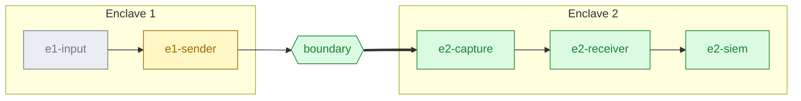
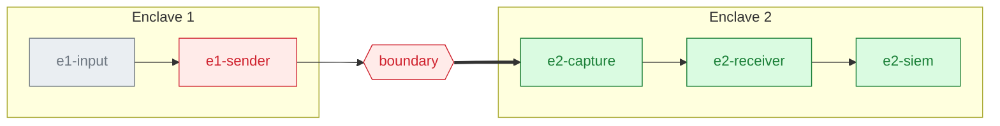
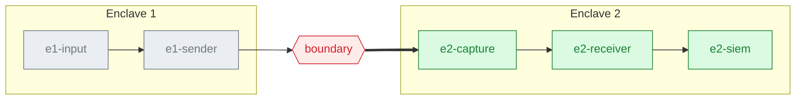
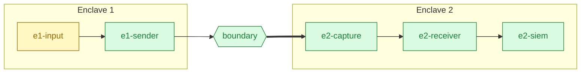
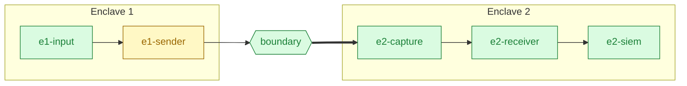
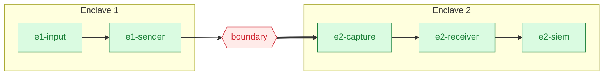
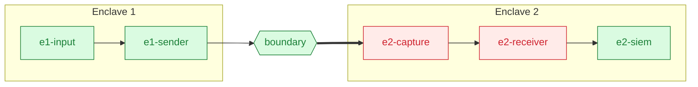
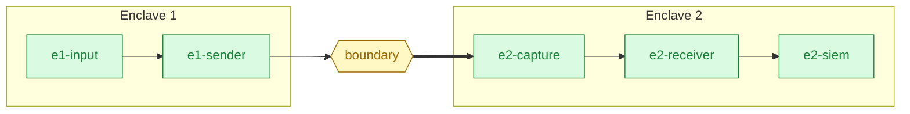
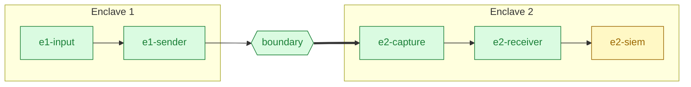
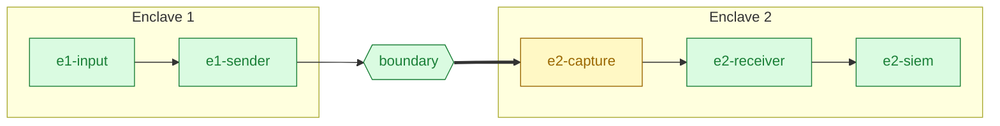

# wd2l state of health

Here "state of health" means: is every log event that enters Enclave 1 reaching the SIEM in
Enclave 2, and if not, where along the path is it stopping? One dashboard in the Enclave 2 SIEM
answers that, along with whether the timestamps and both audit trails can be trusted. The
receiver works out where a fault is itself and writes the answer into its health records, so any
SIEM can draw it; this page says what to show and how to read it. Background is in the audit
plan's [§12](audit-and-health-plan.md#12-the-where-is-the-fault-dashboard),
[operations.md](operations.md) and [planned-downtime.md](planned-downtime.md); the example
dashboard for Splunk is `deploy/receiver/splunk/wd2l-health-dashboard.json`.

## The questions, in order

The dashboard is laid out in this order, top to bottom:

1. Is the transfer working right now? If not, where is the fault? (Panels 1, 1b, 3)
2. Is the receiver itself alive? It can't report its own absence. (Panel 2)
3. Is anything lost, and does the SIEM hold exactly what Enclave 1 sent? (Panels 4, 5, 8, 11, 12)
4. Is it keeping up? (Panels 8, 9)
5. Can we trust the timestamps? (Panels 6, 10)
6. Are both audit trails being written and intact? (Panels 7, 20)
7. For diagnosis: what does each segment's detail say? (Panels 13–19)

## Who looks, and when

| Who | When | What they look at |
|---|---|---|
| Operator (SOC/NOC) | A glance at the wall screen | The top row only. Acts on red: reads panel 1b and calls on-call. Amber is a warning, or planned downtime (rule 2) |
| On-call engineer | An alert fired | The status tile (1, 1b), the pipeline (3), the fault history (13), then the detail row for the segment that isn't green (14–19). The [scenarios](#reading-it-scenarios) say what to do |
| Security owner, auditor | Weekly | Reconciliation (5, 12), the audit trail tile (7) and the "WD2L - Audit review (daily)" report. Panel 20 needs the `wd2l_auditor` role |

The Enclave 1 team can't see this dashboard: it is in Enclave 2, and nothing goes back across
the link (see the direction rule in the [README](../README.md)). When the fault is in Enclave 1,
tell them by phone or ticket, as for [planned downtime](planned-downtime.md#before-you-start).

## The mockup

This shows a fiber or optic fault (rule 7). Panel numbers match the table below. The values are
illustrative, not from a real system: they tell one story, a clean planned stop that morning and
then fiber errors from 13:41Z. The time range is 12 hours so that the planned stop is in view.

## The six segments

| Segment | Where | What it covers |
|---|---|---|
| `e1-input` | Enclave 1: the log aggregator handing events to the sender, on the log server | Events in per second, connected clients, input backlog (bytes the aggregator has handed over that the sender hasn't read yet), bad input, auth failures |
| `e1-sender` | Enclave 1: `wd2l-sender` and its egress NIC | Heartbeats, send errors, drops, restarts (`boot`), time stalled on pacing or a full send buffer, process CPU and memory, egress NIC carrier and transmit counters, time sync |
| `boundary` | The network tap and fiber, seen from Enclave 2 | Capture NIC carrier and carrier changes, receive CRC and frame errors, packets that aren't the log flow |
| `e2-capture` | Enclave 2: the capture NIC and the pcap archive | NIC receive counters, kernel drops, the newest archive file's age and size |
| `e2-receiver` | Enclave 2: `wd2l-receiver` | Gaps by reason, split events that never completed, link delay (`wd2l_rx_time − wd2l_tx_time`), time sync, process CPU and memory |
| `e2-siem` | Enclave 2: delivery to the SIEM | Spool files and bytes, collector errors and rejections, SIEM ingest delay (index time − `wd2l_rx_time`) |

The receiver colors each segment in every summary (`seg_e1_input` … `seg_e2_siem`): `ok`, `amber`,
`red`, or `unknown` (grey) for a segment it can't see right now. While nothing arrives, it can't
see the aggregator's side; while packets arrive but none are wd2l frames, it can't see either
Enclave 1 segment. Every rule that matches colors its own segments, so more than one box can be
off green. The status tile names the first rule that matches.

## Panels

| # | Panel | Answers | Data | Green / amber / red | If not green |
|---|---|---|---|---|---|
| 1 | **Transfer status** | Is it working? | Latest `type=health` summary: `fault_status` | `ok` / `amber` / `red`, as the receiver says | Read panel 1b, then the segment's detail row |
| 1b | **Where and why** | Where is the fault? | Same record: `fault_segment`, `fault_rule`, `fault_detail` | — | The rule's row in the scenario table below |
| 2 | **Receiver last heard** | Is the receiver alive? | Age of the newest `wd2l:health` record | < 90 s / 90–900 s / > 900 s | Receiver host and service; the "WD2L - Receiver silent" alert |
| 3 | **Pipeline** | Which segment? | Latest summary: `seg_e1_input` … `seg_e2_siem` | per box: green / amber / red; grey = can't be seen right now | That box's detail row (panels 14–19) |
| 4 | **Open gap events** | Is anything missing now? | Latest summary: `open_gap_events` | 0 / — / > 0 | [operations.md, events lost](operations.md#alert-events-lost-typegap) |
| 5 | **Reconciliation** | Does the SIEM hold exactly what was sent? | Latest `type=reconcile` per stream, last 25 h | all balanced / — / any not; grey (`UNKNOWN`) with no `reconcile` record in 25 h | Panel 12; replay or re-send; unbalanced with no gaps is an incident. A stream with a permanent gap (events re-sent from Enclave 1 come back under new numbers) stays red for good: follow "WD2L - Events lost in transfer" and [its runbook](operations.md#alert-events-lost-typegap) |
| 6 | **Time** | Can we trust timestamps? | Latest summary: `time_status`, `clock_offset_s` | `ok` / — / `alarm` | `time_reason`; chrony and the GPS receiver on that side |
| 7 | **Audit trail** | Are both trails written and intact? | Latest health from each side, each from its own sourcetype: `audit_ok`, `audit_verify` | both ok / self-check not run yet / any `false` or `failed` | [operations.md, audit trail](operations.md) |
| 8 | **Events in vs delivered** | Does everything that enters Enclave 1 leave Enclave 2? | Summaries: per-minute growth of `sender_events_in` and `events_delivered` | the lines overlap | A gap between the lines is loss or backlog: panels 4, 11, 19 |
| 9 | **Delay by segment** | Is it keeping up? | Imported events: `wd2l_tx_time − _time`, `wd2l_rx_time − wd2l_tx_time`, `_indextime − wd2l_rx_time` | site values; e.g. under 60 s, 50 ms, 60 s | [operations.md, measuring delays](operations.md#measuring-delays) |
| 10 | **Clock skew** | Do the two enclaves agree on time? | Summaries: `clock_offset_s` | inside ±50 ms | Time sync, not the network |
| 11 | **Gaps by reason** | What kind of loss? | `type=gap` records, `count` by `reason` (records-stream gaps marked) | none | The reason table in operations.md |
| 12 | **Reconciliation by stream** | Which run doesn't balance, and since when? | `type=reconcile`: `cut`, `balanced`, `gaps_open` per stream | all balanced | As panel 5. A row with `gaps_open` above 0 that never balances is a permanent gap, not a new fault |
| 13 | **Fault history** | What changed, when? | `type=fault` and `type=time_status` records | — | Attach to the incident ticket |
| 14 | **Enclave 1 input** | Is the aggregator feeding the sender? | Latest `wd2l:sender:health`: `events_in`, `clients`, `input_backlog_bytes`, `bad_input` | — | Enclave 1 team: the aggregator |
| 15 | **Enclave 1 sender** | Is the sender keeping up? | Latest `wd2l:sender:health`: `stall_s`, `sender_drops`, `send_errors`, `cpu_pct`, `nic_carrier`, `nic_tx_errors` | — | Enclave 1 team: the log server |
| 16 | **Boundary** | Is the tap, fiber and optic clean? | Latest summary: `nic_carrier`, `nic_carrier_changes`, `nic_rx_crc_errors`, `nic_rx_frame_errors`, `other_packets`, `bad_frames` | — | Optics, fiber, tap ports, tap filter |
| 17 | **Enclave 2 capture** | Is every packet captured and archived? | Latest summary: `nic_rx_packets`, `kernel_drops`, `archive_file`, `archive_age_s` | — | Host capacity; `wd2l-capture` |
| 18 | **Enclave 2 receiver** | Is the receiver keeping up? | Latest summary: `heartbeat_age_s`, `open_gap_events`, `reasm_expired`, `cpu_pct`, `rss_mb` | — | Receiver host |
| 19 | **Enclave 2 SIEM** | Is the SIEM taking everything? | Latest summary: `hec_queue`, `hec_spool_files`, `hec_spool_bytes`, `hec_posts_failed`, `hec_rejected_events`, `output_dropped` | — | The SIEM; `<spool>/rejected/` |
| 20 | **Audit events to review** | What did people change? | `index=wd2l_audit`: `start`, `stop`, `config_changed`, `state_reset`, `replay_run`, `debug_toggled`, `audit_failure`, `audit_verify` | — | Needs the `wd2l_auditor` role; others see it empty |

* **"Latest summary"** is the newest `type=health` record from the receiver
  (`index=wd2l sourcetype=wd2l:health`), written every 60 s. Enclave 1's own summary arrives
  in-band about once a minute as `sourcetype=wd2l:sender:health` (panels 7, 14 and 15).
* **Panels 1, 3 and 6 show what the receiver decided.** The SIEM only draws it. Panels 2, 4, 5
  and 7 color by the simple conditions in the table.
* **Panels 14–19 have no colors of their own.** They are for reading the values once panel 3
  says which segment to look at.

## Reading it: scenarios

Each scenario shows the pipeline (panel 3) as the receiver colors it, then what you see, what it
means and what to do. The rules are the receiver's decision order, from the audit plan's
[§12](audit-and-health-plan.md#12-the-where-is-the-fault-dashboard).

| Scenario | Rule | Status tile |
|---|---|---|
| [Healthy](#healthy) | — | green |
| [Planned downtime: sender stopped cleanly](#planned-downtime-sender-stopped-cleanly-rule-2) | 2 | amber, `e1-sender` |
| [Nothing arriving: sender down, or the link](#nothing-arriving-sender-down-or-the-link-rule-3) | 3 | red, `e1-sender/boundary` |
| [Tap, fiber or optic down](#tap-fiber-or-optic-down-rule-1) | 1 | red, `boundary` |
| [Packets but no wd2l frames](#packets-but-no-wd2l-frames-rule-4) | 4 | red, `boundary` |
| [Aggregator stopped sending](#aggregator-stopped-sending-rule-5) | 5 | amber, `e1-input` |
| [Sender dropping or backed up](#sender-dropping-or-backed-up-rule-6) | 6 | amber, `e1-sender` |
| [Loss with receive errors on the capture NIC](#loss-with-receive-errors-on-the-capture-nic-rule-7) | 7 | red, `boundary` |
| [Loss with kernel drops](#loss-with-kernel-drops-rule-8) | 8 | red, `e2-capture` |
| [Loss, nothing else wrong](#loss-nothing-else-wrong-rule-9) | 9 | amber, `boundary` |
| [SIEM slow, down or refusing](#siem-slow-down-or-refusing-rule-10) | 10 | amber (red if events were dropped), `e2-siem` |
| [Archive not being written](#archive-not-being-written-rule-11) | 11 | amber, `e2-capture` |
| [Time fault](#time-fault) | — | unchanged; Time tile red |
| [Audit trail fault](#audit-trail-fault) | — | unchanged; Audit trail tile red |
| [Receiver down](#receiver-down) | — | stale; Receiver last heard red |

### Healthy

| You see | It means | Do | See also |
|---|---|---|---|
| Every tile and every box green. In panel 8 the two lines lie on top of each other. Open gap events 0, and every stream balanced | Every event that enters Enclave 1 reaches the SIEM, on time, and both audit trails are being written | Nothing | [Panels](#panels) |

### Planned downtime: sender stopped cleanly (rule 2)

| You see | It means | Do | See also |
|---|---|---|---|
| Amber, `e1-sender`, rule 2: "the sender stopped cleanly (planned downtime?) and nothing has arrived since". `e1-input` is grey. In panel 8 both lines drop to 0 together. Open gap events stay 0 | The sender's final heartbeat arrived (a `stream_end` record) and nothing newer has. That is how a clean stop looks. Nothing is lost | If the stop is planned, nothing: the runbook mutes the alerts for the window. If it isn't, ask the Enclave 1 team why the sender was stopped | [planned-downtime.md](planned-downtime.md) |

### Nothing arriving: sender down, or the link (rule 3)

| You see | It means | Do | See also |
|---|---|---|---|
| Red, `e1-sender/boundary`, rule 3. `e1-sender` and `boundary` red, `e1-input` grey. "WD2L - Heartbeat stale" fires. Panel 2 stays green: the receiver itself is fine | No packets for longer than the heartbeat timeout (5 s), and the last sender run didn't end cleanly. The sender, its host or its egress NIC is down or hung, or the tap or fiber is. From Enclave 2 these look the same | Ask the Enclave 1 team whether `wd2l-sender` is running and its egress NIC has carrier. If it is, check the tap and the fiber. After recovery, an unchanged `boot` in the heartbeat means the sender stayed up and the link was the problem. Then look for `gap` records and re-send those windows from Enclave 1 | [Limits](#limits); [re-sending from Enclave 1](operations.md#re-sending-from-enclave-1) |

### Tap, fiber or optic down (rule 1)

| You see | It means | Do | See also |
|---|---|---|---|
| Red, `boundary`, rule 1: "capture NIC has no carrier: tap, fiber or optic". Panel 16: `nic_carrier` false and `nic_carrier_changes` up. `e1-sender` is red and `e1-input` grey too: nothing arrives, so rule 3 matches as well. The tile names `boundary` because rule 1 comes first | The capture NIC in Enclave 2 has lost its link. Nothing can arrive | Check the optics at both ends of the fiber, the fiber itself, and the tap's monitor port and power. On the receiver host, `ip link show ens256` (your capture NIC) shows the link state. Once carrier is back, look for `gap` records and re-send those windows from Enclave 1 | [Network tap](deployment/network.md#network-tap) |

### Packets but no wd2l frames (rule 4)

| You see | It means | Do | See also |
|---|---|---|---|
| Red, `boundary`, rule 4: "packets arrive but none are valid wd2l frames: tap filter or wiring". Both Enclave 1 boxes grey. Panel 16: `other_packets` or `bad_frames` rising. "WD2L - Unexpected traffic or damage on the tap" fires | The capture NIC gets traffic, but none of it is the log flow. Usually the tap's filter changed, or the fiber is on the wrong tap port. The sender may be fine; Enclave 2 just can't see it | Check the tap's filter and which port feeds the fiber. On the receiver host, `sudo tcpdump -i ens256 -nn -c 5` should show only `10.255.255.1.5514 > 10.255.255.2.5514`. Traffic other than the log flow reaching Enclave 2 is also a question for the security owner | [Network checks](deployment/network.md#checks) |

### Aggregator stopped sending (rule 5)

| You see | It means | Do | See also |
|---|---|---|---|
| Amber, `e1-input`, rule 5: "no events from the log aggregator for N s". Heartbeats still arrive. In panel 8 both lines are at 0. Panel 14: `events_in` not growing, perhaps `clients` 0 | The sender and the link work, but no events have come from the aggregator for 5 minutes (the receiver's `--input-flat-after`). The aggregator, its output to the sender, or its sources stopped | Ask the Enclave 1 team to check the aggregator: is its output to `wd2l-sender` on and connected, and are its sources sending? If the output was held on purpose (step 1 of planned downtime), this is expected | [Log aggregator](deployment/log-server.md#5-log-aggregator) |

### Sender dropping or backed up (rule 6)

| You see | It means | Do | See also |
|---|---|---|---|
| Amber, `e1-sender`, rule 6: "sender: drops", "send errors" or "input backlog growing". Panel 15: `sender_drops` or `send_errors` rising, or panel 14: `input_backlog_bytes` growing. When drops leave gaps, `boundary` turns amber too (rule 9 matches as well), but the tile still names `e1-sender` | The sender is running but not keeping up: it gave up on packets, sending failed, or it is falling behind the aggregator (over 1 MiB unread and growing). Dropped packets never leave the log server | Ask the Enclave 1 team to check the log server: CPU (`cpu_pct`, `stall_s`), the egress NIC (`nic_carrier`, `nic_tx_errors`), and the input rate against the sender's packet rate cap (`--rate-pps`). Re-send the windows of any `gap` records from Enclave 1 | [Sender service](deployment/log-server.md#4-sender-service) |

### Loss with receive errors on the capture NIC (rule 7)

| You see | It means | Do | See also |
|---|---|---|---|
| Red, `boundary`, rule 7: "37 events lost with capture NIC receive errors: fiber or optic". Open gap events above 0, `not_received` gaps in panel 11, and in panel 16 `nic_rx_crc_errors` or `nic_rx_frame_errors` rising. The current sender run doesn't balance. This is the mockup above | Frames were damaged on the way in: a dirty or failing optic, a damaged fiber, or a failing tap port. The capture NIC threw them away, so neither the receiver nor the archive has those events | Clean or replace the optics, and check the fiber and the tap's monitor port. On the receiver host, `ethtool -S ens256` gives the driver's own counters and `ethtool -m ens256` the optic's receive power, where the optic supports it. Then re-send the lost windows from Enclave 1: the `gap` records give the ranges | [Events lost](operations.md#alert-events-lost-typegap) |

### Loss with kernel drops (rule 8)

| You see | It means | Do | See also |
|---|---|---|---|
| Red, `e2-capture`, rule 8: "N events lost with kernel drops: receiver host capacity". `e2-capture` and `e2-receiver` red. Panel 17: `kernel_drops` rising; panel 18: CPU high | Packets reached the capture NIC, but the receiver host didn't keep up, and the kernel dropped them before the receiver read them | Check the receiver host: CPU, memory, what else runs on it, and the NIC's receive ring size. Then replay the capture archive: tcpdump has its own buffer and may have kept what the receiver missed. Re-send from Enclave 1 whatever the replay doesn't fill | [Replay from the archive](operations.md#replay-from-the-capture-archive) |

### Loss, nothing else wrong (rule 9)

| You see | It means | Do | See also |
|---|---|---|---|
| Amber, `boundary`, rule 9: "N events lost, no NIC errors or kernel drops: loss on the path". Open gap events above 0; panels 16 and 17 look clean | Events went missing between the sender and the capture NIC, and no counter in Enclave 2 says why: the sender's egress NIC, the tap, or a fault the capture NIC doesn't count. Isolated single-event gaps with a live heartbeat look like this | Ask the Enclave 1 team for the egress NIC's counters (panel 15, `nic_tx_errors`) and check the tap's port counters. Re-send the lost windows from Enclave 1 | [Events lost](operations.md#alert-events-lost-typegap) |

### SIEM slow, down or refusing (rule 10)

| You see | It means | Do | See also |
|---|---|---|---|
| Amber, `e2-siem`, rule 10: "SIEM delivery: spool growing" or "posts failing or rejected"; red, with "events dropped", when events were lost. Panel 19: `hec_spool_files`, `hec_posts_failed`, `hec_rejected_events` or `output_dropped` rising. Panel 9: SIEM ingest delay up. If the SIEM is down completely, the dashboard itself stops updating: see [Receiver down](#receiver-down) | The receiver can't hand events to the SIEM as fast as they arrive. While they spool to disk nothing is lost. Red means the spool or the memory queue was full and events were dropped (`output_dropped` gaps) | Check the SIEM's HTTP event collector, its indexes and the receiver's token. Refused events are in `<spool>/rejected/`. Once the SIEM takes events again the spool drains by itself. For red, replay the capture archive to fill the `output_dropped` gaps | [Routine](operations.md#routine) |

### Archive not being written (rule 11)

| You see | It means | Do | See also |
|---|---|---|---|
| Amber, `e2-capture`, rule 11: "the capture archive isn't being written: a replay would have nothing". Panel 17: `archive_age_s` growing, `archive_file` not changing | Packets arrive, but the newest pcap file isn't being written: `wd2l-capture` (tcpdump) has stopped or is stuck, or its disk is full. The transfer still works, but there would be nothing to replay from | Run `systemctl status wd2l-capture` and check the free space under `/var/lib/wd2l/pcap`. Restart the capture | [Capture archive](deployment/receiver.md#3-capture-archive) |

### Time fault

| You see | It means | Do | See also |
|---|---|---|---|
| Panel 6 red: `time_status` is `alarm`, with the reason in `time_reason`, for example "receiver: unsynced", "sender: stratum 5 > 3", "sender: unavailable" (chrony can't be read) or "clock skew 0.081 s > 0.05 s". Panel 10 may be outside the ±50 ms lines. The pipeline and the transfer status don't change. "WD2L - Time quality" fires | One side's clock is unsynchronised, above stratum 3, more than 100 ms off or can't be read, or the two enclaves disagree by more than 50 ms. Events still arrive, but their times, and the delays in panel 9, can't be trusted | On the side `time_reason` names, run `chronyc tracking` (for "unavailable", check that `chronyd` runs and the wd2l service can run `chronyc`), then check that enclave's GPS receiver and the switch that serves time at stratum 2. Skew while both sides are synced points to one side's GPS receiver or switch | [Measuring delays](operations.md#measuring-delays) |

### Audit trail fault

| You see | It means | Do | See also |
|---|---|---|---|
| Panel 7 red: `audit_ok` is false, or `audit_verify` is `failed`, on one side. The pipeline and the transfer status don't change. "WD2L - Audit trail" fires | `audit_ok` false: that side can't write its audit file, or its disk is below the free-space threshold. `audit_verify` failed: the self-check found the hash chain broken, so a record was changed, removed or reordered, or the file is damaged. Either way the transfer keeps going | For `audit_ok` false: free space and permissions on `/var/log/wd2l`, and the reason in the `audit_failure` record. For a failed self-check: run `wd2l-audit-report verify --dir /var/log/wd2l` on that host, compare it with the other copies (the log retention server for Enclave 1, the `wd2l_audit` index), tell the security owner and follow the incident process | [Audit plan §10](audit-and-health-plan.md#10-protecting-the-audit-trail-protection-storage-failure-response) |

### Receiver down

| You see | It means | Do | See also |
|---|---|---|---|
| Panel 2 amber after 90 s and red after 15 minutes. Every other panel still shows the last values the receiver wrote, often all green, as in the strip above. "WD2L - Receiver silent" fires after 15 minutes | No health record has reached the SIEM: the receiver or its host is down, or the SIEM isn't taking its data. The receiver can't report its own absence, so the rest of the dashboard is stale | On the receiver host: `systemctl status wd2l-receiver wd2l-capture` and `journalctl -u wd2l-receiver`. If the receiver is running, check the SIEM's collector and the receiver's spool. If only the receiver stopped, the capture kept archiving: after the restart, replay the archive to fill the gap. If the whole host was down, re-send that window from Enclave 1 | [Replay from the archive](operations.md#replay-from-the-capture-archive) |

## Limits

* **Sender down or fiber cut?** While nothing reaches Enclave 2, the receiver can't tell a
  stopped or hung sender from a broken link. Rule 3 narrows it to that pair
  (`e1-sender/boundary`). Once the link returns, the heartbeat's `boot` settles it: unchanged
  `boot` means the sender stayed up and the link was the problem. A planned stop doesn't have
  this problem: the sender's final heartbeat says so before it goes quiet (rule 2).
* **The receiver can't report its own absence.** Panel 2 and the "WD2L - Receiver silent" alert
  cover it: both are worked out in the SIEM from the age of the newest health record.
* **Enclave 1 has no live view of its own.** Its state reaches Enclave 2 only in the sender's
  heartbeats and in-band records, so it is only as fresh as the last heartbeat that arrived.
  While the link is down, panels 14 and 15 show Enclave 1 as it was before the outage.

## Building it in your SIEM

The Splunk example is `deploy/receiver/splunk/wd2l-health-dashboard.json`, for Dashboard Studio.
To load it: Dashboards → Create new → Dashboard Studio → Source, paste the file, save. Its panel
titles are the bold titles in the [Panels](#panels) table.

For another SIEM, the data contract is the field list in the [Panels](#panels) table and
[operations.md](operations.md). The receiver does the reasoning, so every panel is either a
latest value or a count over time, with nothing to work out beyond the few thresholds in the
table. The example was checked for structure, not in a live Splunk: adjust the index names
(`enclave1` for the imported events) to yours, and give the people who read panel 20 the auditor
role (`deploy/receiver/splunk/authorize.conf`).

## Alerts that go with it

The alerts are in `deploy/receiver/splunk/savedsearches.conf`. Every alert reads only the health
index (`index=wd2l`), so the people who own them don't need the auditor role; only the daily
review report reads `wd2l_audit`. For planned downtime, mute the alerts the
[runbook](planned-downtime.md) lists: the dashboard shows the clean stop as amber (rule 2), not
red.

| Alert | Fires when | Panel |
|---|---|---|
| "WD2L - Events lost in transfer" | The receiver declared a gap (`type=gap`) | 4, 11 |
| "WD2L - Heartbeat stale" | No sender heartbeat for the heartbeat timeout, or a sender run went quiet without a clean end | 1, 3 |
| "WD2L - Sender run missing or restart chain broken" | A whole sender run never reached Enclave 2, the sender's restart count went back, or a stream with open gaps was dropped from tracking | — (the records are in [operations.md](operations.md#health-records)) |
| "WD2L - Receiver silent" | No health record from the receiver for 15 minutes | 2 |
| "WD2L - Unexpected traffic or damage on the tap" | In the last 20 minutes: packets that aren't the log flow, corrupt frames, refused Enclave 1 records (`records_bad`), kernel drops, sender drops, truncation, unread input at a sender stop, SIEM rejections or dropped output | 15–19 |
| "WD2L - Opaque content in imported logs" | Imported events carry a blob that can't be inspected (`wd2l_opaque`) | — (in the imported events) |
| "WD2L - Fault segment" | The receiver's fault status moved away from `ok` (`type=fault`) | 1, 1b, 3, 13 |
| "WD2L - Reconciliation not balanced" | A sender run with no open gaps hasn't balanced for an hour | 5, 12 |
| "WD2L - Audit trail" | `audit_ok` false or `audit_verify` failed, on either side | 7 |
| "WD2L - Time quality" | A clock unsynchronised, above stratum 3, more than 100 ms off or unreadable, or skew over 50 ms | 6, 10 |
| "WD2L - Audit review (daily)" | A report, not an alert: every morning, the previous day's configuration changes, state resets, archive replays, debug toggles, audit failures, self-checks and time quality changes. Its owner needs the `wd2l_auditor` role | 20 |
