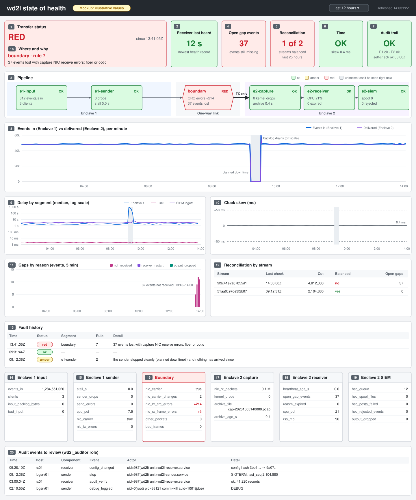
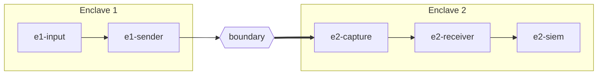

# wd2l state of health

Is every log event that enters Enclave 1 reaching the SIEM in Enclave 2, and if not, where is it
stopping? One dashboard in the Enclave 2 SIEM answers that, along with whether the time stamps
and both audit trails can be trusted. The receiver works out where a fault is and writes the
answer into its health records ([the rules](audit-and-health.md#10-where-is-the-fault-the-rules)),
so any SIEM can draw it. This page says what to show and how to read it. The example dashboard
for Splunk is `deploy/receiver/splunk/wd2l-health-dashboard.json`.

## The questions, in order

The dashboard is laid out in this order, top to bottom:

1. Is the transfer working right now? If not, where is the fault? (Panels 1, 1b, 3)
2. Is the receiver itself alive? It can't report its own absence. (Panel 2)
3. Is anything lost, and does the SIEM hold exactly what Enclave 1 sent? (Panels 4, 5, 8, 11, 12)
4. Is it keeping up? (Panels 8, 9)
5. Can we trust the time stamps? (Panels 6, 10)
6. Are both audit trails being written and intact? (Panels 7, 20)
7. For diagnosis: what does each segment's detail say? (Panels 13–19)

## Who looks, and when

| Who | When | What they look at |
|---|---|---|
| Operator (SOC/NOC) | A glance at the wall screen | The top row. Acts on red: reads panel 1b and calls on-call. Amber is a warning, or planned downtime (rule 2) |
| On-call engineer | An alert fired | The status tile (1, 1b), the pipeline (3), the fault history (13), then the detail row of the segment that isn't green (14–19). [Reading it](#reading-it) says what to do |
| Security owner, auditor | Weekly | Reconciliation (5, 12), the audit trail tile (7) and the "WD2L - Audit review (daily)" report. Panel 20 needs the `wd2l_auditor` role |

The Enclave 1 team can't see this dashboard: nothing goes back across the link (the direction
rule in the [README](../README.md)). When the fault is in Enclave 1, tell them by phone or ticket,
as for [planned downtime](planned-downtime.md#before-you-start).

## The mockup

A fiber or optic fault (rule 7). Panel numbers match the table below. The values are
illustrative: a clean planned stop that morning, then fiber errors from 13:41Z, over the default
12-hour range.

## The six segments

| Segment | Covers |
|---|---|
| `e1-input` | The log aggregator handing events to the sender, on the log server |
| `e1-sender` | `wd2l-sender` and its egress NIC |
| `boundary` | The network tap and fiber, seen from Enclave 2 |
| `e2-capture` | The capture NIC and the pcap archive |
| `e2-receiver` | `wd2l-receiver` |
| `e2-siem` | Delivery to the SIEM |

The fields each one is judged by are in [audit-and-health.md](audit-and-health.md#6-health-signals-by-segment).
The receiver colours each segment in every summary (`seg_e1_input` … `seg_e2_siem`): `ok`,
`amber`, `red`, or `unknown` (grey) for one it can't see right now. Every matching rule colours
its own segments, so more than one box can be off green; the status tile names the first rule
that matches.

## Panels

| # | Panel | Answers | Data | Green / amber / red | If not green |
|---|---|---|---|---|---|
| 1 | **Transfer status** | Is it working? | Latest `type=health` summary: `fault_status` | `ok` / `amber` / `red`, as the receiver says | Panel 1b, then the segment's detail row |
| 1b | **Where and why** | Where is the fault? | Same record: `fault_segment`, `fault_rule`, `fault_detail` | — | The rule's row in [Reading it](#reading-it) |
| 2 | **Receiver last heard** | Is the receiver alive? | Age of the newest `wd2l:health` record | < 90 s / 90–900 s / > 900 s | Receiver host and service; "WD2L - Receiver silent" |
| 3 | **Pipeline** | Which segment? | Latest summary: `seg_e1_input` … `seg_e2_siem` | per box; grey = can't be seen right now | That box's detail row (14–19) |
| 4 | **Open gap events** | Is anything missing now? | Latest summary: `open_gap_events` | 0 / — / > 0 | [operations.md, events lost](operations.md#alert-events-lost-typegap) |
| 5 | **Reconciliation** | Does the SIEM hold exactly what was sent? | Latest `type=reconcile` per stream, last 25 h | all balanced / — / any not; grey (`UNKNOWN`) with no record in 25 h | Panel 12. Unbalanced with no gaps is an incident. A stream with a permanent gap (re-sent events come back under new numbers) stays red: follow "WD2L - Events lost in transfer" |
| 6 | **Time** | Can we trust time stamps? | Latest summary: `time_status`, `clock_offset_s` | `ok` / — / `alarm` | `time_reason`; chrony and the GPS receiver on that side |
| 7 | **Audit trail** | Are both trails written and intact? | Latest health from each side, each from its own sourcetype: `audit_ok`, `audit_verify` | both ok (the self-check may not have run yet) / — / any `false` or `failed` | [operations.md, audit trail](operations.md#alert-audit-trail) |
| 8 | **Events in vs delivered** | Does everything that enters Enclave 1 leave Enclave 2? | Per-minute growth of `sender_events_in` and `events_delivered` | the lines overlap | A gap between the lines is loss or backlog: panels 4, 11, 19 |
| 9 | **Delay by segment** | Is it keeping up? | `wd2l_tx_time − _time`, `wd2l_rx_time − wd2l_tx_time`, `_indextime − wd2l_rx_time` | site values; e.g. 60 s, 50 ms, 60 s | [operations.md, measuring delays](operations.md#measuring-delays) |
| 10 | **Clock skew** | Do the two enclaves agree on time? | `clock_offset_s` | inside ±50 ms | Time sync, not the network |
| 11 | **Gaps by reason** | What kind of loss? | `type=gap`, `count` by `reason` (records-stream gaps marked) | none | The reason table in operations.md |
| 12 | **Reconciliation by stream** | Which run doesn't balance, since when? | `type=reconcile`: `cut`, `balanced`, `gaps_open` per stream | all balanced | As panel 5. `gaps_open` above 0 that never balances is a permanent gap, not a new fault |
| 13 | **Fault history** | What changed, when? | `type=fault` and `type=time_status` records | — | Attach to the incident ticket |
| 14 | **Enclave 1 input** | Is the aggregator feeding the sender? | Latest `wd2l:sender:health`: `events_in`, `clients`, `input_backlog_bytes`, `bad_input` | — | Enclave 1 team: the aggregator |
| 15 | **Enclave 1 sender** | Is the sender keeping up? | Latest `wd2l:sender:health`: `stall_s`, `sender_drops`, `send_errors`, `cpu_pct`, `nic_carrier`, `nic_tx_errors` | — | Enclave 1 team: the log server |
| 16 | **Boundary** | Are the tap, fiber and optic clean? | `nic_carrier`, `nic_carrier_changes`, `nic_rx_crc_errors`, `nic_rx_frame_errors`, `other_packets`, `bad_frames` | — | Optics, fiber, tap ports, tap filter |
| 17 | **Enclave 2 capture** | Is every packet captured and archived? | `nic_rx_packets`, `kernel_drops`, `archive_file`, `archive_age_s` | — | Host capacity; `wd2l-capture` |
| 18 | **Enclave 2 receiver** | Is the receiver keeping up? | `heartbeat_age_s`, `open_gap_events`, `reasm_expired`, `cpu_pct`, `rss_mb` | — | Receiver host |
| 19 | **Enclave 2 SIEM** | Is the SIEM taking everything? | `hec_queue`, `hec_spool_files`, `hec_spool_bytes`, `hec_posts_failed`, `hec_rejected_events`, `output_dropped` | — | The SIEM; `<spool>/rejected/` |
| 20 | **Audit events to review** | What did people change? | `index=wd2l_audit`: `start`, `stop`, `config_changed`, `state_reset`, `replay_run`, `debug_toggled`, `audit_failure`, `audit_verify` | — | Needs the `wd2l_auditor` role; others see it empty |

* **"Latest summary"** is the newest `type=health` record from the receiver
  (`index=wd2l sourcetype=wd2l:health`), written every 60 s. Enclave 1's own summary arrives
  in-band about once a minute as `wd2l:sender:health` (panels 7, 14, 15).
* **Panels 1, 3 and 6 show what the receiver decided**; the SIEM only draws it. Panels 2, 4, 5
  and 7 colour by the conditions in the table. Panels 14–19 have no colours: read them once
  panel 3 says which segment to look at.

## Reading it

Replace `<nic>` with your capture NIC. "Re-send" means replaying that time window from the log
retention server in Enclave 1 ([operations.md](operations.md#re-sending-from-enclave-1)); the
`gap` records give the ranges.

| Situation | Status, rule | You see | It means | Do |
|---|---|---|---|---|
| **Healthy** | green | Panel 8's lines overlap; no open gaps; every stream balanced | Every event reaches the SIEM on time; both trails are written | Nothing |
| **Planned downtime** | amber, `e1-sender`, 2 | `e1-input` grey; panel 8 at 0; no open gaps | The final heartbeat arrived (`stream_end`) and nothing since. Nothing is lost | Planned: nothing (the [runbook](planned-downtime.md) mutes the alerts). Unplanned: ask Enclave 1 why |
| **Nothing arriving** | red, `e1-sender/boundary`, 3 | "WD2L - Heartbeat stale"; panel 2 still green | No packets for 5 s and no clean end: the sender, its host or egress NIC, or the tap or fiber. From here they look the same | Ask Enclave 1: is `wd2l-sender` running, does its egress NIC have carrier? Then the tap and fiber. After recovery, an unchanged `boot` means the link failed. Re-send the gaps |
| **Tap, fiber or optic down** | red, `boundary`, 1 | Panel 16: `nic_carrier` false (rule 3 matches too; rule 1 comes first) | The capture NIC lost its link | Optics, fiber, the tap's monitor port and power; `ip link show <nic>`. Re-send the gaps ([tap](deployment/network.md#network-tap)) |
| **Packets, no wd2l frames** | red, `boundary`, 4 | Panel 16: `other_packets` or `bad_frames` rising; "WD2L - Unexpected traffic or damage on the tap" | Traffic arrives, none of it the log flow: the tap's filter changed, or the fiber is on the wrong port | The tap's filter and port; `sudo tcpdump -i <nic> -nn -c 5` must show only `10.255.255.1.5514 > 10.255.255.2.5514`. Tell the security owner ([checks](deployment/network.md#checks)) |
| **Aggregator stopped** | amber, `e1-input`, 5 | Heartbeats arrive; panel 14: `events_in` flat | No events for 5 minutes (`--input-flat-after`) | Ask Enclave 1 to check the aggregator's output and sources. Expected while it is held for downtime ([aggregator](deployment/log-server.md#5-log-aggregator)) |
| **Sender dropping or behind** | amber, `e1-sender`, 6 | Panels 14–15: drops, send errors or a growing backlog | The sender can't keep up; dropped packets never leave the log server | Ask Enclave 1 to check CPU (`cpu_pct`, `stall_s`), the egress NIC and `--rate-pps`. Re-send the gaps ([sender](deployment/log-server.md#4-sender-service)) |
| **Loss with NIC errors** | red, `boundary`, 7 | Panel 16: CRC or frame errors rising; `not_received` gaps (the mockup) | Frames were damaged on the way in; neither the receiver nor the archive has them | Clean or replace the optics; check the fiber and tap port (`ethtool -S`, `ethtool -m`). Re-send the gaps ([events lost](operations.md#alert-events-lost-typegap)) |
| **Loss with kernel drops** | red, `e2-capture`, 8 | Panel 17: `kernel_drops` rising; panel 18: CPU high | The receiver host fell behind, and the kernel dropped packets | CPU, memory, other load, the NIC's receive ring. Replay the archive, then re-send what it doesn't fill ([replay](operations.md#replay-from-the-capture-archive)) |
| **Loss, nothing else wrong** | amber, `boundary`, 9 | Panels 16–17 clean | Lost between the sender and the capture NIC, and no counter says why | Enclave 1's egress NIC counters (panel 15) and the tap's port counters. Re-send the gaps |
| **SIEM slow, down or refusing** | amber (red: events dropped), `e2-siem`, 10 | Panel 19; panel 9's ingest delay up. A SIEM fully down freezes the dashboard (see Receiver down) | Spooling loses nothing; red means a full queue or spool dropped events | The collector, indexes and token; refused events are in `<spool>/rejected/`. The spool drains itself; for red, replay the archive ([routine](operations.md#routine)) |
| **Archive not written** | amber, `e2-capture`, 11 | Panel 17: `archive_age_s` growing. Briefly at receiver start while the sender is stopped: not a fault | tcpdump isn't writing: stopped, stuck, disk full, or SELinux denying it | `systemctl status wd2l-capture`, and restart it; space and label (`ls -dZ`) of `/var/lib/wd2l/pcap` ([archive](deployment/receiver.md#3-capture-archive)) |
| **Time fault** | Time tile red | `time_reason`, e.g. "receiver: unsynced", "sender: unavailable", "clock skew 0.081 s > 0.05 s" | Times can't be trusted; events still arrive | `chronyc tracking` on that side, then its GPS receiver and time switch ([delays](operations.md#measuring-delays)) |
| **Audit trail fault** | Audit tile red | `audit_ok` false or `audit_verify` `failed` | `audit_ok` false: can't write, or below the space floor. `failed`: the chain is broken, or the check couldn't run (journal: "could not start", "timeout") | Space and permissions on `/var/log/wd2l`, and the `audit_failure` reason. A broken chain: `sudo -u wd2l wd2l-audit-report verify --dir /var/log/wd2l`, compare the other copies, tell the security owner ([protection](audit-and-health.md#8-protecting-the-audit-trail)) |
| **Receiver down** | Receiver last heard amber at 90 s, red at 15 min | Other panels frozen, often green; "WD2L - Receiver silent" | No health record reaches the SIEM: the receiver or host is down, or the SIEM is refusing | `systemctl status wd2l-receiver wd2l-capture`; `journalctl -u wd2l-receiver`. If it runs, check the SIEM's collector and the receiver's spool. Receiver only: replay the archive after the restart. Whole host: re-send the window |

## Limits

* **Sender down or fiber cut?** While nothing reaches Enclave 2, the receiver can't tell them
  apart; rule 3 narrows it to that pair. Once the link returns, an unchanged `boot` means the
  sender stayed up and the link was the problem. A planned stop says so in its final heartbeat
  (rule 2).
* **The receiver can't report its own absence.** Panel 2 and "WD2L - Receiver silent" cover it,
  from the age of the newest health record.
* **Enclave 1 has no live view of its own.** Its state arrives in the heartbeats and in-band
  records, so while the link is down panels 14 and 15 show Enclave 1 as it was before.

## Building it in your SIEM

The Splunk example is `deploy/receiver/splunk/wd2l-health-dashboard.json`, for Dashboard Studio.
To load it: Dashboards → Create new → Dashboard Studio → Source, paste the file, save. Its panel
titles are the bold titles in the [Panels](#panels) table. The panels that show the latest health
record share one search for it, and each picks its own fields from that. The shared search ends in
`| fields *`: without it, Splunk passes on only the fields the search names, and those panels stay
empty (#203).

For another SIEM, the data contract is the field list in the [Panels](#panels) table. The receiver
does the reasoning, so every panel is a latest value or a count over time. Adjust the index names
(`enclave1` for the imported events) to yours, and give the people who read panel 20 the auditor
role (`deploy/receiver/splunk/authorize.conf`).

## Alerts

The alerts that go with this dashboard, and what to do for each, are in
[operations.md](operations.md#alerts). For planned downtime, mute the ones the
[runbook](planned-downtime.md#before-you-start) lists: the dashboard shows the clean stop as amber
(rule 2), not red.
