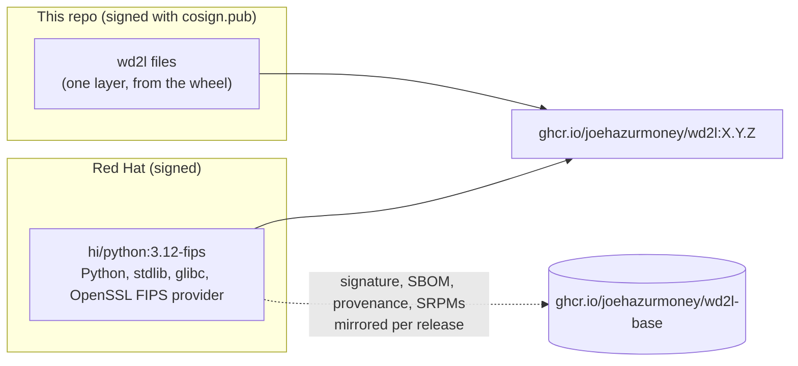

# Phase 1: decisions on record, license, build artifacts

Part of the [release packaging plan](README.md). Read its **Global constraints** first. Spec:
[spec.md](spec.md) "Phase 1".

**Delivers:**

* MIT license;
* one version source;
* a wheel that carries `wd2l/BUILD`, and an sdist that carries `deploy/` and `packaging/`;
* `check_dist.py`, run in CI on every push;
* the pinned CI tool images and their wrapper;
* the measured base-image comparison;
* ADR-0004, ADR-0005 and ADR-0006, status Proposed. They become Accepted in Task 6.5 once
  Phase 0's results are in and the first release is out.

Run tests with `T` from the plan README.

---

### Task 1.1: License, one version source, BUILD in the wheel, dist checks

**Files:**
- Create: `LICENSE`, `MANIFEST.in`, `packaging/check_dist.py`, `tests/test_packaging.py`
- Modify: `pyproject.toml`, `wd2l/__init__.py`, `.gitignore`, `.gitattributes`,
  `tests/helpers.py`, `.github/workflows/tests.yml`

**Interfaces:**
- Consumes: nothing.
- Produces:
  * `helpers.load_script(relpath) -> module`, used by every later test of a `packaging/`
    script;
  * `check_dist.check(dist, version, commit) -> List[str]`, `check_dist.repo_version() -> str`,
    and the constants `check_dist.SCRIPTS` and `check_dist.SDIST_NEEDS` (Task 5.2 adds the RPM
    sources to it);
  * the `dist` CI artifact: one wheel and one sdist.

- [ ] **Step 1: Ask your partner for the copyright holder.** "The LICENSE says
  `Copyright (c) 2026 <name>`. Shall I use `Joe Azurmoni` (your git user.name) or another name?"
  Use their answer below.

- [ ] **Step 2: Write the failing tests**

`tests/helpers.py`, add at the end:

```python
def load_script(relpath):
    """Load a script under packaging/ by its path. packaging/ has no __init__.py on purpose:
    a regular package called `packaging` would shadow the library pytest and pip import."""
    import importlib.util
    import os
    import sys
    root = os.path.join(os.path.dirname(os.path.abspath(__file__)), "..")
    path = os.path.join(root, relpath)
    name = "wd2l_script_" + relpath.replace("/", "_").replace(".", "_").replace("-", "_")
    spec = importlib.util.spec_from_file_location(name, path)
    mod = importlib.util.module_from_spec(spec)
    sys.modules[name] = mod
    spec.loader.exec_module(mod)
    return mod
```

`tests/test_packaging.py`:

```python
import io
import os
import re
import tarfile
import zipfile

from helpers import load_script

REPO = os.path.join(os.path.dirname(os.path.abspath(__file__)), "..")
check_dist = load_script("packaging/check_dist.py")


def read(rel):
    with open(os.path.join(REPO, rel)) as f:
        return f.read()


def test_version_has_one_source():
    py = read("pyproject.toml")
    project = py.split("[project]", 1)[1].split("\n[", 1)[0]
    assert 'dynamic = ["version"]' in project
    assert not re.search(r"^version\s*=", project, re.M)
    assert 'version = {attr = "wd2l.__version__"}' in py
    assert check_dist.repo_version() == __import__("wd2l").__version__


def test_license_is_mit():
    assert read("LICENSE").startswith("MIT License\n\nCopyright (c) 2026 ")
    py = read("pyproject.toml")
    assert 'license = "MIT"' in py and 'license-files = ["LICENSE"]' in py
    assert 'requires = ["setuptools>=77"]' in py


def test_build_file_and_rpm_sources_ship_in_the_sdist():
    assert 'wd2l = ["BUILD"]' in read("pyproject.toml")
    manifest = read("MANIFEST.in").splitlines()
    for line in ("include LICENSE", "include wd2l/BUILD", "graft deploy", "graft packaging",
                 "global-exclude __pycache__ *.py[cod]"):
        assert line in manifest, line


def make_wheel(path, version="0.3.0", build="abc123", scripts=check_dist.SCRIPTS,
               license_expr="MIT", license_file=True):
    di = "wd2l-%s.dist-info/" % version
    with zipfile.ZipFile(path, "w") as z:
        z.writestr("wd2l/__init__.py", '__version__ = "%s"\n' % version)
        if build is not None:
            z.writestr("wd2l/BUILD", build + "\n")
        z.writestr(di + "entry_points.txt",
                   "[console_scripts]\n" + "".join("%s = m:main\n" % s for s in scripts))
        z.writestr(di + "METADATA", "Metadata-Version: 2.4\nName: wd2l\nVersion: %s\n"
                                    "License-Expression: %s\n" % (version, license_expr))
        if license_file:
            z.writestr(di + "licenses/LICENSE", "MIT License\n")


def make_sdist(path, version="0.3.0", members=check_dist.SDIST_NEEDS):
    with tarfile.open(path, "w:gz") as t:
        for m in members:
            info = tarfile.TarInfo("wd2l-%s/%s" % (version, m))
            info.size = 1
            t.addfile(info, io.BytesIO(b"x"))


def good_dist(tmp_path, version="0.3.0"):
    make_wheel(str(tmp_path / ("wd2l-%s-py3-none-any.whl" % version)), version)
    make_sdist(str(tmp_path / ("wd2l-%s.tar.gz" % version)), version)


def test_good_dist_passes(tmp_path):
    good_dist(tmp_path)
    assert check_dist.check(str(tmp_path), "0.3.0", "abc123") == []


def test_prerelease_names_pass(tmp_path):
    good_dist(tmp_path, "0.3.0rc1")
    assert check_dist.check(str(tmp_path), "0.3.0rc1", "abc123") == []


def test_wheel_problems_are_each_named(tmp_path):
    make_wheel(str(tmp_path / "wd2l-0.3.0-py3-none-any.whl"), build=None,
               scripts=("wd2l-sender",), license_expr="Proprietary", license_file=False)
    make_sdist(str(tmp_path / "wd2l-0.3.0.tar.gz"))
    probs = "\n".join(check_dist.check(str(tmp_path), "0.3.0", "abc123"))
    for word in ("BUILD", "wd2l-receiver", "wd2l-audit-report", "License-Expression",
                 "licenses/LICENSE"):
        assert word in probs, word


def test_wrong_commit_and_wrong_version(tmp_path):
    good_dist(tmp_path)
    assert any("BUILD" in p for p in check_dist.check(str(tmp_path), "0.3.0", "def456"))
    probs = check_dist.check(str(tmp_path), "0.4.0", "abc123")
    assert any("wheel name" in p for p in probs) and any("sdist name" in p for p in probs)


def test_sdist_must_carry_the_deploy_tree(tmp_path):
    make_wheel(str(tmp_path / "wd2l-0.3.0-py3-none-any.whl"))
    make_sdist(str(tmp_path / "wd2l-0.3.0.tar.gz"),
               members=[m for m in check_dist.SDIST_NEEDS if not m.startswith("deploy/")])
    probs = check_dist.check(str(tmp_path), "0.3.0", "abc123")
    assert any("deploy/log-server/wd2l-sender.service" in p for p in probs)


def test_exactly_one_wheel_and_one_sdist(tmp_path):
    probs = check_dist.check(str(tmp_path), "0.3.0", "abc123")
    assert any("one wheel" in p for p in probs) and any("one sdist" in p for p in probs)
```

- [ ] **Step 3: Run them to verify they fail**

Run: `T tests/test_packaging.py -v`
Expected: FAIL. Collection fails with `FileNotFoundError` for `packaging/check_dist.py`.

- [ ] **Step 4: Write the implementation**

`LICENSE` (the holder from step 1):

```text
MIT License

Copyright (c) 2026 <holder from step 1>

Permission is hereby granted, free of charge, to any person obtaining a copy
of this software and associated documentation files (the "Software"), to deal
in the Software without restriction, including without limitation the rights
to use, copy, modify, merge, publish, distribute, sublicense, and/or sell
copies of the Software, and to permit persons to whom the Software is
furnished to do so, subject to the following conditions:

The above copyright notice and this permission notice shall be included in all
copies or substantial portions of the Software.

THE SOFTWARE IS PROVIDED "AS IS", WITHOUT WARRANTY OF ANY KIND, EXPRESS OR
IMPLIED, INCLUDING BUT NOT LIMITED TO THE WARRANTIES OF MERCHANTABILITY,
FITNESS FOR A PARTICULAR PURPOSE AND NONINFRINGEMENT. IN NO EVENT SHALL THE
AUTHORS OR COPYRIGHT HOLDERS BE LIABLE FOR ANY CLAIM, DAMAGES OR OTHER
LIABILITY, WHETHER IN AN ACTION OF CONTRACT, TORT OR OTHERWISE, ARISING FROM,
OUT OF OR IN CONNECTION WITH THE SOFTWARE OR THE USE OR OTHER DEALINGS IN THE
SOFTWARE.
```

`pyproject.toml` (whole file):

```toml
[build-system]
requires = ["setuptools>=77"]
build-backend = "setuptools.build_meta"

[project]
name = "wd2l"
dynamic = ["version"]
description = "One-way log transfer: frame logs into UDP, rebuild them from tapped packets"
readme = "README.md"
license = "MIT"
license-files = ["LICENSE"]
requires-python = ">=3.9"
dependencies = []

[project.optional-dependencies]
test = ["pytest"]

[project.scripts]
wd2l-sender = "wd2l.sender:main"
wd2l-receiver = "wd2l.receiver:main"
wd2l-audit-report = "wd2l.audit_report:main"

[tool.setuptools]
packages = ["wd2l"]

[tool.setuptools.dynamic]
version = {attr = "wd2l.__version__"}

[tool.setuptools.package-data]
wd2l = ["BUILD"]

[tool.pytest.ini_options]
testpaths = ["tests"]
pythonpath = [".", "tests"]
```

`MANIFEST.in`:

```text
include LICENSE
include README.md
include wd2l/BUILD
graft deploy
graft packaging
global-exclude __pycache__ *.py[cod]
```

`wd2l/__init__.py`: change the version line to `__version__ = "0.3.0"`.

`.gitignore`, add:

```text
wd2l/BUILD
dist/
.cache/
```

`.gitattributes`, add:

```text
# Shell scripts without an extension, run in Linux.
packaging/ci/tool text eol=lf
```

`packaging/check_dist.py`:

```python
#!/usr/bin/env python3
"""Checks dist/ before anything is packaged from it (the image pipeline and the release):

* one wheel and one sdist, both named for wd2l/__init__.py's version;
* the wheel carries wd2l/BUILD (the commit), the three commands and the MIT license;
* the sdist carries what the RPM is built from (deploy/, packaging/, LICENSE).

    python3 packaging/check_dist.py DIST_DIR --commit SHA [--version V]

Exit 0 when all is well, 1 with one line per problem."""

import argparse
import glob
import os
import re
import sys
import tarfile
import zipfile
from typing import List, Optional, Sequence

SCRIPTS = ("wd2l-sender", "wd2l-receiver", "wd2l-audit-report")
# Files the sdist must hold. Task 5.2 adds the RPM spec and rpmify.py.
SDIST_NEEDS = ("LICENSE", "README.md", "wd2l/__init__.py", "wd2l/BUILD",
               "deploy/common/wd2l-audit-seal.sh", "deploy/log-server/wd2l-sender.service",
               "deploy/receiver/wd2l-receiver.service", "packaging/check_dist.py")
REPO = os.path.join(os.path.dirname(os.path.abspath(__file__)), "..")


def repo_version(init: str = os.path.join(REPO, "wd2l", "__init__.py")) -> str:
    with open(init) as f:
        m = re.search(r'^__version__ = "([^"]+)"$', f.read(), re.M)
    if not m:
        raise SystemExit("no __version__ in %s" % init)
    return m.group(1)


def _text(z: zipfile.ZipFile, name: str) -> str:
    try:
        return z.read(name).decode("utf-8", "replace")
    except KeyError:
        return ""


def check_wheel(path: str, version: str, commit: str) -> List[str]:
    out = []
    want = "wd2l-%s-py3-none-any.whl" % version
    if os.path.basename(path) != want:
        out.append("wheel name %s, expected %s" % (os.path.basename(path), want))
    di = "wd2l-%s.dist-info/" % version
    with zipfile.ZipFile(path) as z:
        names = set(z.namelist())
        build = _text(z, "wd2l/BUILD").strip()
        if build != commit:
            out.append("wheel wd2l/BUILD is %r, expected the commit %r" % (build, commit))
        ep = _text(z, di + "entry_points.txt")
        for s in SCRIPTS:
            if not re.search(r"^%s\s*=" % re.escape(s), ep, re.M):
                out.append("wheel has no %s command" % s)
        if not re.search(r"^License-Expression: MIT$", _text(z, di + "METADATA"), re.M):
            out.append("wheel METADATA has no License-Expression: MIT")
        if di + "licenses/LICENSE" not in names:
            out.append("wheel has no %slicenses/LICENSE" % di)
    return out


def check_sdist(path: str, version: str) -> List[str]:
    out = []
    want = "wd2l-%s.tar.gz" % version
    if os.path.basename(path) != want:
        out.append("sdist name %s, expected %s" % (os.path.basename(path), want))
    top = "wd2l-%s/" % version
    with tarfile.open(path) as t:
        names = set(t.getnames())
    out += ["sdist has no %s" % (top + n) for n in SDIST_NEEDS if top + n not in names]
    return out


def check(dist: str, version: str, commit: str) -> List[str]:
    wheels = sorted(glob.glob(os.path.join(dist, "*.whl")))
    sdists = sorted(glob.glob(os.path.join(dist, "*.tar.gz")))
    out = []
    if len(wheels) != 1:
        out.append("expected one wheel in %s, found %d" % (dist, len(wheels)))
    if len(sdists) != 1:
        out.append("expected one sdist in %s, found %d" % (dist, len(sdists)))
    if len(wheels) == 1:
        out += check_wheel(wheels[0], version, commit)
    if len(sdists) == 1:
        out += check_sdist(sdists[0], version)
    return out


def main(argv: Optional[Sequence[str]] = None) -> int:
    p = argparse.ArgumentParser(description="Check the wheel and sdist in DIST.")
    p.add_argument("dist")
    p.add_argument("--commit", required=True, help="the commit wd2l/BUILD must name")
    p.add_argument("--version", help="default: wd2l/__init__.py's __version__")
    a = p.parse_args(argv)
    version = a.version or repo_version()
    probs = check(a.dist, version, a.commit)
    for x in probs:
        print("dist: " + x)
    if not probs:
        print("dist: ok (wd2l %s, BUILD %s)" % (version, a.commit))
    return 1 if probs else 0


if __name__ == "__main__":
    sys.exit(main())
```

`.github/workflows/tests.yml`. Change the byte-compile step to
`python -m compileall -q wd2l lab tests packaging`, and add a job after `pytest`:

```yaml
  dist:
    # The wheel and sdist every package is made from (docs/decisions/0006-release-artifacts-and-signing.md).
    runs-on: ubuntu-latest
    steps:
      - uses: actions/checkout@v4
      - uses: actions/setup-python@v5
        with:
          python-version: "3.12"
      - run: python -m pip install build
      - run: git rev-parse HEAD > wd2l/BUILD && python -m build
      - run: python packaging/check_dist.py dist --commit "$(git rev-parse HEAD)"
      - uses: actions/upload-artifact@v4
        with:
          name: dist
          path: dist/
```

(Task 4.1 moves this job into `image.yml` and pins every action by SHA.)

- [ ] **Step 5: Run the tests to verify they pass, then build for real**

Run: `T tests/test_packaging.py -v && T -q`
Expected: PASS; the whole suite stays green.

Run: `B && MSYS_NO_PATHCONV=1 docker run --rm -v "$(pwd -W)":/src -w /src wd2l-test-312 python packaging/check_dist.py dist --commit "$(git rev-parse HEAD)"`
Expected: `dist: ok (wd2l 0.3.0, BUILD <sha>)`. If the wheel's METADATA lacks
`License-Expression`, the build used an old setuptools; check that build isolation is on (no
`--no-isolation`).

- [ ] **Step 6: Commit**

```bash
rm -f wd2l/BUILD
git add LICENSE MANIFEST.in pyproject.toml wd2l/__init__.py .gitignore .gitattributes \
  packaging/check_dist.py tests/helpers.py tests/test_packaging.py .github/workflows/tests.yml
git commit -m "MIT license; one version source; the wheel carries BUILD; dist checks in CI"
```

---

### Task 1.2: Pinned CI tool images and the wrapper that runs them

**Files:**
- Create: `packaging/ci/tools.Containerfile`, `packaging/ci/tool`, `packaging/ci/pin-images.sh`
- Modify: `tests/test_packaging.py`

**Interfaces:**
- Consumes: nothing.
- Produces:
  * `packaging/ci/tool NAME ARGS...`. It runs stage `NAME` of `tools.Containerfile`, with the
    work tree mounted at `/work` (the working directory). Registry logins are passed through
    read-only. `TOOL_ENV="A B"` passes those variables through, and `TOOL_NETWORK=none` runs
    with no network.
  * `packaging/ci/tool --ref NAME` prints the pinned image.
  * Stage names: `cosign grype oras syft trivy hadolint ubi9 ubi10`.
  * `packaging/ci/pin-images.sh FILE...` re-pins every `FROM NAME:TAG`. `RESOLVE=cmd`
    overrides how digests are looked up (tests).

- [ ] **Step 1: Write the failing tests** (append to `tests/test_packaging.py`)

```python
import subprocess

TOOLS = os.path.join(REPO, "packaging", "ci", "tools.Containerfile")
TOOL = os.path.join(REPO, "packaging", "ci", "tool")
PIN = os.path.join(REPO, "packaging", "ci", "pin-images.sh")
PINNED_FROM = re.compile(r"^FROM (\S+?):(\S+?)@sha256:[0-9a-f]{64} AS (\S+)$")


def tool_refs():
    out = {}
    for line in read("packaging/ci/tools.Containerfile").splitlines():
        if line.startswith("FROM "):
            m = PINNED_FROM.match(line)
            assert m, "not pinned: " + line
            out[m.group(3)] = line.split()[1]
    return out


def test_every_tool_is_pinned_by_digest():
    assert set(tool_refs()) == {"cosign", "grype", "oras", "syft", "trivy", "hadolint",
                                "ubi9", "ubi10"}


def test_tool_runs_the_pinned_image_with_the_work_tree(tmp_path):
    log = tmp_path / "args"
    fake = tmp_path / "podman"
    fake.write_text('#!/bin/sh\nfor a in "$@"; do echo "$a"; done > "%s"\n' % log)
    fake.chmod(0o755)
    env = dict(os.environ, PODMAN=str(fake), TOOL_ENV="COSIGN_PASSWORD", COSIGN_PASSWORD="x",
               TOOL_NETWORK="none", XDG_RUNTIME_DIR=str(tmp_path))
    r = subprocess.run(["bash", TOOL, "cosign", "verify", "--key", "k.pub", "img"],
                       cwd=str(tmp_path), env=env, stdout=subprocess.PIPE,
                       stderr=subprocess.PIPE)
    assert r.returncode == 0, r.stderr
    args = log.read_text().splitlines()
    ref = tool_refs()["cosign"]
    assert args[0] == "run" and args[args.index(ref) + 1:] == ["verify", "--key", "k.pub", "img"]
    assert args[args.index("--network") + 1] == "none"
    assert "COSIGN_PASSWORD" in args and "%s:/work" % tmp_path in args
    assert "--userns=keep-id" in args


def test_tool_ref_and_unknown_tool():
    r = subprocess.run(["bash", TOOL, "--ref", "syft"], stdout=subprocess.PIPE)
    assert r.returncode == 0 and r.stdout.decode().strip() == tool_refs()["syft"]
    r = subprocess.run(["bash", TOOL, "nope"], stderr=subprocess.PIPE)
    assert r.returncode == 2 and b"no stage named nope" in r.stderr


def test_pin_images_rewrites_only_from_lines(tmp_path):
    f = tmp_path / "Containerfile"
    old = "sha256:" + "a" * 64
    f.write_text("FROM a.io/x:1 AS one\nFROM b.io/y:2@%s AS two\nRUN echo hi\nFROM c.io/z:3\n" % old)
    resolver = tmp_path / "resolve"
    resolver.write_text("#!/bin/sh\necho sha256:%s\n" % ("b" * 64))
    resolver.chmod(0o755)
    r = subprocess.run(["bash", PIN, str(f)], env=dict(os.environ, RESOLVE=str(resolver)),
                       stderr=subprocess.PIPE)
    assert r.returncode == 0, r.stderr
    new = "sha256:" + "b" * 64
    assert f.read_text() == ("FROM a.io/x:1@%s AS one\nFROM b.io/y:2@%s AS two\nRUN echo hi\n"
                             "FROM c.io/z:3@%s\n" % (new, new, new))


def test_pin_images_refuses_a_bad_digest(tmp_path):
    f = tmp_path / "Containerfile"
    f.write_text("FROM a.io/x:1\n")
    resolver = tmp_path / "resolve"
    resolver.write_text("#!/bin/sh\necho 'manifest unknown'\n")
    resolver.chmod(0o755)
    r = subprocess.run(["bash", PIN, str(f)], env=dict(os.environ, RESOLVE=str(resolver)),
                       stderr=subprocess.PIPE)
    assert r.returncode == 1 and b"no digest for a.io/x:1" in r.stderr
    assert f.read_text() == "FROM a.io/x:1\n"
```

- [ ] **Step 2: Run them to verify they fail**

Run: `T tests/test_packaging.py -k "tool or pin" -v`
Expected: FAIL (`FileNotFoundError` for `tools.Containerfile`).

- [ ] **Step 3: Write the implementation**

`packaging/ci/tools.Containerfile`. Write it **without** digests; step 4 adds them:

```dockerfile
# Pinned CI tool images. Never built: packaging/ci/tool runs a stage by name, and Dependabot
# (.github/dependabot.yml) proposes new digests. Re-pin by hand with:
#   packaging/ci/pin-images.sh packaging/ci/tools.Containerfile
FROM registry.access.redhat.com/hi/cosign:latest AS cosign
FROM registry.access.redhat.com/hi/grype:0.115 AS grype
FROM registry.access.redhat.com/hi/oras:1.3 AS oras
FROM docker.io/anchore/syft:v1.54.1 AS syft
FROM docker.io/aquasec/trivy:0.75.0 AS trivy
FROM docker.io/hadolint/hadolint:v2.15.1 AS hadolint
FROM registry.access.redhat.com/ubi9/ubi:latest AS ubi9
FROM registry.access.redhat.com/ubi10/ubi:latest AS ubi10
```

`packaging/ci/tool`:

```bash
#!/usr/bin/env bash
# Runs a pinned CI tool: packaging/ci/tool NAME [ARGS...]. NAME is a stage of
# tools.Containerfile, where the image is pinned by digest.
#   packaging/ci/tool --ref NAME     print the pinned image instead of running it
# The work tree ($PWD) is mounted at /work, the tool's working directory, owned by the caller
# (--userns=keep-id): pass paths as /work/<relative path>. Registry logins made with
# `podman login` are passed in read-only. Environment:
#   TOOL_ENV="A B"     pass these variables through (e.g. COSIGN_PRIVATE_KEY COSIGN_PASSWORD)
#   TOOL_NETWORK=none  run with no network (offline verification)
#   PODMAN=...         the podman command (tests)
set -euo pipefail
HERE="$(cd "$(dirname "$0")" && pwd)"
FILE="$HERE/tools.Containerfile"

ref_of() {
  awk -v want="$1" 'toupper($1) == "FROM" && toupper($3) == "AS" && $4 == want {print $2; found = 1}
                    END {exit !found}' "$FILE"
}

if [ "${1:-}" = --ref ]; then
  ref_of "${2:?usage: tool --ref NAME}" || { echo "tool: no stage named $2 in $FILE" >&2; exit 2; }
  exit 0
fi
[ $# -ge 1 ] || { echo "usage: tool NAME [ARGS...] | tool --ref NAME" >&2; exit 2; }
name="$1"; shift
ref="$(ref_of "$name")" || { echo "tool: no stage named $name in $FILE" >&2; exit 2; }

args=(run --rm --userns=keep-id --security-opt label=disable -v "$PWD:/work" -w /work -e HOME=/tmp)
auth="${REGISTRY_AUTH_FILE:-${XDG_RUNTIME_DIR:-/run/user/$(id -u)}/containers/auth.json}"
if [ -f "$auth" ]; then
  args+=(-v "$auth:/auth/config.json:ro" -e DOCKER_CONFIG=/auth -e REGISTRY_AUTH_FILE=/auth/config.json)
fi
for v in ${TOOL_ENV:-}; do args+=(-e "$v"); done
[ -z "${TOOL_NETWORK:-}" ] || args+=(--network "$TOOL_NETWORK")
exec ${PODMAN:-podman} "${args[@]}" "$ref" "$@"
```

`packaging/ci/pin-images.sh`:

```bash
#!/usr/bin/env bash
# Pins every FROM NAME:TAG in the given Containerfiles to the digest the tag points at now:
#   FROM NAME:TAG[@sha256:OLD] [AS STAGE]   ->   FROM NAME:TAG@sha256:NEW [AS STAGE]
# The digest is the multi-arch index's when there is one. Looks digests up with skopeo if it
# is installed, else `docker buildx imagetools` (Docker Desktop). RESOLVE=cmd overrides (tests).
# A file is rewritten only when every FROM in it resolved.
set -euo pipefail
resolve() {
  if [ -n "${RESOLVE:-}" ]; then "$RESOLVE" "$1"
  elif command -v skopeo >/dev/null 2>&1; then
    echo "sha256:$(skopeo inspect --raw "docker://$1" | sha256sum | cut -d' ' -f1)"
  else docker buildx imagetools inspect --format '{{.Manifest.Digest}}' "$1"; fi
}
re='^([Ff][Rr][Oo][Mm][[:space:]]+)([^@[:space:]]+)(@sha256:[0-9a-f]{64})?(.*)$'
for f in "$@"; do
  tmp="$(mktemp)"
  while IFS= read -r line || [ -n "$line" ]; do
    if [[ "$line" =~ $re ]]; then
      head="${BASH_REMATCH[1]}"; ref="${BASH_REMATCH[2]}"; rest="${BASH_REMATCH[4]}"
      d="$(resolve "$ref" 2>/dev/null || true)"
      if ! [[ "$d" =~ ^sha256:[0-9a-f]{64}$ ]]; then
        echo "pin-images: no digest for $ref: $d" >&2; rm -f "$tmp"; exit 1
      fi
      printf '%s%s@%s%s\n' "$head" "$ref" "$d" "$rest" >> "$tmp"
      echo "pinned $ref@$d" >&2
    else
      printf '%s\n' "$line" >> "$tmp"
    fi
  done < "$f"
  cat "$tmp" > "$f"; rm -f "$tmp"
done
```

- [ ] **Step 4: Pin the tools file for real**

Run: `bash packaging/ci/pin-images.sh packaging/ci/tools.Containerfile && git diff --stat`
Expected: eight `pinned …@sha256:…` lines, and every FROM now ends `@sha256:<64 hex> AS <stage>`.

Then record each image's entrypoint, because later tasks rely on it:

```bash
for s in cosign grype oras syft trivy hadolint; do
  r=$(bash packaging/ci/tool --ref $s); docker pull -q "$r" >/dev/null
  echo "$s: $(docker image inspect --format '{{json .Config.Entrypoint}} {{json .Config.Cmd}}' "$r")"
done
```

Expected:

* cosign, grype, oras, syft and trivy each have an entrypoint that is the tool itself;
* hadolint has no entrypoint and `Cmd ["/bin/hadolint","-"]`, so later tasks call it as
  `tool hadolint /bin/hadolint FILE`.

If any differs, add an As-built row naming the call form to use.

- [ ] **Step 5: Run the tests**

Run: `T tests/test_packaging.py -v`
Expected: PASS.

- [ ] **Step 6: Commit**

```bash
chmod +x packaging/ci/tool packaging/ci/pin-images.sh
git add --chmod=+x packaging/ci/tool packaging/ci/pin-images.sh
git add packaging/ci/tools.Containerfile tests/test_packaging.py
git commit -m "CI: pinned tool images and the wrapper that runs them"
```

---

### Task 1.3: Measure the candidate bases; ADR-0004 (the base image)

**Files:**
- Create: `packaging/container/compare-bases.sh`,
  `packaging/container/candidates/ubi10-micro-python.Containerfile`,
  `packaging/container/candidates/ubi9-micro-python.Containerfile`,
  `.github/workflows/compare-bases.yml`, `docs/decisions/0004-container-base-image.md`

**Interfaces:**
- Consumes: `packaging/ci/tool` (syft, grype); the As-built row P0-6 (FIPS behavior) from
  Phase 0.
- Produces: ADR-0004. Later tasks link to it, and Task 3.2's Containerfile cites it.

- [ ] **Step 1: Write the candidate Containerfiles**

`packaging/container/candidates/ubi10-micro-python.Containerfile`:

```dockerfile
# ADR-0004 option B, as we would ship on it: UBI 10 micro plus python3 from the UBI 10 repos.
# Measured by packaging/container/compare-bases.sh; never shipped.
FROM registry.access.redhat.com/ubi10/ubi:latest AS build
RUN dnf install -y --installroot /rootfs --releasever 10 --setopt=reposdir=/etc/yum.repos.d \
      --setopt=install_weak_deps=0 --nodocs python3 \
 && dnf --installroot /rootfs clean all
FROM registry.access.redhat.com/ubi10/ubi-micro:latest
COPY --from=build /rootfs/ /
USER 65532
```

`packaging/container/candidates/ubi9-micro-python.Containerfile`: the same, with `ubi9`
everywhere and `--releasever 9`, and the comment saying "option D … UBI 9 … (Python 3.9)".

- [ ] **Step 2: Write the measuring script**

`packaging/container/compare-bases.sh`:

```bash
#!/usr/bin/env bash
# Measures the candidate base images for ADR-0004 (docs/decisions/0004-container-base-image.md),
# each as we would ship on it: Python 3 and its standard library. Prints a Markdown table.
# Needs rootless podman, jq and packaging/ci/tool (syft, grype). Run from the repo root:
#   packaging/container/compare-bases.sh > compare.md
set -euo pipefail
HERE="$(cd "$(dirname "$0")" && pwd)"
TOOL="$HERE/../ci/tool"
WORK="$(mktemp -d -p "$PWD" .compare.XXXX)"
REL="${WORK#"$PWD"/}"
trap 'rm -rf "$WORK"' EXIT

# "label|image" or "label|build:<file in candidates/>"
CANDIDATES=(
  "A. Hardened Images, FIPS (chosen)|registry.access.redhat.com/hi/python:3.12-fips"
  "A. Hardened Images, non-FIPS (reference)|registry.access.redhat.com/hi/python:3.12"
  "B. UBI 10 micro + python3|build:ubi10-micro-python.Containerfile"
  "C. UBI 10 python-312-minimal|registry.access.redhat.com/ubi10/python-312-minimal:latest"
  "D. UBI 9 micro + python3 (3.9)|build:ubi9-micro-python.Containerfile"
  "E. Google distroless python3|gcr.io/distroless/python3-debian12:latest"
  "E. Chainguard python|cgr.dev/chainguard/python:latest"
  "E. python:3.12-slim (Debian)|docker.io/library/python:3.12-slim"
)

echo "Measured $(date -u +%Y-%m-%d) on $(uname -m) by \`packaging/container/compare-bases.sh\`."
echo
echo "| Candidate | Image | Size | OS packages | Shell | Package manager | Default user | FIPS crypto policy | Known CVEs | Fixable High/Critical |"
echo "|---|---|---|---|---|---|---|---|---|---|"
i=0
for c in "${CANDIDATES[@]}"; do
  label="${c%%|*}"; src="${c#*|}"; i=$((i + 1)); img="localhost/compare-$i"
  if [[ "$src" == build:* ]]; then
    podman build -q -t "$img" -f "$HERE/candidates/${src#build:}" "$HERE/candidates" >/dev/null
    shown="built from \`candidates/${src#build:}\`"
  else
    podman pull -q "$src" >/dev/null
    podman tag "$src" "$img"
    shown="\`$src@$(podman image inspect --format '{{.Digest}}' "$src" | cut -c1-19)…\`"
  fi
  podman save -q --format oci-archive -o "$WORK/$i.tar" "$img"
  size=$(podman image inspect --format '{{.Size}}' "$img" | awk '{printf "%.0f MB", $1 / 1000000}')
  user=$(podman image inspect --format '{{.Config.User}}' "$img"); user="${user:-root}"
  "$TOOL" syft "oci-archive:/work/$REL/$i.tar" -q -o json > "$WORK/$i.syft.json"
  pkgs=$(jq '[.artifacts[] | select(.type == "rpm" or .type == "deb" or .type == "apk")] | length' "$WORK/$i.syft.json")
  "$TOOL" grype "oci-archive:/work/$REL/$i.tar" -q -o json > "$WORK/$i.grype.json"
  cves=$(jq '[.matches[].vulnerability.id] | unique | length' "$WORK/$i.grype.json")
  fixable=$(jq '[.matches[] | select((.vulnerability.severity == "High" or .vulnerability.severity == "Critical")
                 and .vulnerability.fix.state == "fixed") | .vulnerability.id] | unique | length' "$WORK/$i.grype.json")
  podman create -q --name "compare-$i" "$img" >/dev/null
  podman export "compare-$i" > "$WORK/$i.fs.tar"
  podman rm -f "compare-$i" >/dev/null
  tar -tf "$WORK/$i.fs.tar" | sed 's#^\./##' > "$WORK/$i.files"
  if grep -qxE '(usr/)?bin/(sh|bash|ash|dash|busybox)' "$WORK/$i.files"; then shell=yes; else shell=no; fi
  pm=$(grep -oxE '(usr/)?bin/(dnf|dnf5|microdnf|yum|rpm|apt|apt-get|dpkg|apk)' "$WORK/$i.files" \
       | sed 's#.*/##' | sort -u | paste -sd, - || true)
  fips=$(tar -xOf "$WORK/$i.fs.tar" etc/crypto-policies/config 2>/dev/null | tr -d '[:space:]' || true)
  echo "| $label | $shown | $size | $pkgs | $shell | ${pm:-none} | $user | ${fips:-n/a} | $cves | $fixable |"
done
```

- [ ] **Step 3: Write the workflow**

`.github/workflows/compare-bases.yml`:

```yaml
name: compare-bases
# Measures the candidate base images for ADR-0004. Run by hand:
#   gh workflow run compare-bases.yml --ref <branch>
on: workflow_dispatch
permissions:
  contents: read
jobs:
  compare:
    runs-on: ubuntu-24.04
    steps:
      - uses: actions/checkout@v4
      - run: packaging/container/compare-bases.sh | tee compare.md >> "$GITHUB_STEP_SUMMARY"
      - uses: actions/upload-artifact@v4
        with:
          name: compare-bases
          path: compare.md
```

- [ ] **Step 4: Run it. Ask your partner first.** "To measure the candidate base images for
  ADR-0004 I need to push branch `release-packaging` and run `compare-bases.yml` once. It only
  pulls public images. OK?" With their OK:

```bash
chmod +x packaging/container/compare-bases.sh
git add --chmod=+x packaging/container/compare-bases.sh
git add packaging/container/candidates .github/workflows/compare-bases.yml
git commit -m "ADR-0004 input: measure the candidate base images"
git push -u origin release-packaging
gh workflow run compare-bases.yml --ref release-packaging
gh run watch "$(gh run list --workflow compare-bases.yml --limit 1 --json databaseId --jq '.[0].databaseId')"
gh run download --name compare-bases --dir /tmp/compare && cat /tmp/compare/compare.md
```

Expected:

* a ten-column table with eight rows;
* row A shows `no` for shell, `none` for package manager, `65532` and `FIPS`;
* the numbers are whatever they are today, and get quoted as measured.

- [ ] **Step 5: Write ADR-0004**

`docs/decisions/0004-container-base-image.md`. Use ADR-0003's layout: Context, Decision (with a
diagram), Options considered (one dimension table each), Trade-off analysis, Consequences,
Action items. Below is the content, close to final. Paste the measured table from step 4 where
it says so, and the dates.

````markdown
# ADR-0004: Container base image: Red Hat Hardened Images, FIPS variant

**Status:** Proposed
**Date:** <today>
**Deciders:** System owner. The security owner, for the cryptography and patching commitments.

## Context

wd2l now also ships as a container image: `wd2l-sender` and `wd2l-receiver`, run by systemd
([ADR-0005](0005-quadlet.md)). The **base image** is everything in that image that isn't wd2l:
the C library, Python, OpenSSL and whatever else the base brings. Every package in it is:

* something to patch, scan and accredit;
* after a compromise, something an attacker can use.

What wd2l needs from a base is small:

* **Python ≥ 3.9 and its standard library.** wd2l has no other dependencies, and the
  [accreditation notes](../accreditation-notes.md) count that as a security property. The
  image should keep it: the runtime is Python, the standard library and the C libraries they
  need.
* **OpenSSL, for two things.** HTTPS to the SIEM, and SHA-256, which every frame and audit
  record uses.
* **Nothing else at run time.** No shell, package manager, compiler or network tools.

Constraints:

* **RPM-based.** The hosts run RHEL. The same packaging, scanners and security data should
  cover the image.
* **FIPS 140 cryptography** where the platform can provide it. The security owner wants FIPS
  wherever possible.
* **Offline enclaves.** Images arrive as files and are verified without the internet
  ([ADR-0006](0006-release-artifacts-and-signing.md)).
* **Least privilege.** The receiver needs one capability (`CAP_NET_RAW`, to capture), and the
  sender needs none.
* **No cost, and redistributable.** Releases are attached to GitHub and carried into enclaves.

## Decision

* **Run on `registry.access.redhat.com/hi/python:3.12-fips`**, the FIPS variant of Red Hat
  Hardened Images (formerly Project Hummingbird).
* **Install with `…/hi/python:3.12-fips-builder`.** It is only the build stage, which
  pip-installs the wheel. Nothing from the builder ships except wd2l's own files.
* **Pin both by digest** in `packaging/container/Containerfile`. Dependabot proposes new
  digests. The image pipeline verifies each base's Red Hat signature and SLSA provenance, and
  the release copies the base, with its signature, SBOM, provenance and source image, into our
  registry ([ADR-0006](0006-release-artifacts-and-signing.md)).
* **The image adds wd2l and nothing else.** The pipeline fails if the image's RPM database
  differs from the base's by one byte.



## Options considered

### Option A: Red Hat Hardened Images, `hi/python:3.12-fips` (chosen)

| Dimension | Assessment |
|---|---|
| Attack surface | Distroless: no shell, no package manager. Only what Python needs (see the measured table) |
| Least privilege | Runs as UID 65532 by default. With Quadlet: no capabilities except `NET_RAW` on the receiver, read-only root filesystem, no new privileges |
| Flaw remediation | Rebuilt under the same tag as soon as a fix lands; built to ship with no known CVEs |
| Supply chain | Signed with Red Hat's release key 3. SLSA provenance and an SPDX SBOM from Red Hat's Konflux pipeline. Source images (`<release>-source`) hold the SRPMs. Built to be reproducible |
| Cryptography | OpenSSL loads only the FIPS provider (the frozen 3.0.7 module, as on RHEL 10). MD5 and other non-approved algorithms are refused. **Validated only on a RHEL host installed in FIPS mode**; elsewhere it is FIPS-configured |
| Fit | RPM-based, scannable with the same tools as the hosts. Packages are rebuilt from Fedora spec files in Red Hat's own build system, not RHEL packages |
| Cost and redistribution | No cost. Under the UBI EULA, so images built on it can be redistributed |
| Lifecycle risk | New: GA on 2026-05-12. Floating tags, so we pin digests. Red Hat plans optional paid long-term-support images |

**Pros:** the smallest attack surface of the RPM-based options, a non-root default, the fastest
fixes, and a full supply-chain record from Red Hat. It has FIPS cryptography with the same
module RHEL uses.

**Cons:** a new product. No `chronyc` and no `tcpdump` in its repositories. No CA bundle in the
FIPS variant. pip is present (the base installs it). Its packages aren't the RHEL builds.

### Option B: UBI 10 micro, with python3 added from the UBI 10 repositories

<the same table: RHEL 10 packages and errata (RHEL lineage); you assemble Python yourself, and
the result has more packages (measured); shell and package-manager presence as measured; root
by default unless you set USER; fixes follow RHEL errata; signed by Red Hat; UBI EULA; no FIPS
configuration unless you add it and the host is in FIPS mode>

### Option C: UBI 10 `python-312-minimal`

<table: has microdnf and a shell (measured); a ready Python; RHEL lineage; root or a default
user as measured>

### Option D: UBI 9 micro, with python3 3.9

<table: like B with Python 3.9, which is wd2l's floor; EL9 support dates>

### Option E: non-RPM minimal images (Google distroless, Chainguard/Wolfi, `python:3.12-slim`)

<one table for the group: small, and often few CVEs (measured); a different packaging ecosystem
and security data than the RHEL hosts; FIPS availability and terms per vendor (link each
vendor's page as read on the day; make no claim that isn't on that page)>

### Measured comparison

<paste compare.md from step 4 here, with its date line>

## Trade-off analysis

* **Least functionality** (e.g. NIST CM-7).
  * No shell and no package manager means a compromised wd2l process can't start a shell,
    install tools or live off the land with binaries that aren't there.
  * Option A is the only RPM-based candidate with neither (measured table).
* **Fewer packages, fewer flaws to fix** (e.g. NIST SI-2, RA-5).
  * Each package left out is a CVE that never needs an emergency patch or a re-assessment.
  * The packages that are there get rebuilt as soon as fixes land, and the weekly rescan
    (`image-rescan.yml`) catches anything disclosed after a release.
* **Least privilege** (e.g. NIST AC-6).
  * A non-root default means a mistake in the unit file doesn't silently run wd2l as root.
  * With [ADR-0005](0005-quadlet.md), the receiver holds exactly one capability, and the
    sender none.
* **Integrity and provenance** (e.g. NIST SR-3, SR-4, CM-14).
  * Red Hat signs the base and publishes how it was built (SLSA provenance) and what is in it
    (SBOM).
  * We verify both before every build, sign our layer, and keep the base's records and
    sources for as long as a release is supported ([ADR-0006](0006-release-artifacts-and-signing.md)).
* **Cryptographic protection** (e.g. NIST SC-13).
  * The FIPS variant uses the same validated OpenSSL module as RHEL 10. On a RHEL host
    installed in FIPS mode, wd2l's SHA-256 and its TLS to the SIEM run in a validated module.
  * wd2l uses nothing outside the approved set (CI runs the whole test suite under the FIPS
    provider).
* **Why not UBI micro (B, D).** It has RHEL lineage and RHEL errata, which is a real strength.
  But we would assemble and maintain the Python layer ourselves, it ships more packages
  (measured), and it has no FIPS configuration of its own. B stays the fallback if a policy
  requires RHEL-built packages (see Revisit).
* **Why not the non-RPM images (E).** Several are excellent. But they move the image to a
  different packaging and vulnerability-data ecosystem than the hosts, which doubles the work
  for patching and assessment.

## Consequences

* **Easier:**
  * The smallest runtime to patch, scan and accredit, with nothing in it we didn't ask for.
  * The base's provenance and sources come with it.
  * FIPS cryptography with no extra work.
* **Harder:**
  * `chronyc` isn't available, so the containers ask chronyd directly over UDP
    (`--chrony-addr`, `wd2l/hostinfo.py`).
  * `tcpdump` isn't available, so the capture archive stays on the host for now (see Action
    items).
  * The FIPS variant has no CA bundle, so the receiver must be given `--hec-ca`, which the unit
    already does.
  * pip comes with the base. It can't install anything: the root filesystem is read-only and
    the user is non-root.
  * Tags float, so we pin digests, take Dependabot's updates and rescan weekly.
  * The packages are Fedora-derived, not RHEL errata.
* **Revisit** when any of these happens:
  1. Red Hat changes the Hardened Images terms, or drops the FIPS variant.
  2. A policy requires RHEL-built packages inside the image (move to option B).
  3. FIPS validation is needed on hosts that aren't RHEL in FIPS mode.
  4. wd2l needs a package the Hardened Images repositories don't have.

## Action items

1. [ ] **Receiver capture container.** The tcpdump archive stays on the host until one of these
   is chosen. The archive is the recovery source, so it must stay independent of the receiver.
   * **(a)** A tcpdump image on UBI 10 micro (tcpdump and libpcap from UBI 10), run under
     Quadlet as non-root with `NET_RAW`, through the same image pipeline. Recommended if wanted
     now.
   * **(b)** Contribute libpcap, tcpdump and a tcpdump image to Project Hummingbird. This is the
     best attack-surface story, on their timeline. Pursue it alongside (a).
   * **(c)** A standard-library archiver in wd2l. Not recommended: if one bug hit both the live
     path and the recovery path, recovery would fail exactly when it's needed.
````

Fill in options B–E's tables in the same style as A, from the measured table and the vendors'
pages (with links). Keep every claim to what the measurement or a linked page shows.

- [ ] **Step 6: Check the links and commit**

Run: `grep -o '](\.\./[^)]*\|](0[0-9]*[^)]*' docs/decisions/0004-container-base-image.md`
Expected: every relative link names a file that exists, or that Tasks 1.4 and 1.5 create
(`0005-quadlet.md`, `0006-release-artifacts-and-signing.md`).

```bash
git add docs/decisions/0004-container-base-image.md
git commit -m "ADR-0004: Red Hat Hardened Images (FIPS variant) as the container base"
```

---

### Task 1.4: ADR-0005 (Quadlet)

**Files:**
- Create: `docs/decisions/0005-quadlet.md`

**Interfaces:**
- Consumes: Phase 0 rows P0-2 (env-file expansion), P0-3 (SELinux) and P0-4 (user names).
- Produces: ADR-0005. Task 3.5's Quadlet files and the containers guide link to it.

- [ ] **Step 1: Write the ADR** (same layout as ADR-0003; content close to final)

````markdown
# ADR-0005: Run the containers under systemd with Quadlet

**Status:** Proposed
**Date:** <today>
**Deciders:** System owner. Host administrators of both enclaves.

## Context

[ADR-0004](0004-container-base-image.md) makes wd2l available as an image. Something has to
start it at boot, keep it running and stop it cleanly. The hosts already run wd2l under systemd,
and the design leans on that:

* **Ordering.** `wd2l-receiver` requires `wd2l-capture-nic.service`; `wd2l-sender` requires
  `wd2l-egress-nic.service` and the network.
* **Clean stops.** The sender sends its final heartbeat on SIGTERM within 30 s. The receiver
  writes a final health record and flushes to the SIEM within 60 s
  ([planned-downtime.md](../planned-downtime.md)).
* **The journal and auditd.** The operational logs go to the journal. Host auditd rules record
  who changes the units and settings.
* **Restart on failure,** and nothing else running that wasn't accredited.

Constraints:

* RHEL 9.2+ and RHEL 10 ship Podman with Quadlet, and don't ship Docker Engine.
* The enclaves may be offline: images are loaded from files, and nothing may pull at start.
* Change control: what runs must be a specific, verified image.

## Decision

Run each container with a **Quadlet unit**:

* `deploy/log-server/wd2l-sender.container`;
* `deploy/receiver/wd2l-receiver.container`.

At boot, a systemd generator turns each into an ordinary service with the same name as the
native unit. Use one or the other on a host, never both. The Quadlet units read the same
`/etc/wd2l/*.env` files as the native units.

## Options considered

### Option A: Quadlet `.container` units (chosen)

| Dimension | Assessment |
|---|---|
| Fit with systemd | Native. The generated unit keeps `Requires=`/`After=`, `Restart=`, `TimeoutStopSec=`, `systemctl` and the journal |
| Daemon | None. Podman runs under systemd through conmon; no root daemon listens on a socket |
| Hardening in the file | `DropCapability=all`, `AddCapability=NET_RAW` (receiver only), `NoNewPrivileges=true`, `ReadOnly=true`, `User=`, plus SELinux `container_t` |
| Offline | `Pull=never`: runs only an image already loaded (and verified) |
| Change control | `Image=` names one version, or a digest; `AutoUpdate` is off. Rollback is the previous image and a restart |
| Support | Podman ≥ 4.4 (RHEL 9.2+, RHEL 10). Red Hat's recommended way |

### Option B: a hand-written unit that runs `podman run`

<table: works anywhere, but every flag and the stop and cleanup handling are ours to get right;
easy to drift from what Podman expects>

### Option C: `podman generate systemd`

<table: deprecated in favor of Quadlet; urgent fixes only, no new features>

### Option D: Docker Engine with restart policies or compose

<table: a root daemon to accredit and patch; not shipped by RHEL; ordering against the NIC units
is outside systemd>

### Option E: Kubernetes, MicroShift or `podman kube play`

<table: schedulers, an API server and more components to accredit, for one process per host>

## Trade-off analysis

* **Least functionality** (e.g. NIST CM-7). Quadlet adds no service to the host. Docker adds a
  root daemon, and Kubernetes adds a control plane. Quadlet adds a generator that runs at boot.
* **The same operations, native or container.**
  * `systemctl stop wd2l-receiver` and `journalctl -u wd2l-receiver` work the same either way.
  * The planned-downtime runbook doesn't change.
  * auditd still sees who changes `/etc/wd2l/` (the settings) and the units.
* **Hardening, two layers** (e.g. NIST AC-6, SC-39).
  * **For a native unit,** systemd's sandbox options (`ProtectSystem`,
    `CapabilityBoundingSet` and the rest) confine wd2l.
  * **Under Quadlet,** namespaces, the capability set, SELinux `container_t` and a read-only
    image confine it. systemd's options now confine Podman itself.
  * Both give the receiver one capability and the sender none.
* **Change control** (e.g. NIST CM-3, CM-14).
  * The unit names the image.
  * Podman runs only what is already loaded, and that was verified with `cosign.pub` before
    loading ([ADR-0006](0006-release-artifacts-and-signing.md)).
  * Rolling back is naming the previous image.

## Consequences

* **Easier:** one way to start, stop and read wd2l on a host, whether native or container. The
  hardening is declared in one short file. No daemon.
* **Harder:**
  * **Signals.** An operator's `podman kill --signal USR1` shows as pid 0 inside the
    container. The host's auditd records who ran it.
  * **User names.** The user's name in audit records depends on Phase 0 check 4: <P0-4 result>.
  * **SELinux.** Shared directories need the mount options from Phase 0 check 3:
    <P0-3 result>.
  * **Podman version.** It needs Podman 4.4 or later.
* **Revisit** when wd2l runs on a platform without systemd, or when more than one container
  per host needs coordinating.
````

Replace the `<P0-n result>` markers with the recorded Phase 0 outcomes, in plain words. Fill
in options B–E in the same style as A.

- [ ] **Step 2: Commit**

```bash
git add docs/decisions/0005-quadlet.md
git commit -m "ADR-0005: run the containers under systemd with Quadlet"
```

---

### Task 1.5: ADR-0006 (release artifacts and signing)

**Files:**
- Create: `docs/decisions/0006-release-artifacts-and-signing.md`

**Interfaces:**
- Consumes: Phase 0 rows P0-7 (cosign flags) and P0-8 (copying the base).
- Produces: ADR-0006. `docs/releasing.md` (Task 6.4) and the release notes link to it.

- [ ] **Step 1: Write the ADR** (content close to final)

````markdown
# ADR-0006: Release artifacts and how they are signed

**Status:** Proposed
**Date:** <today>
**Deciders:** System owner. The security owner, who holds the signing key.

## Context

A version tag must produce everything a site needs, verifiable in an enclave that has no
internet:

* RPMs for RHEL 9 and RHEL 10;
* the container image ([ADR-0004](0004-container-base-image.md));
* the wheel and sdist they are made from.

An assessor must be able to show, for any running copy, where it came from: the commit, the
build, the base image and its sources.

Constraints:

* **The repository is private for the proof of concept.** It will go public under the MIT
  license afterwards.
* **Private-repository limits.** GitHub's artifact attestations need GitHub Enterprise Cloud in
  a private repository. Keyless Sigstore signing writes the repository's identity to the public
  Rekor log.
* **Offline verification.** Enclaves verify from files: no Rekor, no Fulcio, no GitHub.

## Decision

* **Artifacts:**
  * **From one wheel,** built once with `wd2l/BUILD` (the commit): the RPMs (three noarch
    packages each for EL9 and EL10, plus the two SRPMs) and the image.
  * **The image goes out twice:** pushed to `ghcr.io/joehazurmoney/wd2l`, and saved with
    `cosign save` as an OCI layout that carries its signature and attestations.
  * **SBOMs** (SPDX and CycloneDX) and `base-image-record.json`.
  * **`SHA256SUMS`** over all of the above.
* **Signing:**
  * **A cosign key pair.** The private key is only in the Actions secrets. The public key is
    `cosign.pub` in the repo and in every release.
  * **No transparency-log upload.** Every verification is offline with
    `--insecure-ignore-tlog`, which only means "don't look in the public log".
  * **What gets signed:** the image, by digest, and `SHA256SUMS`, which covers every asset.
  * **Attestations on the image:** the SBOM, SLSA provenance (commit, workflow, wheel digest,
    base digests), the vulnerability scan results and the base-image record.
* **The base's records.** Every release copies its base image into
  `ghcr.io/joehazurmoney/wd2l-base/python`, by digest: Red Hat's signature, the SLSA provenance
  and SBOM, and the matching source image (SRPMs). They are kept as long as the release is
  supported.
* **A person publishes.** The workflow creates a **draft** release, and a maintainer reviews
  and publishes it.

## Options considered

### Option A: cosign key pair, no transparency log (chosen while private)

| Dimension | Assessment |
|---|---|
| Works offline | Yes: one public key file |
| Private repo | Nothing is published outside GitHub |
| Key management | We hold one key: generation, storage, rotation and compromise response below |
| Strength of provenance | Self-asserted, signed by our key: about SLSA Build L1–L2 |

### Option B: keyless Sigstore and GitHub artifact attestations

<table: no key to manage; SLSA Build L3 provenance from GitHub's isolated builder; needs a
public repository (or Enterprise Cloud); writes identity to the public log; offline
verification needs a copied trust root. Added alongside A once the repo is public>

### Option C: GPG-signed RPMs and a dnf repository

<table: native `dnf` gpgcheck; one more key; a repository to host in each enclave. Deferred; the
signed SHA256SUMS covers the RPMs today>

### Option D: checksums only

<table: shows the files match each other, not who made them. Rejected>

## Key management

* **Generation:** `cosign generate-key-pair` by the security owner, on a trusted machine.
  * The password goes in the secret `COSIGN_PASSWORD`, the private key in `COSIGN_PRIVATE_KEY`.
  * `cosign.pub` is committed.
  * The local private key is then stored offline, or destroyed.
* **Rotation:** a new pair, a new `cosign.pub` committed, and the old one moved to
  `keys/retired/cosign-<from>-<to>.pub`. Releases signed with the old key stay verifiable with
  it.
* **Compromise:**
  1. Remove the secrets.
  2. Publish a notice that names the window.
  3. Rotate the key.
  4. Re-sign the supported releases' `SHA256SUMS` and images with the new key.

## Trade-off analysis

* **Integrity of what's installed** (e.g. NIST SI-7, CM-14). Verifying `SHA256SUMS` and the
  image signature before anything is installed proves the files are the ones this repository's
  workflow built.
* **Provenance** (e.g. NIST SR-4, SR-11). The provenance names the commit, and the base-image
  record names the exact Red Hat image. That record carries the base's own signature,
  provenance, SBOM and sources.
* **Offline first.** Everything an enclave needs to verify is in the release: the files, the
  signatures and `cosign.pub`.

## Consequences

* **Easier:** one key, one command per artifact, and it works the same online and offline.
* **Harder:**
  * The key is ours to protect.
  * Our provenance is self-asserted until the repo is public. It is still bound to the commit,
    and it is signed.
* **Revisit** when the repository goes public:
  * add GitHub artifact attestations (`actions/attest-build-provenance`) and keyless
    signatures **alongside** the key, and keep the key for offline enclaves;
  * upload the scanners' SARIF to code scanning;
  * make the packages public, and turn on immutable releases.
````

Fill in options B–D in the same style as A.

- [ ] **Step 2: Commit**

```bash
git add docs/decisions/0006-release-artifacts-and-signing.md
git commit -m "ADR-0006: release artifacts, offline signing, and the base image's records"
```
