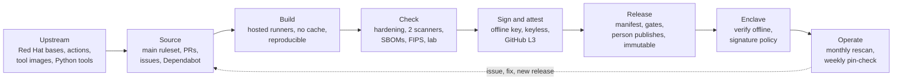

# Supply-chain security: SLSA Build L3, end to end, and the gaps

For a security reviewer or assessor. This page shows:

* how a wd2l release meets **SLSA Build Level 3**, one requirement at a time, with the evidence
  and the commands to check it yourself;
* where wd2l stands on SLSA's **Source track**;
* how the supply chain is protected from upstream inputs to installation in an enclave;
* the **gaps**, and what would close each one.

The NIST SP 800-53 Rev 5 mapping of the same controls, with each control's text, is in
[supply-chain-controls.md](supply-chain-controls.md).

**As of:** 1.4.0, 2026-10-30. The repository settings quoted here (rulesets, environments,
Actions permissions) were read from the forge's API on that date.

**What is claimed:** SLSA v1.2's Build L3 for every file in `SHA256SUMS` and for each published
image. SLSA's Build track is the same in v1.1 and v1.2, and v1.2 adds the Source track. "SLSA v3"
usually means Build Level 3: SLSA has no version 3.

**What is not claimed:**

* any Source-track level (see [the Source track](#the-slsa-source-track));
* hermetic builds;
* compliance with any framework: the security owner decides what applies.

## How a release is built, in brief

A `v*` tag on a commit already on `main` starts [`release.yml`](../.github/workflows/release.yml).
It builds, tests and checks everything again from the tag, waits for the owner's approval before
anything is signed, and ends at a **draft** release that a person publishes. The diagram and what
each job proves are in [releasing.md](releasing.md#how-a-release-is-built). Two kinds of
provenance come out of it:

| Provenance | Made by | Signed with | SLSA level | What it's for |
|---|---|---|---|---|
| GitHub's build provenance (`actions/attest`) | [`attest.yml`](../.github/workflows/attest.yml), a reusable workflow; the only job that gets an OIDC token | A short-lived Sigstore certificate naming `attest.yml` at the tag | **Build L3** | Who built each file and image, from which tag, on which runner. Checked with `gh attestation verify`, online or offline |
| wd2l's own provenance ([`provenance.py`](../packaging/release/provenance.py)) | `publish.yml`, in the build | The release key (`cosign.pub`) | Self-asserted, about L2 | The wheel's digest and the exact Red Hat base images, with their mirrored copies. Checks offline with nothing but `cosign.pub` |

The L3 claim rests on the first. The second adds what GitHub's provenance doesn't record: the
base images. It also keeps working in an enclave that can't use Sigstore's trust root.
[ADR-0006](decisions/0006-release-artifacts-and-signing.md) and
[ADR-0007](decisions/0007-slsa-build-l3.md) give the reasons.

## SLSA Build L3, requirement by requirement

The requirements are from [SLSA v1.2, Build: Requirements for producing
artifacts](https://slsa.dev/spec/v1.2/build-requirements). Each section below quotes the
requirement, then gives how wd2l meets it, the evidence, and how to check it.

### 1. Choose an appropriate build platform (producer; L1–L3)

> The producer MUST select a build platform that is capable of reaching their desired SLSA Build
> Level.

* **How:** GitHub Actions, on GitHub-hosted runners, with GitHub's artifact attestations made in
  a reusable workflow. GitHub documents this pattern as Build L3 when the verifier pins the
  signer workflow.
* **Evidence:**
  * every job on the release path runs on a GitHub-hosted label, `ubuntu-24.04` or the arm
    runner (`test_release_path_runs_on_github_hosted_runners`), and none on a moving `-latest`
    label (`test_no_job_runs_on_a_moving_runner_label`);
  * [ADR-0007](decisions/0007-slsa-build-l3.md), options considered: GitHub's reusable-workflow
    attestations against `slsa-github-generator`.
* **Check:** `gh attestation verify … --deny-self-hosted-runners` refuses provenance from a
  self-hosted runner ([below](#verification-what-a-consumer-pins)).

### 2. Follow a consistent build process (producer; L1–L3)

> The producer MUST build their artifact in a consistent manner such that verifiers can form
> expectations about the build process.

* **How:** one workflow, one path, for every release:
  * a `v*` tag on a commit that is already on `main` (`release.yml`'s `version` job refuses
    any other);
  * the same jobs run in the same order every time;
  * one wheel, built once by [`build-dist.sh`](../packaging/build-dist.sh), goes into every
    package;
  * a second build must match the first, byte for byte, or the run fails.
* **Evidence:**
  * the `version` job's `git merge-base --is-ancestor` check;
  * `test_a_build_that_does_not_reproduce_fails`;
  * `test_the_wheel_is_built_with_hash_pinned_tools_only`;
  * [releasing.md, How a release is built](releasing.md#how-a-release-is-built).
* **What a verifier can expect:** builder `attest.yml` in this repository, source ref
  `refs/tags/v<version>`, a GitHub-hosted runner. These are the values the verify commands pin.

### 3. Distribute provenance (producer; L1–L3)

> The producer MUST distribute provenance to artifact consumers.

* **How:**
  * **With every release:** `wd2l-<version>-attestations.jsonl` holds GitHub's bundles, one per
    line, for offline checks.
  * **On the registry:** each image's attestations are pushed next to it in ghcr
    (`push-to-registry: true`).
  * **On GitHub:** the repository's attestations page lists every attestation.
  * **wd2l's own provenance:** attached to each image as a signed in-toto attestation, and
    shipped as `wd2l-<version>-provenance.json`.
* **Evidence:**
  * `attest.yml`'s last two steps;
  * `release.yml`'s "Attach the GitHub attestations" step;
  * `test_notes_get_the_manifest_and_the_attestation_pages`.
* **Check:** `gh release view v<version> --json assets` lists `wd2l-<version>-attestations.jsonl`.

### 4. Provenance exists (build platform; L1–L3)

> The build process MUST generate provenance that unambiguously identifies the output package by
> cryptographic digest and describes how that package was produced.

* **How:** `actions/attest` makes SLSA v1 provenance:
  * **subjects:** one for every line of `SHA256SUMS` (`subject-checksums`), and one for each
    image digest: the index, each platform image, and the UBI 9 comparison image;
  * **build definition:** the workflow, the repository and the ref;
  * **run details:** the runner environment and the run ID;
  * **resolved dependencies:** the source commit.
* **Evidence:** `attest.yml`, `test_attest_reads_the_checksums_the_release_lists`.
* **Check:** `gh attestation verify FILE --repo … --format json` prints the predicate.

### 5. Provenance is authentic (build platform; L2–L3)

> Consumers MUST be able to validate the authenticity of the provenance attestation … The
> provenance MUST be generated by the control plane … and not by a tenant of the build platform.

* **How:**
  * **The signature:** each attestation is signed with a short-lived Sigstore certificate. Fulcio
    issues it for the run's OIDC identity, `attest.yml@refs/tags/v<version>`, and the signature
    is logged in Rekor, the public transparency log. SLSA recommends a transparency log for
    exactly this: a key compromise can be detected.
  * **Who fills it in:** GitHub's OIDC claims fill in the builder, the source and the ref, not
    anything the build wrote.
  * **The subjects:** the digests come from `SHA256SUMS`, which the `assets` job made. SLSA allows
    the subject to come from the tenant ("forge output digest", [threats](https://slsa.dev/spec/v1.2/threats)).
    A build that lies about a digest only claims to have built something it didn't.
* **Evidence:** `attest.yml`, [ADR-0007](decisions/0007-slsa-build-l3.md), proving run
  [38072299782](https://github.com/JoeHazurmoney/architecture-wiredata-to-log/actions/runs/38072299782)
  (0.3.0rc3). On that run, a branch ref and another repository were both refused.

### 6. Provenance is unforgeable (build platform; L3)

> Any secret material used for authenticating the provenance … MUST NOT be accessible to the
> environment running the user-defined build steps. … The user-controlled build steps MUST NOT
> be able to inject or alter the contents.

* **How:**
  * **Only one workflow can get an OIDC token.** `attest.yml` is the only workflow with
    `id-token: write`. The jobs that build (`tests`, `image`, `rpm`, `publish`, `assets`) never
    get it, so no build step can get a signing certificate in this repository's name.
  * **It runs only for this repository and a tag.** `attest.yml`'s job runs only when
    `github.repository` is this repository and the ref is a `v*` tag. Anyone can call a public
    reusable workflow, and checkout would then fetch the caller's code next to the token.
  * **It runs late.** It runs after the owner approved `publish`, and in its own job on a fresh
    runner.
  * **Verifiers pin the builder.** They pin the signer workflow, so provenance signed by any
    other workflow, including this repository's own build workflows, is refused.
* **Evidence:**
  * `test_only_attest_yml_can_get_an_oidc_token` (it also refuses `write-all`);
  * `test_attest_yml_runs_only_for_this_repo_and_a_tag`;
  * `test_attestation_runs_only_for_a_tag`;
  * `test_release_waits_for_attest_on_a_tag`.
* **External parameters:** the provenance lists the workflow, the ref, the repository and the
  event. `release.yml` takes no inputs on a tag run (`workflow_dispatch` is a dry run that signs
  nothing).
* **Limit:**
  * `attest.yml` checks out the tag and runs `packaging/ci/tool cosign …` for the keyless image
    signature while it holds the token, so that script and `packaging/ci/tools.Containerfile`'s
    pins are inside the trust boundary.
  * They change only through `main`'s rules, like `attest.yml` itself.
  * See [gap G5](#gaps-and-how-to-close-them).

### 7. Hosted (build platform; L2–L3)

> All build steps ran using a hosted build platform on shared or dedicated infrastructure, not on
> an individual's workstation.

* **How:** every job on the release path runs on a GitHub-hosted runner. Nothing is built on a
  workstation. The person who cuts a release only pushes a tag and approves the gates.
* **Evidence:** `test_release_path_runs_on_github_hosted_runners`.
* **Check:** `--deny-self-hosted-runners` in every documented `gh attestation verify`.

### 8. Isolated (build platform; L3)

> The build platform ensured that the build steps ran in an isolated environment, free of
> unintended external influence.

SLSA lists five things the platform must guarantee:

| SLSA guarantee | How it holds here | Evidence |
|---|---|---|
| A build can't reach the platform's secrets, such as the provenance signing key | Fulcio's key is GitHub's and Sigstore's, not ours. The OIDC token exists only in `attest.yml`. The release key lives only in the `release` environment, and only the two gated jobs get it | `test_only_attest_yml_can_get_an_oidc_token`, `test_no_workflow_hands_its_secrets_on`, `test_main_fails_if_the_signing_key_is_a_repository_secret`, `test_no_secret_is_pasted_into_a_script` |
| Builds that overlap in time can't influence one another | Each job gets a fresh GitHub-hosted VM. A tag run is never cancelled, and a second run of the same tag waits for the first (`concurrency`) | `test_only_a_prs_or_a_dry_runs_older_run_is_cancelled` |
| One build can't persist into the next: an ephemeral environment for each build | GitHub-hosted runners are single-use VMs | `test_release_path_runs_on_github_hosted_runners` |
| No cache poisoning | No `actions/cache`, no `setup-python` cache, no BuildKit `type=gha` cache, and no other run's artifacts on the release path | `test_nothing_is_shared_between_runs_on_the_release_path` |
| No services open for remote influence unless recorded as external parameters | The workflow opens no inbound service. A tag run takes no inputs | `release.yml`'s triggers |

**Beyond L3, not required:** the wheel, the sdist and the image ID reproduce byte for byte from
the same inputs, on a second runner. The build is not hermetic: it pulls the pinned base images,
tool images and hash-pinned Python tools over the network. Every one of those is pinned by
digest or hash, and the release manifest lists them.

### Security best practices (all levels)

> All implementations MUST use industry security best practices … proper access controls,
> securing communications, implementing proper management of cryptographic secrets, doing
> frequent updates, and promptly fixing known vulnerabilities.

| Practice | wd2l |
|---|---|
| Access controls | Rulesets on `main` and `v*` tags; the `release` environment with a required reviewer; read-only default token; a fork's PR runs only after approval ([releasing.md, one-time setup](releasing.md#one-time-setup)) |
| Cryptographic secrets | One key, in the `release` environment only; rotation and compromise steps in [ADR-0006](decisions/0006-release-artifacts-and-signing.md#key-management). See gaps G4 and G12 |
| Frequent updates | Dependabot each week for base images, tool images, actions and pip pins; pin-check each week |
| Fixing known vulnerabilities | Two scanners on every PR and release, a human review gate, a monthly rescan of shipped images, and 7 days (Critical) and 30 days (High) to a patch release ([releasing.md](releasing.md#when-to-move-them)) |

### Verification: what a consumer pins

From [releasing.md, GitHub build provenance, offline](releasing.md#github-build-provenance-offline):

```bash
gh attestation verify "$f" --bundle wd2l-<version>-attestations.jsonl \
  --custom-trusted-root trusted_root.jsonl \
  --repo JoeHazurmoney/architecture-wiredata-to-log \
  --signer-workflow JoeHazurmoney/architecture-wiredata-to-log/.github/workflows/attest.yml \
  --source-ref refs/tags/v<version> --deny-self-hosted-runners
```

| Pin | Refuses (SLSA threat) |
|---|---|
| `--repo` | A build from a fork or another repository (D: build from an unofficial fork) |
| `--signer-workflow …/attest.yml` | Provenance signed by any other workflow, including our own build jobs (E: forge values of the provenance) |
| `--source-ref refs/tags/v<version>` | A build from a branch, or from a different tag (D: build from an unofficial branch or tag) |
| `--deny-self-hosted-runners` | A build on a machine outside GitHub's hosted fleet |
| `--bundle`, `--custom-trusted-root` | Nothing extra: they make the same check work with no network |

An enclave with no network also checks, with only `cosign.pub`: the signature on `SHA256SUMS`, every checksum, the
image's key signature and wd2l's own provenance (`verify-release`,
[releasing.md](releasing.md#bringing-a-release-into-an-enclave)).

## The SLSA Source track

SLSA v1.2 added a Source track ([source requirements](https://slsa.dev/spec/v1.2/source-requirements)).
Its levels are: L1 version controlled; L2 history and provenance; L3 continuous technical
controls; L4 two-party review.

**Formally, wd2l is at Source Level 0.** From L1 up, the source control system must issue a
*Source Verification Summary Attestation* (VSA) for each revision, and from L2 up, *Source
Provenance*. The forge doesn't issue either today, so no level can be claimed, whatever controls
are in place. The table shows how close the controls come:

| Source requirement | Level | wd2l today | Met? |
|---|---|---|---|
| Repositories and revisions uniquely identifiable; human-readable diffs | L1 | Git, on GitHub | Yes |
| Source VSA for each revision | L1+ | None issued | **No** (G7) |
| History: every change to a branch recorded; no force-push | L2 | `main` ruleset blocks force-push and deletion; squash merges only | Yes |
| Continuity of controls | L2 | The rulesets have been on since the repository went public (2026-10-09). There's no attested record of that | Partly |
| Identity management | L2 | GitHub accounts. Commit signatures aren't required | Partly (G7) |
| Source provenance | L2 | None issued | **No** (G7) |
| Protected named references | L3 | `main`: PR, `ci-ok` and `pr-title` required, no bypass. `v*` tags: only the admin role may create, move or delete them | Controls yes; attestations no |
| Two-party review | L4 | Required approvals: 0. One maintainer | **No** (G1) |

## The supply chain, end to end



| Stage | What protects it | Where |
|---|---|---|
| **Upstream inputs** | Base images are Red Hat Hardened Images, pinned by digest. Red Hat's signature, SLSA provenance and per-platform SBOM are checked for the pinned digest before use, and recorded in `base-image-record.json`. Actions are pinned by commit SHA (enforced by the repository setting). CI tools run from images pinned by digest. Python build and test tools are installed `--require-hashes`. wd2l itself has no third-party runtime packages: standard library only | [ADR-0004](decisions/0004-container-base-image.md), [`base_record.py`](../packaging/container/base_record.py), [`tools.Containerfile`](../packaging/ci/tools.Containerfile), [`check_containerfile.py`](../packaging/container/check_containerfile.py) |
| **Source** | `main` takes only squash PRs with `ci-ok` and `pr-title` green, and has no bypass. Each change closes an issue. Secret scanning with push protection. A fork's PR waits for approval and never gets secrets | [releasing.md, conventions](releasing.md#conventions) |
| **Build** | Ephemeral GitHub-hosted runners; no caches; one wheel in every package; a reproducibility check that fails the run | [Isolated](#8-isolated-build-platform-l3) above |
| **Check** | Hardening: non-root, no shell, no package manager, no setuid, FIPS policy, nothing beside the wheel's files. Grype and Trivy, with coverage reported; a security-review gate; SBOMs that fail on a gap, and `sbom_diff`, which shows the image is its base plus wd2l and nothing else; the whole suite under FIPS; the namespace lab | [releasing.md](releasing.md#how-a-release-is-built), ADRs [0009](decisions/0009-sbom-content.md), [0010](decisions/0010-sbom-generator.md), [0011](decisions/0011-vulnerability-scanners.md) |
| **Sign and attest** | The release key signs `SHA256SUMS` and each image (both formats), and attests wd2l's provenance, the SBOM, the scan and the base record onto the image. `attest.yml` makes the L3 provenance and the keyless signatures. `publish` refuses to sign an image an earlier run signed | [ADR-0006](decisions/0006-release-artifacts-and-signing.md), [ADR-0007](decisions/0007-slsa-build-l3.md), `test_publish_refuses_to_sign_an_image_an_earlier_run_signed` |
| **Release** | The owner approves twice, before `publish` and before `release`. The release manifest (JSON, schema-checked) lists the commit, every PR and issue, every file's SHA-256, the image and base digests, the pinned tools and the approvals, and is itself in `SHA256SUMS`. A person publishes the draft. Releases are immutable, and GitHub attests each published release | [ADR-0008](decisions/0008-release-manifest.md), [releasing.md, cutting a release](releasing.md#cutting-a-release) |
| **Delivery into an enclave** | `cosign.pub` comes from a trusted channel. `verify-release` checks the signature, every checksum, the manifest, the source bundle's commit and the image tar, offline. Podman's signature policy requires our key for registry pulls. A full-history `git bundle` makes the source retrievable without the forge | [releasing.md, bringing a release into an enclave](releasing.md#bringing-a-release-into-an-enclave), [containers.md](deployment/containers.md#signature-policy-registry-pulls) |
| **Operate** | `image-rescan` each month rescans the latest two final releases with fresh data and opens issues. `pin-check` each week checks every pin still resolves. Dependabot each week. Vulnerability exceptions expire within 90 days | [releasing.md, keeping the pins current](releasing.md#keeping-the-pins-current) |

## Threats and where they're addressed

SLSA's threat model ([v1.2 threats](https://slsa.dev/spec/v1.2/threats)) groups supply-chain
threats as (A) to (I), plus dependency, availability and verification threats.

| SLSA threat | Addressed by | Remaining |
|---|---|---|
| (A) Producer: an intentionally malicious producer | Out of scope for SLSA. Everything is public: source, history, workflows and Rekor entries | One maintainer (G1, G15) |
| (B1) Submit a change without review | Only through a PR with green CI; no bypass, even for the admin | No second reviewer (G1) |
| (B2) Evade change management: admin disables controls, rewrites history, moves a tag | No bypass on `main`; force-push and deletion blocked; only the admin role may touch `v*` tags; immutable releases | The admin can still change the rulesets themselves. No attested record that they stayed on (G7) |
| (B3) Render code review ineffective | Human-readable diffs; the release manifest lists every PR | No independent reviewer (G1) |
| (B4) Render change metadata ineffective | GitHub attributes pushes and merges to authenticated accounts | Commit signatures not required (G7) |
| (C) Source code management: compromise the forge | Inherited from GitHub. The `git bundle` in each release keeps a copy of the source with its history outside the forge | Not addressed by SLSA |
| (D) External build parameters: build from a fork, a branch or other inputs | `version` refuses a tag not on `main`; `attest.yml` refuses another repository or a non-tag ref; verifiers pin `--repo` and `--source-ref` | None known |
| (E) Build process: forge provenance, compromise the build, poison the cache | OIDC only in `attest.yml`; no caches; ephemeral runners; reproducible builds; hardening and SBOM checks | `attest.yml` runs repo scripts while it holds the token (G5) |
| (F) Artifact publication: upload a modified package | Only the gated jobs push or sign; `SHA256SUMS` is signed; drafts only; immutable releases | One person approves both gates (G2) |
| (G) Distribution channel: tamper in transit or in the registry | Signatures and attestations are bound to digests; checked offline before install | RPMs are checked through `SHA256SUMS`, not by dnf (G9) |
| (H) Package selection: typosquatting, the wrong package | One published name each: `ghcr.io/joehazurmoney/wd2l` and the release assets; the release notes list the digests | None known |
| (I) Usage: a consumer skips verification | The documented install starts with `verify-release`; Podman's policy refuses unsigned pulls | It's up to the site to follow it |
| Dependency threats | Bases verified against Red Hat's signature and provenance; everything pinned; Dependabot; two scanners | Trivy can't see the Hardened image's OS packages (G8) |
| Availability threats | Releases carry everything needed to verify and rebuild offline: source bundle, SBOMs, attestations. Base images are mirrored by digest to `wd2l-base/python` | Depends on GitHub and ghcr for new releases |
| Verification threats: a verifier that doesn't pin enough | The documented commands pin repository, signer workflow, ref and runner type, and cosign also pins `--certificate-github-workflow-repository` | Sigstore's trust root must be refreshed with each release (G12) |

## Gaps and how to close them

These are the shortfalls known on 2026-10-30. None of them stops the SLSA Build L3 claim; G5 is
the one that bears on its strength. The 800-53 control IDs are in
[supply-chain-controls.md](supply-chain-controls.md).

| # | Gap | Why it matters | Reference | How to close it | Effort |
|---|---|---|---|---|---|
| G1 | **No second reviewer.** `main` requires 0 approvals, and there are no code owners. One maintainer writes and merges every change | One person, or one stolen account, can change the code, the workflows and the release process. CI checks the change, but no second person does | Source L4; SA-11(4), CM-5(4), CM-3 | Add a second maintainer; require 1 approval, approval of the last push, and code-owner review for `.github/`, `packaging/` and `cosign.pub` | Low to set; needs a second person |
| G2 | **One person does every release step.** The admin tags, approves both `release` gates and publishes the draft. `prevent_self_review` is off on the `release` environment | No separation of duties at the point of signing | AC-5, CM-5(4) | Name a release approver who is not the tagger; turn on `prevent_self_review` | Low; needs a second person |
| G3 | **The `security-review` environment lets admins bypass it** (`can_admins_bypass: true`) | An admin can skip the human review of a fixable High or Critical | RA-5, SI-2 | Turn the bypass off, as on `release` | Trivial |
| G4 | **The release key is a software key** in an Actions environment secret, password-protected, with no set cryptoperiod | A leaked secret signs anything until it is rotated, and nothing detects its use | SC-12, SC-13; SLSA's best practices | Move the key to a KMS or HSM that cosign supports (e.g. a cloud KMS), with signing limited to the release workflow's identity; set a rotation period | Medium |
| G5 | **`attest.yml` runs repository scripts while it holds the OIDC token** (`packaging/ci/tool cosign`) | Code beyond the reusable workflow itself is inside the trust boundary of the L3 provenance. It still changes only through `main`'s rules | SLSA Build L3 (unforgeable); SA-10, SI-7 | Use only pinned actions in `attest.yml` (e.g. a pinned cosign installer action), or move attestation into a separate repository with stricter rules | Medium |
| G6 | **No static analysis of wd2l's own Python.** Code scanning receives the image scanners' results, but no CodeQL or other analysis of the source | Common flaws in the code aren't checked by a tool. Fuzz tests, `WD2L_NO_SKIPS` and the lab cover behavior, not code patterns | SA-11(1), SA-15(7) | Add CodeQL analysis for Python, and a linter with security rules (e.g. ruff with its Bandit rules), required by `ci-ok` | Low |
| G7 | **No source attestations, and commit signatures aren't required** | Without Source VSAs or source provenance, no Source level can be claimed, and nothing proves the controls stayed on | Source L1–L3; SA-10(5), CM-3 | Require signed commits in the `main` ruleset; issue source provenance and VSAs with the SLSA project's source tooling (e.g. `slsa-framework/source-tool`, still a proof of concept) | Medium |
| G8 | **On the Hardened image, Trivy can't see the OS packages.** Only Grype's data covers them | One scanner's database is a single point of failure for OS findings | RA-5(3) | Documented in [ADR-0011](decisions/0011-vulnerability-scanners.md). `pin-check` watches for Red Hat's Trivy database each week. Add Red Hat's VEX or CSAF data when it can be reached | Waits on Red Hat |
| G9 | **The RPMs aren't GPG-signed.** The signed `SHA256SUMS` covers them, but `dnf` can't check them itself, and a STIG host needs `--nogpgcheck` | The check depends on an operator running `verify-release` first | CM-14, SI-7(15) | Sign the RPMs with an RPM signing key ([ADR-0006](decisions/0006-release-artifacts-and-signing.md), option C), and publish the public key with `cosign.pub` | Medium: a second key to manage |
| G10 | **No security policy or private vulnerability reporting, and no VEX** | Outsiders have no published way to report a flaw. Findings judged not affected aren't published in a machine-readable form | RA-5(11), SR-8 | Add `SECURITY.md`; turn on private vulnerability reporting; publish an OpenVEX document with each release for the exceptions in `vuln-exceptions.json` | Low |
| G11 | **Any action may run** (`allowed_actions: all`), though each must be pinned by SHA | A pinned but malicious action could still be added through a PR | CM-7(5), SR-3 | Allow only GitHub's own actions and a named list | Low |
| G12 | **The keyless path trusts Sigstore's public instance and GitHub's OIDC issuer.** Offline checks need a trust root carried in with each release, by hand | A stale or substituted trust root weakens the offline check. The key-signed path has no timestamp, so after a key compromise, old and new signatures look the same | SC-12, SI-7(6) | Document how a trust root is fetched and checked; add an RFC 3161 timestamp to key signatures (`signing-config.json` can name a timestamp authority) | Low to medium |
| G13 | **The organization's own documents are the customer's to write:** the SCRM policy, plan, team and strategy | This repository supplies evidence to them, but can't meet them | SR-1, SR-2, SR-2(1), PM-30 | The customer's security owner writes them, citing this page and the controls page | Customer |
| G14 | **No formal threat model of the build pipeline** | The threat table above is SLSA's model applied, not an analysis at an agreed rigor | SA-11(2) | A short threat model of `release.yml`, reviewed by the security owner, kept beside the ADRs | Medium |
| G15 | **One maintainer** | Continuity: releases, key custody and reviews all depend on one person | CP-2 (contingency planning) | A second maintainer with the admin role and a documented hand-over of key custody | Needs a person |

## Keeping this page true

Update this page, and [supply-chain-controls.md](supply-chain-controls.md), when:

* a gap closes: move it out of the table and say where it was closed;
* the release path changes: a new job that signs, a new secret, a new runner type;
* SLSA publishes a new version, or the forge starts issuing source attestations.
